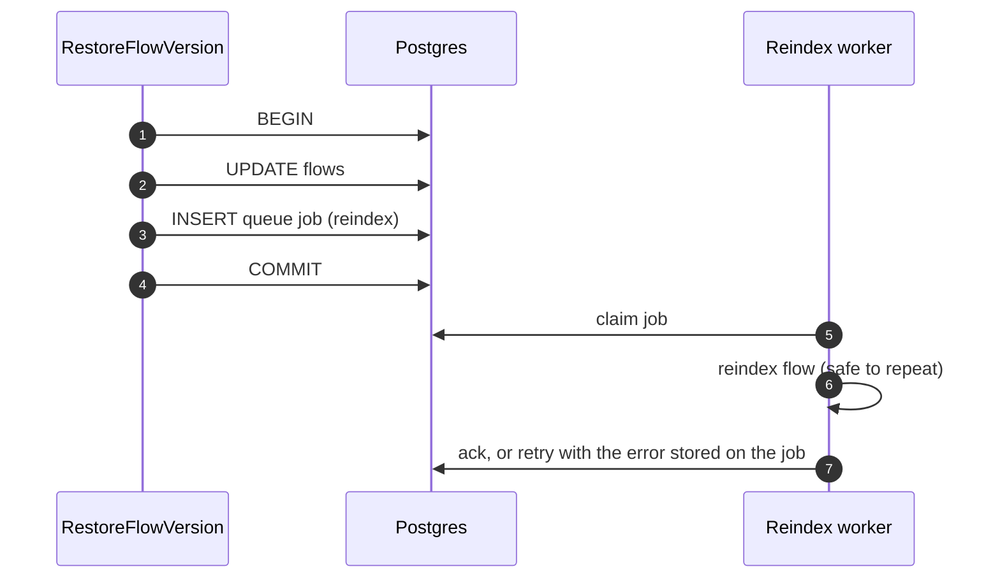

# 0007: Side effects leave through the outbox

- Status: proposed
- Date: 2026-10-29
- Part of: [feature architecture](../feature-architecture.md)

## Context

Actions trigger effects outside our Postgres: Anchor usage reports, email, webhooks, search indexing and cloud dispatch. Echopoint's [ADR-0001](https://github.com/nanostack-dev/echopoint/blob/1d13937e/docs/adr/0001-usage-sync-always-goes-through-pgqueue.md) already routes usage sync through pgqueue. This ADR makes that the rule for every external effect.

## Decision

- Any external effect runs in a **worker**, fed by a queue job that the action enqueues **inside its transaction** ([0006](0006-actions-own-the-transaction.md)).
- There is no network call inside `InTx`.
- Workers are idempotent: they recompute and set the result rather than increment it, because delivery is at least once.

## Alternatives

- **Enqueue or publish after the commit.** A crash between the commit and the publish loses the effect. Enqueueing before the commit lets the worker run before the data is visible ([River](https://riverqueue.com/docs/transactional-enqueueing)).
- **Call the remote service inside the transaction.** This holds row locks during network I/O. A timeout leaves the remote effect unknown while our rollback has already undone the local change.
- **An in-process event bus after the commit** (anchor's `events.Emitter`). Keep it only for effects that may be lost.

## Consequences

- Local state and the intent to act commit together, and failures retry ([transactional outbox](https://microservices.io/patterns/data/transactional-outbox.html)).
- Effects are eventually consistent, so tests poll for them or assert the enqueued job.
- Job names, payloads and retry policy remain application-owned ([boundaries](../boundaries.md)).
