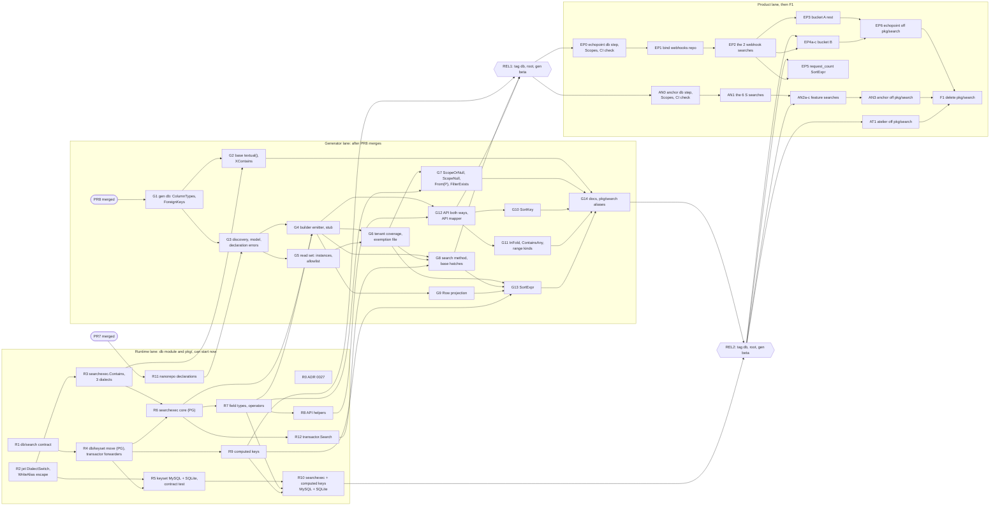

# Search in the db module: design

This page is the design of search in the framework ([ADR 0027](../adr/0027-search-in-the-db-module.md)). It is the final design report, kept as it was approved; the PRs G1 to G14 and R0 to R12 of section 7 implement it. Paths that start with `reports/` are workspace documents outside this repository. [Generated code](../generated-code.md#searches) is the user guide.

- Date: 2026-11-09 (final, after four reviews)
- Status: final design. Alexis approved the combined prototype and the 10 default answers (approval dated 2026-11-09). This document resolves every item of `reports/search-combined.md` section 6 "What remains", and applies the four reviews (coverage, tenant security, dialects, DX and plan). Section 10 logs each finding. Decisions S1 to S14 are final unless Alexis overrules one by its number. One approved answer is tightened (answer 7, S6.6); Alexis must confirm it.
- Scope: search lives **in** the db framework: the db module (`db/search`, `db/keyset`, `db/searchexec`, `db/nanorepo`) and `nano gen repo`. It replaces `pkg/search` (aliases in the last generator PR, then delete). It does not sit beside it.
- Sources, read only:
  - Prototype: `reports/prototypes/search-combined/` (51 PASS, 0 FAIL, 2 MISS). Report: `reports/search-combined.md`.
  - Study: `reports/search-prototypes.md`, sections 6 (where it lives, rollout) and 7.
  - Repository design: `reports/design-repo.md` (D1 to D27, part 1 = 8 PRs).
  - Inventories: `reports/search-inventory-echopoint.md` (echopoint `20f2181d`, 30 POST searches, 2 extra pagers) and `reports/search-inventory-anchor.md` (anchor `dc2a986a`, 24 searches). Section 8 maps every row.
  - Gate audit: `reports/search-gate-audit-echopoint.md` (2026-11-09).
  - Framework `origin/main` at `592d8a9`: ADR 0015, ADR 0001, `pkg/db/transactor/{keyset,page,transactor,row_lock}.go`, `pkg/search`, `db/query`, `db/internal/jet/{dialect,serializer,expression}.go`, `db/mysql/dialect.go`, `db/generator/template/unique_keys.go`, `core/nano/project/project.go`, `lint/base.golangci.yml`, `.github/workflows/{ci,db}.yml`.
  - PR7 work in progress (#85, `nanostack-framework-worktrees/gen-repo-base`, read only): `db/nanorepo/nanorepo.go`, `Postgres.Scopes` in `core/nano/project/project.go`, `gen/repo/emit.go`, `gen/repo/table.go`, `docs/adr/0026-nano-gen-repo.md`. ADR 0025 is reserved for mappers (pipeline design, PR 9), so this design takes **ADR 0027**.
- Standing rules that this design keeps: go-jet is the only way to write SQL (no raw SQL typing, no query directive). No other SQL code generator, job queue or dependency-injection library. Decisions rest on end-state quality, never on cost of change. Release notes and the CHANGELOG never name other libraries.

## Summary

A developer declares a search with one `nanorepo.Search` call in the same `func _()` as `nanorepo.Implement`. `nano gen repo` writes, into the declaring file's `<file>_repo.gen.go`: the immutable builder, a typed scope value, the sort enum, the keyset spec, one-line filter accessors, the API mapper, and the repository method when no hand-written method exists.

The runtime lives in the db module, in three packages:

| Package | Holds | Imports |
|---|---|---|
| `db/search` | The contract: `Result`, `Pagination`, `Sort`, `Request` (from the last generator PR), cursor, errors, limits, `CheckPage`, `All`. | Standard library only |
| `db/keyset` | The one keyset pager: keys, `Order`, `Seek`, `Trim`, `Cursor`, `Page`. It moves here from `pkg/db/transactor`. Dialect behaviour for PostgreSQL, MySQL/MariaDB and SQLite. | `db/search`, `db/query`, the dialect packages |
| `db/searchexec` | The runtime of generated searches: `Spec`, `Query`, `Resolve`, `Plan`, `Run`, the generic field types, `Contains`. | `db/keyset`, `db/search`, `db/query` |

The runtime takes the executor explicitly, as `db/query` does today, typed as the one alias `query.Executor`. `pkg/db/transactor` keeps the context transaction and the row-lock rules, and becomes thin forwarders (`transactor.Search`, `transactor.Page`, key aliases). **No `db/exec` is needed now.** When ADR 0015 stage 2 lands, it changes one alias and one scan path (S1).

The tenant rule is structural (S6): the generator computes which table instances a search reads and proves that each one is covered by a scope, by a key equality with a covered instance, or by a declared foreign key. The runtime refuses a query that does not carry its generated spec.

The PR plan (section 7) has two lanes. The **runtime lane** (R0 to R12) touches only the db module and the root module's `pkg/`. It can start now: R0, R1 and R2 have no dependency. The **generator lane** (G1 to G14) touches `gen/` and starts after PR8 merges. G14, the last one, documents search and turns `pkg/search` into aliases. Each PR is small and green on its own. Section 8 maps all 56 inventory searches to a PR, or to a hand-written method with the reason.

## 1. Decisions

Each decision gives the choice, the rejected alternatives and the reason. "Prototype" means the combined prototype runs it. "New" means no prototype runs it yet; the PR that builds it carries the test that proves it.

### S1. Packages, and the direction between modules

- **Choice.** Four packages in the db module, as in the table above, plus the declarations in `db/nanorepo` (S10). The contract (`db/search`) imports the standard library only, so domain packages import it (decision log, 2026-05-22, "Search Contract Split"). `db/keyset` and `db/searchexec` take the executor as a parameter, typed `query.Executor`. `db/query` owns that alias (`type Executor = qrm.Queryable` today). Every keyset and searchexec statement runs through `db/query` (`query.All`, `query.Count`), not through its own `qrm` call. They never read a transaction from the context. `pkg/db/transactor` passes `transactor.Executor(ctx, db)` in, applies its row-lock rules, and wraps the answer in its `Result`.
- **Why the executor is a parameter.** The db module requires only `pkg/functional`. It cannot import the root module, and the context transaction lives in the root module (`transactor.WithTx`, `CurrentTx`). `db/query` already solved the same problem in the same way. Its package doc says: "the context-carried transaction belongs to the caller's transaction manager, which passes its executor in". The search runtime follows that rule. So the pager moves into the db module, and the context transaction does not.
- **Why this needs no `db/exec` now.** `db/exec` is ADR 0015's executor seam (an abstract `Rows`, a pgx implementation). Search needs neither today. It runs on `database/sql` through `db/query`, exactly as the transactor's pager runs today. When `db/exec` lands (stage 2), the signatures of `keyset.Page`, `PageOf`, `searchexec.Run`, `RunPage` and `transactor.Search` change type, because `qrm.Queryable` returns `*sql.Rows`, which stage 2 replaces. The alias and the routing through `db/query` keep that change to **one alias and one scan path**. The pager does not move again. ADR 0027 records this.
- **Rejected: `db/search` holds the contract and the executor.** The executor imports the dialect packages. Every domain package that imports the contract would then depend on SQL, which is the regression the study found in typed-builder (study, section 7, weakness 3).
- **Rejected: one package `db/searchexec` with the keys and the pager inside.** Hand-written searches and the transactor use the keys and the pager without any generated builder. `db/keyset` is the concept of ADR 0001 (keyset cursor pagination), and it has consumers of its own.
- **Rejected: keep the pager in `pkg/db/transactor` and generate code that imports it** (the prototype's `pkg/db/transactor/searchexec`). The search runtime would then live in the root module, not in the db module, and the db module could never test it on three dialects.
- **Rejected: move the context transaction into the db module now.** That is `db/exec`'s work (ADR 0015, stage 2). Doing it now pulls the stage forward with no benefit for search.

### S2. The keyset pager moves once, and is not copied

- **Choice.** `pkg/db/transactor/keyset.go` and `page.go` move to `db/keyset` with the same behaviour on PostgreSQL. The transactor keeps its API as forwarders:
  - generic type aliases: `type Key[T any] = keyset.Key[T]`, `type Order[T any] = keyset.Order[T]`, `type PageBuilder[T, R any]` wraps `keyset.PageBuilder`;
  - one-line function forwarders: `transactor.StringKey`, `TimeKey`, ..., `StrictKeys`, `Page`. `transactor.Page(...).Run` calls `keyset` with `Executor(ctx, db)`, then wraps the answer in `transactor.Result`.
  - **Row lock.** Today `transactor.Page` runs through `Query` and `QueryCount`, which inject `FOR ...` (`row_lock.go`, `withRequestedRowLock`), and PostgreSQL then refuses the count. After the move, `keyset` runs its own statements, so a forwarder could read without the lock and say nothing. `transactor.Page(...).Run` refuses a requested row lock with `ErrRowLockSearch`, as `transactor.Search` does. A test pins it.
  - **Bridge until G14.** `pkg/search` keeps its own types until the last generator PR turns them into aliases (S11). Until then, the transactor forwarders copy `pkg/search.Pagination` and `[]pkg/search.Sort[S]` into the `db/search` types and copy the answer back (field-for-field struct copies, about 30 lines). The error sentinels are shared from R1, so `errors.Is` and `IsClientError` agree across both packages. G14 deletes the bridge.
- The two `pkg/jetx` helpers that the pager uses (`CombineFilters`, `CombineFiltersWithOr`, `OrderBy`) become unexported helpers of `db/keyset`. `pkg/jetx` itself does not change.
- `transactor.Keys` (the lenient form that drops an unknown sort) is marked "use db/keyset" in its doc comment, with no deprecation marker (S11). It becomes an adapter: it drops the unknown sorts, then calls `keyset.OrderOf`, so the order logic exists once. `db/keyset` exposes only the strict form, `keyset.OrderOf`. A search that orders by a column the client did not ask for answers another question.
- **Proof that nothing changes.** Cursor tokens are byte-identical: a golden test encodes a cursor with the old code (a copy kept in the test only) and with `db/keyset`, for every key type.
  - `keyset_integration_test.go` and `keyset_bounds_integration_test.go` stay in `pkg/db/transactor`, unchanged, until F1. They are the proof that the forwarders behave as before.
  - R4 ports copies of them to `db/tests/postgres`, calling `db/keyset` directly.
  - The SQL-shape unit tests move into `db/keyset`. The `ForTest` hooks of `pkg/db/transactor/export_test.go` (`CountStatementForTest`, `PageStatementForTest`, `KeysetStatementForTest`) go away in R4, because a wrapper cannot expose them without new public exports of `db/keyset`.
  - The prototype already proved that a cursor from today's binary continues (`oldcursor/`).
- **Rejected: a copy of the pager in the search runtime.** typed-builder copied it and lost the `limit <= 0` guard (`Limit(0)` panicked, study section 2).

### S3. Three dialects (ADR 0015)

The runtime runs on PostgreSQL, MySQL/MariaDB and SQLite. The generator emits PostgreSQL searches only in this part, like the repository base (D20): a `nanorepo.Search` on another dialect is a gen error. The runtime does not wait for the generator.

#### S3.1 Contains

`searchexec.Contains(term, exprs...)` is the one substring rule of the framework. The search's `FullText`, every `Text` field and (after G2) the repository base's `r.where.XContains` call it.

| Step | Rule |
|---|---|
| Term | `strings.TrimSpace(term)`. A blank term gives the literal `TRUE`, so it filters nothing. `Contains` never returns `nil`: a nil expression panics when a caller composes it (`x.AND(nil)` reaches `binaryOperatorSerializer.serialize` on a nil interface). |
| Length | A term longer than `search.MaxTermLength` (1000 characters) is `search.ErrTermTooLong` (400). The field type records the error, and `Resolve` returns it. |
| Escape | The escape character is `!`. In the term, `!` becomes `!!`, `%` becomes `!%`, `_` becomes `!_`. The pattern is `%<escaped>%`. `\` is an ordinary character. |
| PostgreSQL | `expr ILIKE $1 ESCAPE '!'` |
| MySQL, MariaDB | `LOWER(expr) LIKE LOWER(?) ESCAPE '!'` |
| SQLite | `LOWER(expr) LIKE LOWER(?) ESCAPE '!'` |
| Several expressions | Each match is one atomic expression. The matches are combined with `jet.OR`, which wraps the whole in parentheses, so `scope AND (e1 OR e2)` can never render as `scope AND e1 OR e2`. One bound pattern per expression. |

- **Why `!` and not `\`.** In MySQL (default `sql_mode`), `\` escapes inside a string literal, so `ESCAPE '\'` is a syntax error and needs `'\\'`. In PostgreSQL, `'\\'` is two characters and the `ESCAPE` clause refuses it. `!` means the same in the three dialects' literal syntax, so one SQL text works everywhere. It also survives drivers that interpolate parameters client-side.
- **Why `ILIKE` on PostgreSQL.** A plain `gin_trgm_ops` index on the column serves `ILIKE`. `LOWER(col) LIKE` needs an expression index on `lower(col)`. echopoint already has `GIN (title gin_trgm_ops)` on `resource_search_documents` (migration 000017). `ILIKE` and `LOWER` fold case through the same collation, so the answers are equal.
- **Why `LOWER` on both sides on MySQL and SQLite.** MySQL has no `ILIKE`, and a column with a `_bin` or `_cs` collation compares case-sensitively. SQLite's `LIKE` is case-insensitive only while `PRAGMA case_sensitive_like` is off. `LOWER` on both sides does not depend on a collation or a pragma.
- **Known limits, pinned by tests.**
  - SQLite's `LOWER` folds ASCII letters only (unless the product loads the ICU extension). PostgreSQL and MySQL fold Unicode. The test asserts `'é'` finds `'É'` on PostgreSQL and MySQL, and does not on SQLite.
  - Matching follows the column's collation. MySQL `utf8mb4_0900_ai_ci` and MariaDB `uca1400_ai_ci` and `general_ci` are accent-insensitive in `LIKE`, so the term `e` finds `'é'` there and not on PostgreSQL. The test pins this on MySQL and MariaDB, as it pins the SQLite ASCII limit.
  - A two-tenant precedence test runs on every dialect: the scope `AND (e1 OR e2)`, then an assertion of zero rows of the other tenant.
- **Where it is built.** Every `jet.Expression` must implement the unexported `Serializer.serialize` (`db/internal/jet/serializer.go:45-47`), so no package outside `db/internal/jet` can branch on the dialect at serialization time. `jet.SerializerFunc` does not implement `Serializer`, and `CustomExpression` only joins static tokens. R2 adds one constructor to the fork: `jet.DialectSwitch(func(Dialect) Expression)` and its typed forms (`BoolDialectSwitch`, ...), which serialize the expression that the statement's dialect selects. `db/searchexec` and `db/keyset` use it for `ILIKE` against `LOWER() LIKE`, for row-value against expanded seek, and for per-dialect literals. The change is listed in `db/UPSTREAM.md`. The fork diverges from upstream by this one constructor. Per-operator overrides (`OperatorSerializeOverride`) cover operators only, not literals or seek shapes, so they are not enough.
- **Rejected: PostgreSQL's default `\` escape with no `ESCAPE` clause** (the prototype, and PR7's `containsHelper` today). It does not work on SQLite, and it depends on `standard_conforming_strings`. anchor's `searchx.Contains` already names its escape explicitly; the framework does the same with `!`.
- **Rejected: a blank term gives `nil`.** It panics in composition, and `ContextScope` results would need the same care. `TRUE` is safe everywhere.
- **Rejected: lower-case the term in Go.** Go's `strings.ToLower` and the database's `LOWER` disagree on some letters (Turkish dotted I, final sigma). The term must fold by the same rule as the column.

#### S3.2 Keyset pager per dialect

The contract is the same on the three dialects: the same rows, with every walk complete (no row skipped, no row repeated), and the same cursor tokens. **Order and matching follow the column's collation** (S3.5). The dialect is read from the SQL builder when the statement is serialized (through `jet.DialectSwitch`, S3.1), so one `Order` value runs on any dialect. `keyset.Page` reads the dialect of `From`. `INNER_JOIN` returns `ReadableTable` on PostgreSQL but `joinSelectUpdateTable` on MySQL and SQLite, so `keyset.Source` is not a common interface: it is `any`, and `Page` resolves it with a type switch over the three dialect packages' table types. Any other value is `keyset.ErrDialect`.

| Behaviour | PostgreSQL | MySQL, MariaDB | SQLite |
|---|---|---|---|
| NULL placement (the contract: last when ascending, first when descending, unless `NullsFirst` or `NullsLast`) | the default; `NULLS FIRST/LAST` only when a key asks | explicit only for a **nullable** key whose contract differs from the dialect default (MySQL puts NULLs first when ascending): the `col IS NULL, col` emulation of `db/mysql/dialect.go` `serializeOrderBy`. A NOT NULL key renders plain `col ASC`, so the index on `(created_at, id)` serves the walk. | explicit `NULLS FIRST/LAST` only for a nullable key whose contract differs from the default (SQLite 3.30 and later) |
| Seek with every key NOT NULL and one direction | row value: `(a, b) > ($1, $2)` | expanded: `a > ? OR (a = ? AND b > ?)` | row value |
| Seek otherwise | expanded | expanded | expanded |
| `StringKey`, `IntKey`, `FloatKey`, `RealKey`, `LocalTimeKey` | yes | yes | yes |
| Int literal in the seek | `CAST($n AS bigint)` (today's) | `CAST(? AS SIGNED)` | no cast |
| Float codec | today's (NaN and ±Infinity allowed) | refuses NaN and ±Infinity (DOUBLE cannot hold them): `ErrInvalidCursor` | refuses NaN (SQLite stores it as NULL): `ErrInvalidCursor` |
| `TimeKey` (`ColumnTimestampz`) | yes | `ErrDialect`: the generator maps `timestamp` and `datetime` to `Timestamp` (`sql_builder_template.go:205`), so only `LocalTimeKey` applies | `ErrDialect`, as MySQL |
| Time codec range check | PostgreSQL range (today's) | two codecs: `TIMESTAMP` (1970-01-01 to 2038-01-19, session time zone) and `DATETIME(6)` (1000 to 9999), chosen from `ColumnTypes()` | the literal uses the driver's write format, `2006-01-02 15:04:05.999999999-07:00`. A `T`/`Z` literal compares as other text and would skip or repeat rows. |
| `UUIDKey` | `uuid` column, cast literal | `CHAR(36)` text, lower-case canonical | `TEXT`, lower-case canonical |
| `EnumKey` (order = declaration order of the labels) | native enum order, literal cast to the enum type | native `ORDER BY col` (MySQL sorts an ENUM by its index, so the index serves the order); seek with `col IN (<labels after the cursor label>) OR (col = <label> AND <next key>)` | `ORDER BY CASE col WHEN 'A' THEN 0 ... END`; seek with the same `IN` list as MySQL |
| `InetKey` | yes; an address with an IPv6 zone (`fe80::1%eth0`) is `ErrInvalidCursor` | `ErrDialect` | `ErrDialect` |

- **Why expanded seek on MySQL.** MySQL's optimizer does not use a range scan for a row-constructor inequality. Its manual ("Row Constructor Expression Optimization") tells you to write the expanded form. SQLite and PostgreSQL scan a composite index for the row value.
- **Why the enum seek is an `IN` list.** MySQL compares an enum with a string as text, so `col > 'B'` would disagree with the index order of `ORDER BY col`. `col IN (later labels)` uses the index on every dialect and agrees with the declaration order. MySQL's `col+0` is 1-based and 0 means an invalid value; SQLite's `CASE` gives NULL for an unknown label. The contract test pins both cases.
- **Why explicit NULL placement only for nullable keys.** `col IS NULL, col ASC` on every key (the first draft) makes MySQL sort every match on every page, and SQLite accepts a non-default NULL placement only on the first index column after the equality constraints. A NOT NULL column has no NULL to place. `Key` keeps its `nullsDefault` field, and the signature does not change: it adds `:NULLS_FIRST/LAST` only when a key asks, as today. R5's EXPLAIN test shows no filesort (MySQL) and no temporary B-tree (SQLite) for a NOT NULL `(created_at, id)` walk.
- **Hostile cursors.** Every codec on every dialect refuses a value that the column cannot hold with `ErrInvalidCursor` (400), never with a database error (500). R5 adds a golden test of hostile values per codec per dialect.
- **Cursor signature.** The signature names columns, not SQL. It is rendered with one fixed rule on every dialect (today's PostgreSQL rendering). So a cursor issued on PostgreSQL today keeps its token, and the same walk on MySQL gives the same token.
- **Raw identifiers.** `EnumKey(enumType)` writes `CAST(.. AS enumType)` as raw text, and `IntExprKey(name)` writes `name` through `WriteAlias`, which adds the quote character without escaping it. Each key constructor checks its identifier against `^[a-z_][a-z0-9_.]*$` and panics on a mismatch (a programming error). R2 makes `WriteAlias` escape the quote character (listed in `db/UPSTREAM.md`).
- **Rejected: each dialect's own NULL default.** MySQL and SQLite put NULLs first when ascending. The same search would answer a different order on another database.

#### S3.3 Computed keys

`keyset.IntExprKey(name, expr, value)` (and the `Float`, `Time` and `String` forms) orders on an expression, not a column. `name` is the cursor signature name. The pager selects the expression with the alias that `qrm` maps to the row field, orders on it and seeks on it. This serves S9.

An expression can be NULL even when every column it reads is NOT NULL: a scalar subquery that finds no row, such as `MAX(received_at)` for a webhook with no requests, yields NULL, and `qrm` scans NULL into the zero value. The cursor would then carry 0 or year 1, `expr > ?` would be NULL, and the rows would drop out of the walk. So each computed key has a nullable form, `NullableIntExprKey(name, e, func(T) *int64)` (and `Float`, `Time`, `String`), with the NULL placement of S3.2. The generator picks the form from the Row field (G13, error E15).

#### S3.4 CI jobs

| Job | What it runs for search | Where |
|---|---|---|
| `db.yml` integration matrix: `postgres14`, `postgres18`, `mysql`, `mariadb`, `sqlite` | `db/tests/<dialect>/keyset_test.go`, `searchexec_test.go`, `contains_test.go`, and the shared cross-dialect contract test (S3.5) | exists; the suites are new |
| `db.yml` `cockroach` row | the search suites skip it (ADR 0015 drops CockroachDB). Removing the row is a separate change. | exists |
| `db.yml` unit | `db/search`, `db/keyset`, `db/searchexec` unit tests, with `-race` | exists |
| `ci.yml` integration ("Transactor, keyset, search and the legacy modules") | the transactor forwarders: the context transaction, the row-lock refusal, `OnUnique` through `Result`, and the two keyset integration files kept unchanged until F1 (S2). Copies of the keyset cases run in `db/tests/postgres`. | exists |
| `ci.yml` lint, `lintsmoke` | the generic base hatches `search` and `searchPage` (G8) do not crash the linters | exists |
| `ci.yml` gen | goldens of the search emitter and the gen errors; database tests of generated searches on PostgreSQL | exists |
| service CI (anchor, echopoint) | `go tool nano gen -check -fresh` (PR6's job) catches a stale search, and a migration that drops a key or renames a column a search uses | lands with each service's db-step adoption |

#### S3.5 The cross-dialect contract test

One table, the same 200 rows (ties, NULLs, mixed case, `% _ ! \` in text, every key type the dialect supports), and the same 40 searches. Each search walks every page by cursor. This is the check that ADR 0015 asks for, written once. It has two parts, because default collations do not agree (MySQL `utf8mb4_0900_ai_ci` and MariaDB `uca1400_ai_ci` sort `'a' < 'B'`, SQLite `BINARY` sorts bytewise, PostgreSQL follows the database collation):

- **Identical order.** The text columns use binary collations: PostgreSQL `COLLATE "C"`, MySQL and MariaDB `utf8mb4_bin`, SQLite the default `BINARY`. The test computes the expected order in Go (bytewise) and asserts that the three dialects return it, with identical cursor tokens.
- **Default collations.** The same walks on columns with each dialect's default collation. The test compares each walk with the database's own `ORDER BY` of the full result: complete, no skip, no repeat.
- Rows written through each driver (not literals in SQL), so the time codecs see the stored format.

### S4. Typed scope values

- **Choice.** The scope is a typed value `P` of the builder: `searchexec.Query[T, Q, S, P]`.
  - One scope value: `P` is its Go type. `NewScheduleSearch(organizationID string)`. One value cannot be swapped.
  - Two or more: the generator writes a scope struct, and the constructor takes it.

    ```go
    type WebhookRequestScope struct {
    	_              struct{} // keyed fields only
    	OrganizationID string   // webhooks.organization_id
    	WebhookID      string   // webhook_requests.webhook_id
    }
    ```

    The blank first field makes an unkeyed literal `WebhookRequestScope{org, id}` a compile error **in another package** ("too few values"; the blank field cannot be set from outside). In the declaring package, `WebhookRequestScope{struct{}{}, webhookID, orgID}` compiles, and `go vet` is silent (its `composites` check covers imported types only). echopoint's handler sits in the same package as its repository. So the generator also refuses an unkeyed literal of a generated scope type anywhere in the declaring package (error E27, G6). With both, a caller must name each field, so two values of one type cannot change places.
  - **One field, several columns.** `nanorepo.Scope(columns ...Column)` takes one or more columns. One scope field supplies one value to every column it names, and the field takes its name from the first column. After the join rewrite, a child and a parent `organization_id` (echopoint B3 to B6, B10, B11) are one field, `OrganizationID`, not two fields that the caller fills with the same value. Two `Scope` calls that produce the same field name are a gen error (E12).
  - `q.Scope()` (promoted from `Query`) returns `P`. The generator writes no getters. The service reads `q.Scope().WebhookID`.
  - `Resolve` refuses a zero field (`""`, `uuid.Nil`, `0`) with `search.ErrUnscoped`, field by field. A struct literal of the builder (`WebhookRequestSearch{}`) has no spec, and `Resolve` refuses it too.
- **Rejected: positional `[]any` behind typed getters** (the prototype). Two parameters of one type swap silently.
- **Rejected: distinct named ID types (`OrganizationID`, `WebhookID`) across the domain.** It is the strongest form, but it changes every domain type and every handler, and the generator cannot impose it on a product. The scope struct gives the same protection at the one call that matters.
- **Rejected: a lint rule on unkeyed literals.** The generator already parses the package, so a gen error (E27) needs no linter and no product configuration.
- **Rejected: a generated named type per scope field** (`WebhookRequestScopeOrganizationID`). It gives the same protection, but every handler then converts each value, and the scope struct already forces names.
- **Rejected: a chain of scope setters** (`NewX().Organization(o).Webhook(w)`). A forgotten setter fails at run time only.

### S5. The read set is a set of table instances

- **Choice.** The generator computes the read set of a search once, as a set of **table instances**: a table plus its alias. `table.Webhooks` and `table.Webhooks.AS("parent")` are two instances. The read set holds the searched table, every instance the `From` function joins (calls followed, views read), and every instance inside a subquery of an expression function, with its join kind (`INNER`, `LEFT`) and its `ON` clause (or its correlated `WHERE`).
- Every column in `Scope`, `ScopeOrNull`, `ScopeNull`, `ScopeFunc`, `Unscoped`, `Filter`, `FilterAs`, `FilterExists`, `Sort`, `SortKey`, `Tiebreak`, `DefaultSort` and `FullText`, and every instance that an expression function (`FilterExpr`, `Flag`, `Condition`, `SortExpr`, `FullTextExpr`) reads, must be in the read set. Else it is a gen error at the option's line (errors E5, E6).
- This generalises the prototype's check for `Flag` (`broken_expr_table.go`). A `Scope` on a table the search does not join failed only as SQL at run time.
- **Join kinds.** A search's `From` may use `INNER_JOIN` and `LEFT_JOIN` only. `CROSS_JOIN`, `FULL_JOIN` and `RIGHT_JOIN` are a gen error (E28): each of them can bring rows that no tenant link reaches.
- **An inner table with the name of an outer one** (a subquery on `webhook_requests` inside a search of `webhook_requests`) must have an explicit alias. Without one, `webhook_requests.webhook_id = webhook_requests.webhook_id` binds both sides to the inner instance in SQL, so it is always true, while a name check would see a correlation (E8).
- **Allowlist, not denylist (E7).** A `From` or expression function may call only the go-jet constructors on the allowlist: column and table references, `AS`, `INNER_JOIN`, `LEFT_JOIN`, comparison and boolean operators, `SELECT ... FROM ... WHERE` for a subquery, the aggregates `COUNT`, `SUM`, `MIN`, `MAX`, `COALESCE`, `CASE`, the typed casts, the literal constructors (`String`, `Int`, `Bool`, ...), and the typed functions of the dialect package (`LOWER`, `host`, ...). The rules:
  - `CustomExpression`, `Token`, `NewEnumValue`, every `Raw*`, `FromSchema`, `WithPrefix` and `WithSuffix` are refused. (`postgres.Token` is a type, so a conversion `Token("...")` hides raw SQL; the prototype's check skipped conversions and matched names by prefix, so `CustomExpression` and `Func` passed.)
  - `Func(name, ...)` and `CAST(x).AS(type)` are allowed only when `name` or `type` is a string constant that matches `^[a-z_][a-z0-9_]*$`. (`cast.AS` writes `Token("::"+castType)`.)
  - An identifier of a go-jet or table type that is not a local of the function (a package variable such as `var parent = table.Webhooks.AS("p")`, or a prebuilt expression variable) is refused. Write it as a function, so that the generator follows the call.
  - The check fails closed: a call it cannot resolve is an error, not a pass.

### S6. Tenant coverage

The tenant columns and the API spec come from `nanogen/project.go`. The rule then proves, per table instance, that the search cannot read another tenant's rows.

#### S6.1 Hard scopes and context scopes

The `-tenant` and `-spec` flags go away. The tenant columns are PR7's `Postgres.Scopes`. G6 adds one field, `ContextScopes`, in `core/nano/project/project.go` (after PR7 merges):

```go
Postgres: &project.Postgres{Name: "echopoint", Image: "timescale/timescaledb:2.23.0-pg18",
	Scopes: []string{"organization_id", "workspace_id"},
	ContextScopes: []project.ContextScope{
		{Column: "workspace_id", Func: "echopoint/internal/db/workspacescope.Filter"},
	}},
```

- A column of `Scopes` that is not in `ContextScopes` is a **hard scope** (`organization_id`). Its value comes only from the typed scope value: `Scope`, `ScopeOrNull` or `ScopeNull`. A `ScopeFunc` on a hard scope is a gen error (E9).
- A column of `ContextScopes` is a **context scope** (`workspace_id`). It is scoped only by `ScopeFunc(fn, column)`, where `fn` is the function that `project.go` registers for that column name. Another function is a gen error (E9). The registered function may return `TRUE` (echopoint's `workspacescope.Filter` does when the context carries no workspace, for organization-wide reads). It must not return `nil`: `Resolve` refuses a nil context-scope result with `search.ErrUnscoped`.
- A `ContextScopes` column that is not in `Scopes`, or a `Func` that does not resolve to `func(context.Context, C) B`, is a project error.
- The repo step reads the API spec from `Project.API.Spec`.
- **Why the split.** In the first draft, `ScopeFunc(func(...) { return postgres.Bool(true) }, table.Webhooks.OrganizationID)` passed the tenant check: an `Unscoped` with no reason. A hard scope must carry a value that the caller supplies and `Resolve` checks.

#### S6.2 What counts as covered

The generator marks instances and tenant columns as **covered**. It starts from the direct scopes and repeats the rules until nothing changes (a fixpoint). A rule reads only top-level `AND` conjuncts of an `ON` clause or of a correlated subquery's `WHERE`; a conjunct under an `OR` counts for nothing.

1. **Direct.** A tenant column is covered when `Scope`, `ScopeOrNull`, `ScopeNull` or the registered `ScopeFunc` names it. A direct scope is a `WHERE` condition, so it is allowed only on an instance that is not on the nullable side of a `LEFT JOIN`: a `WHERE` on such a column drops the unmatched rows (E29).
2. **Equated.** A tenant column is covered when a conjunct of its instance's `ON` clause (or correlated `WHERE`) equates it with one of these:
   - a covered tenant column (`child.organization_id = parent.organization_id`);
   - a field of the scope value, in the `From` form that takes the scope (S6.4);
   - the referenced column of a declared foreign key whose referencing column is this one, on a covered instance (`configs.product_id = products.id`, with the key `configs.product_id → products.id`).
3. **Referenced row.** Every tenant column of an instance is covered when a conjunct of its `ON` clause matches a declared foreign key **from** a covered instance **to** this instance's key: the covered row references this row, so this row is the covered row's own data (`LEFT JOIN product_roles ON product_roles.id = memberships.role_id`). `-explain` prints the key that carries the coverage.
4. **No tenant column.** An instance with no tenant column is covered when a conjunct of its `ON` clause (or correlated `WHERE`) matches a declared foreign key, in either direction, between it and a covered instance (`webhooks.id = webhook_requests.webhook_id`).
5. **The searched table comes in through an `INNER JOIN` path.** If the searched (root) instance is not covered directly, it must be covered through rule 2, 3 or 4 over `INNER JOIN`s only. A `LEFT`-joined instance never covers the root: the root's rows exist without it.

The search is accepted when every instance is covered, and every tenant column of every instance is covered or exempted (S6.6). Else the error names the first uncovered column and its instance (E9, E10).

The foreign keys come from `nano gen db`, which writes `ForeignKeys()` next to `UniqueKeys()` (S7). A wrong `ON` clause (`INNER_JOIN(webhooks, Bool(true))`, or `webhooks.ID.EQ(webhook_requests.ID)`) matches no declared key, so it covers nothing, and the search fails to generate. A second alias of a table (`table.Webhooks.AS("w2")`) is its own instance, so one scope on `webhooks` does not cover it.

#### S6.3 Why this rule, and what it replaces

- The first draft required a direct scope on "every tenant column of every table it reads, nullable ones included". That rule broke on three shapes:
  - a child and a parent column of the same name (echopoint B3 to B6, B10, B11, anchor #1, #12, #15) gave two scope fields of one name;
  - a direct `WHERE` scope on a `LEFT`-joined table drops the unmatched rows (anchor #1 products with no config, #12 and #15 members with no role or a managed role, #22 organizations with no license);
  - a table name stood for every alias, and an `ON` clause was never read, so a wrong join passed.
- The new rule is syntactic. It needs no free-text reason for a join-implied scope, so the anchor inventory's gap G9 (join-implied scope) is checked, not exempted.
- **Rule 3 trusts referential data.** A role that a membership references counts as the membership's own data. If a bug stored another tenant's role id in a membership, the search would show that role's name. A composite foreign key would close this; the framework cannot impose one. Alexis confirms rule 3 (section 9, question 2). The safe fallback is to drop rule 3, so these joins need `Unscoped` or a tenant equality in the `ON` clause.
- **Rejected: count a search as scoped when any table in the read set has a scoped tenant column** (the prototype's `reach.go`). It accepts the cross join and the wrong `ON` clause.
- **Rejected: a separate `Search.Tenants` field.** Two lists of tenant columns drift.

#### S6.4 Shared rows and a scope inside an `ON` clause

- **`nanorepo.ScopeOrNull(column)`** renders `col = $v OR col IS NULL`, wrapped in parentheses, and counts as covered. It serves rows shared by every tenant: anchor #9 (`organization_id = org OR organization_id IS NULL`, assignable roles). Its value is a field of the scope value, as for `Scope`.
- **`nanorepo.ScopeNull(column)`** renders `col IS NULL` and counts as covered. It takes no value. It serves anchor #8 (managed roles only).
- Both are direct scopes (rule 1), so they are refused on the nullable side of a `LEFT JOIN`. Both appear in the exemption file (S6.6), so a review sees each one.
- **`From` with the scope value.** `nanorepo.From(fn)` takes `func() T` or `func(P) T`, where `P` is the generated scope type. In the second form, the function can put a tenant value inside an `ON` clause:

  ```go
  func licensesOf(s OrganizationLicenseScope) postgres.ReadableTable {
  	return table.Organizations.LEFT_JOIN(table.OrganizationLicenses,
  		table.OrganizationLicenses.OrganizationID.EQ(table.Organizations.ID).
  			AND(table.OrganizationLicenses.PlatformTenantID.EQ(postgres.String(s.PlatformTenantID))))
  }
  ```

  The generator reads `col.EQ(<literal>(s.Field))` as rule 2 (equated with a scope field). The stub mode emits the scope struct first, so the hand-written function type-checks. `Resolve` still refuses a zero field. This serves anchor #22.
- **`nanorepo.FilterExists(child Table, link Column, column Column, ops ...Op)`** keeps rows that have a child row whose `column` passes the filter: `EXISTS (SELECT 1 FROM child WHERE child.link = <root key> AND child.column IN (...))`. The child instance follows S6.2 like any other instance: `link` must match a declared foreign key to a covered instance (rule 4), and a tenant column of the child must be covered by rule 2. This replaces the first draft's blanket refusal of a subquery on a table with a tenant column (E8). It serves anchor #8 and #9 (`permissions`).

#### S6.5 Subqueries in expression functions

A subquery inside `FilterExpr`, `Flag`, `Condition`, `SortExpr` or `FullTextExpr` is a set of inner instances. Each one follows S6.2, with its correlated `WHERE` in the place of an `ON` clause. In addition:

- the correlation must be a top-level `AND` conjunct `inner.fk = outer.key` that matches a declared foreign key to a covered outer instance (rule 4 or rule 2); a correlation on any other column pair (`method = webhooks.name`) covers nothing (E8);
- a subquery in `SortExpr`, `IntExprKey` or `StringExprKey` may only aggregate (`COUNT`, `SUM`, `MIN`, `MAX`). A scalar subquery that reads a column would put another row's value into the Row field (sent to the mapper and the API) and into the cursor token (E8).

#### S6.6 Exemptions (approved answer 7, tightened)

- **`nanorepo.Unscoped(column, "reason")`** exempts one tenant column. The search rule is stricter than the derived-name rule, on purpose: a derived name filters on one scope column first (D25) and reads by key; a search returns lists, so a missing scope leaks many rows.
- **Tightened (change for Alexis, section 9, question 1).** `Unscoped` is accepted only when another hard tenant column **of the same instance** is covered. So a search can never be unscoped as a whole. anchor #18's product-level endpoint is accepted (`organization_id` exempted, `product_id` scoped on the same table). A search with no other covered tenant column on that instance is a gen error (E30).
- **The exemption file.** `nano gen repo` writes `nanogen/search-exemptions.txt`, a checked-in file with one line per exemption: every `Unscoped` with its reason, every `ScopeOrNull` and `ScopeNull`, every coverage by rule 3, every `IgnoresFullText` and `APIHandWritten` (S13) with its reason. `nano gen -check` regenerates it like any other output and fails when the committed file differs (O3), so a new exemption must be committed, and a review sees each one in the diff.
- **Rejected: refuse `Unscoped` on every API-bound search** (the tenant review's M2 fix). anchor's tenants are nested (platform tenant, product, organization). A product-level endpoint reads all organizations of one product on purpose (anchor #18). The same-instance rule and the exemption file give the same protection without refusing a correct search.

### S7. Column types come from `nano gen db`

PR6 (#82) writes the models, `UniqueKeys()` and `nanogen.sum`. The generator still lacks the SQL type: `postgres.ColumnString` covers `text`, `varchar`, `citext`, `uuid`, `inet`, `jsonb` and enums, and the model field is `string` for most of them.

- **Choice.** `nano gen db` appends one more method to each table type, next to `UniqueKeys()`:

  ```go
  // ColumnTypes lists the catalogue type of each column of webhook_requests.
  // Generated by nano gen db. nano gen repo reads it to pick keys, literals and
  // the operators a column accepts.
  func (WebhookRequestsTable) ColumnTypes() map[string]string {
  	return map[string]string{
  		"id": "text", "webhook_id": "text", "method": "varchar", "ip_address": "inet",
  		"headers": "jsonb", "query_params": "jsonb", "body": "text", "received_at": "timestamptz",
  	}
  }
  ```

  The value is the catalogue's type name: `pg_type.typname` on PostgreSQL (`information_schema.columns.udt_name`); `information_schema.columns.COLUMN_TYPE` on MySQL and MariaDB (it keeps `enum('a','b')` and `tinyint(1)`, which `DATA_TYPE` drops); the declared type on SQLite later. The generator reads it with `go/parser`, as it reads `UniqueKeys()`. **The repo step still needs no database.** A column named `ColumnTypes` is a db-step error, as for `UniqueKeys`.
- **`ForeignKeys()`.** The same PR writes a second method, the declared foreign keys of the table (constraint name, columns, referenced table and columns), in catalogue order. The tenant rule (S6.2) reads it. A column named `ForeignKeys` is a db-step error.

  ```go
  // ForeignKeys lists the foreign keys of webhook_requests. Generated by nano gen db.
  func (WebhookRequestsTable) ForeignKeys() []ForeignKey {
  	return []ForeignKey{{Name: "webhook_requests_webhook_id_fkey", Columns: []string{"webhook_id"}, References: "webhooks", ReferencedColumns: []string{"id"}}}
  }
  ```
- What the generator takes from where:

  | Fact | Source |
  |---|---|
  | Column kind (`ColumnString`, `ColumnTimestampz`, ...) | the table type's field types |
  | SQL type (`inet`, `jsonb`, `uuid`, enum name) | `ColumnTypes()` |
  | Nullable | the model field is a pointer (PR6), **or** the column's instance is on the nullable side of a `LEFT JOIN` in the `From` function |
  | Enum labels, in declaration order | the generated enum package (`enum.UserStatus`) |
  | Primary key | the model's `sql:"primary_key"` tags, matched to the `UniqueKeys()` entry with the same columns, for the index order |
  | Unique keys | `UniqueKeys()` |
  | Foreign keys | `ForeignKeys()` |

- **Nullability through outer joins.** A NOT NULL column of a `LEFT`-joined table is NULL in the result row when no row matches (anchor #22 sorts on `organization_licenses.instantiated_at`; anchor #1 maps config columns). The generator marks every column of an instance on the nullable side of a `LEFT JOIN` as nullable. It picks the nullable key form for such a sort. A non-pointer Row field that reads such a column is a gen error (E26).
- **The tiebreak defaults to the primary key**, in index order. `nanorepo.Tiebreak` becomes optional.
- **"Cover" is defined.** An explicit `Tiebreak(columns...)` **covers** a unique key when its column list contains every column of that key of `UniqueKeys()`. Extra columns are allowed, in any place. Only a key that orders every row counts: a partial key, or a key with a column that can be NULL, does not cover, because rows with NULL repeat (G3; Alexis must confirm). Every join must add at most one row per root row (E31, G5), or no key of the root orders the result. The order is the order of the list. So echopoint B10's order (sort, `method`, `id`) is `Tiebreak(table.OpenapiOperations.Method, table.OpenapiOperations.ID)`, which covers the primary key `(id)`. A list that contains no complete key is a gen error (E4). For `webhook_requests` the default is `webhook_requests_pkey (id, received_at)`, which equals the prototype's hand-written `Tiebreak(ID, ReceivedAt)`. G3 has a B10-shaped golden.
- **It also fixes PR7's heuristic.** PR7's base decides that a column is textual when its Go type is `string` and its name does not end in `ID` (`gen/repo/table.go`, `textual()`). That emits `XContains` on `inet` and `jsonb` columns, where `LOWER(inet)` fails at run time. G2 makes `textual()` read `ColumnTypes()` (after PR8; this design does not touch PR7's or PR8's files before PR8 merges).
- **Rejected: typed column kinds in the fork (`ColumnInet`, `ColumnJSON`).** A kind that still embeds `StringExpression` gives no compile-time safety (`LIKE` still compiles), and one that does not breaks go-jet's expression algebra (casts, `host()`). The kinds also differ per dialect (`inet` is PostgreSQL only), so three dialect packages would multiply types. A metadata map is dialect-neutral and is one method per table, as D24 approved for keys.
- **Rejected: the prototype's schema manifest (`-write-schema`).** It needs a live database and a second file to keep in sync. `nanogen.sum` already covers the table files.

### S8. Generated volume

The prototype missed the 60 to 80 line target for webhook requests (97) and monitors (82). Three changes reach it at no cost to safety or readability:

1. **One-line accessors.** A filter accessor is a single `return`. The generator writes it on one line, and gofmt keeps it. Six filters save 12 lines.
2. **One file per declaring file.** The builders and the search methods go into the declaring file's `<file>_repo.gen.go` (D7 already has one such file per declaring file). The two webhook searches share one header and one import block instead of three.
3. **Typed scope (S4).** `q.Scope()` replaces one generated getter per scope column. A nil body is handled by `searchexec.OrZero(body)` in one line instead of three.

Result for the echopoint webhook requests search (section 4): **68 non-blank lines** owned by the search, comments included, plus a header and import block of 16 lines that the whole file shares. The two webhook searches share one file, so each costs about 76 lines. Alone in a file, this search would cost 84. The G4 golden test fails when the lines a fixture search owns grow past 80.

- **Kept, although it costs lines:** the doc comment of each exported type and function, and the explicit key accessor `func(r model.X) time.Time { return r.ReceivedAt }`. The pager needs the value of the last row to build the cursor, and the alternative is reflection, which ADR 0015 removes.

### S9. Computed sort keys (`request_count`)

- **Choice: `nanorepo.SortExpr(field, expr)`.** It declares a sort on a typed go-jet expression. The row type carries the value:

  ```go
  // webhookRow is a webhook as the search reads it.
  type webhookRow struct {
  	model.Webhooks
  	RequestCount int64
  }

  nanorepo.Search[webhookRow]("Webhook", table.Webhooks,
  	nanorepo.Map((*WebhookMapper).SearchRowToDomain),
  	nanorepo.SortExpr("RequestCount", requestCount),
  	...
  )

  // requestCount counts the requests of the webhook of the row.
  func requestCount() postgres.IntegerExpression {
  	return postgres.IntExp(postgres.SELECT(postgres.COUNT(table.WebhookRequests.ID)).
  		FROM(table.WebhookRequests).
  		WHERE(table.WebhookRequests.WebhookID.EQ(table.Webhooks.ID)))
  }
  ```

  The generator checks that `webhookRow` has a field `RequestCount` of the expression's Go type (`int64` for an integer expression; error E15). It selects `requestCount().AS("webhook_row.request_count")`, which `qrm` maps to the field. It adds the constant `WebhookSortRequestCount = "request_count"` and the key `keyset.IntExprKey("webhook_row.request_count", requestCount(), ...)`.
- **NULL.** A non-pointer field requires an expression that cannot be NULL, which the generator checks from the syntax: a top-level `COUNT(...)` or `COALESCE(..., <literal>)`. A pointer field (`*int64`) selects `NullableIntExprKey` (S3.3). Anything else is E15. `requestCount` is a `COUNT`, so `int64` is right.
- **Tenant rule for the subquery** (S6.5, error E8). The inner instance `webhook_requests` has no tenant column. Its correlation `webhook_requests.webhook_id = webhooks.id` matches the declared key `webhook_requests_webhook_id_fkey` to the covered outer instance, so rule 4 covers it. The subquery only aggregates. A correlation on another column pair, a scalar column read, or an inner tenant column that no rule covers is a gen error.
- **Cost.** PostgreSQL postpones an expensive select-list expression until after `ORDER BY ... LIMIT` when the order does not use it. So a page sorted by name counts requests for the 21 rows it reads, as today's `withRequestCounts` does in a second query. A page sorted by `request_count` counts for every candidate row, which is the price of that order today too. G13's acceptance test reads the `EXPLAIN` of both orders. The mapper always gets the count, so `withRequestCounts` and the conditional join go away.
- **`SortHandWritten(name)` stays** for what no expression can say (the flows count from a view, the executions column subset). It now also gets a typed constant (`WebhookSortRequestCount`), so a hand-written method stops comparing with a string. A generated method with a `SortHandWritten` sort is a gen error (E18), because it would refuse that sort at run time.
- **Behaviour change.** The cursor signature of the `request_count` sort changes from `webhook_request_counts.request_count` to `webhook_row.request_count`. A client in the middle of a walk with that sort gets `400 INVALID_CURSOR` once and restarts. echopoint's first search PR (EP2) declares the `Webhook` search with `SortHandWritten("request_count")` and rewrites `SearchWebhooks` by hand on `searchexec.Resolve`. `plan.Order(extra)` adds an `IntExprKey` on the correlated count, and `transactor.RunPlan` selects the key's projection into `webhookRow.RequestCount`. The key's name is both the cursor signature and the select alias, so the name is `webhook_row.request_count` from EP2 on: the one-time `400 INVALID_CURSOR` for in-flight walks of this sort happens in EP2, and EP5 changes no cursor. The switch to `SortExpr` is its own PR (EP5).
- **Rejected: a derived table that joins a grouped count** (today's hand-written shape). It needs the scope inside the aggregate again (`standaloneWebhooksOf(ctx, organizationID)`), so a scope can be forgotten there. The correlated form inherits the outer scope.
- **Rejected: select the computed value only when the order uses it.** The mapper then needs a second query for the other orders. One projection answers both.

#### S9.1 The Row selects its columns

`Spec` has a projection, but the prototype emitter hard-codes `Columns: <table>.AllColumns` (`cmd/nanogen-repo/emit.go:136`), and a custom Row was allowed only for `SortExpr` fields. So a search could not carry joined columns or a column subset (echopoint B6 with 15 summary columns, B8 with 12, B11 with `collections.name` as a sort; anchor #1, #12, #15, #22). And `Sort` on a joined column produced a key accessor that did not compile.

- **Choice: the generator derives the projection from `Row`.**
  - Each embedded `model.X` of a read instance selects that table's `AllColumns`.
  - A field tagged `alias:"table.column"` selects that one column (the tag `qrm` already reads). A `SortExpr` field selects its expression.
  - A Row that is exactly `model.X` of the searched table selects its `AllColumns`, as today.
  - Every column of `Sort`, `SortKey`, `Tiebreak` and every key must map to a Row field. Else it is a gen error (E25), next to E15.
  - A non-pointer field that reads a nullable column (S7, outer joins included) is E26.
  - A Row field with no `alias` tag and no `SortExpr` is allowed only when the search has a `SortHandWritten` sort. The generator selects nothing for it. The hand-written method's `plan.Order(extra)` key selects it: the key's name (its select alias) must be the field's `qrm` path, for example `webhook_row.request_count`, or the walk refuses the key. Any other such field is E25.
- With this, echopoint B6 and B8 need no hand-written method, and B11 sorts on `collections.name`.
- **Rejected: a `Columns(...)` option next to the Row.** Two lists of columns drift; the Row already names what the mapper reads.

### S10. Interaction with PR7 and PR8

- **Declaration.** `nanorepo.Search` sits in the same `func _()` as PR7's real `nanorepo.Implement[I, Impl, E, D any](table, toDomain)`. Its options have their own type, `nanorepo.SearchOption`, so a search option passed to `Implement` does not compile. `db/nanorepo` stays standard library only (D4): options that take go-jet values are generic (`Condition[B any](fn func() B)`), and the generator type-checks the real types.
- **Resolution order** (D8, extended). For each interface method, the first rule that applies wins:
  1. **Hand-written** (D9, D10). A method that takes a declared search must start from `searchexec.Resolve`, `Run` or `RunPage`, called with the method's own `ctx` parameter, the search's generated spec variable and `q.Query`, where `q` is the method's parameter and is never assigned before the call. Else E19. A method that is **promoted** from an embedded struct and takes a declared search fails closed (E19): write it on the implementation.
  2. **Derived** (D21). A derived method takes column values, never a search builder, so the two rules do not meet on one method. The order is still fixed.
  3. **Search.** The parameters are `(context.Context, XSearch)` for a search declared in the same package, and the results are `(search.Result[D], error)`, where `D` is the output of the search's mapper (or `Row` with no mapper). The name is free. Two interface methods may take the same search.
  4. **Else** a gen error at the interface method (E20), with a paste-ready signature.
  - A declared search that no interface method takes, and no hand-written method takes, is a gen error (E24). echopoint's first draft of E1 would have left the `Webhook` declaration as dead code.
- **Generated method.** It calls a new base hatch, so the repository file imports no runtime package for it. It passes the search's own spec:

  ```go
  func (r *webhookRepositoryImpl) SearchRequests(ctx context.Context, q WebhookRequestSearch) (search.Result[webhook.Request], error) {
  	return r.search(ctx, webhookRequestSearch, q.Query, r.webhookMapper.RequestToDomain)
  }
  ```

  G8 adds two generic methods to the base (D19): `search` (calls `transactor.Search`) and `searchPage` (calls `transactor.SearchPage`, for a mapper that reads the whole page, such as the monitors' tags). An implementation with a generated search method must embed its base (E21, as for derived methods).
- **The runtime does not trust the query's spec.** `searchexec.New` is exported (generated constructors call it), so any package can build a query on a hand-made spec. So `Resolve`, `Run` and `RunPage` take the expected spec as an argument and refuse a query whose spec pointer differs, with `search.ErrUnscoped`. The generated method passes its package variable, and E19 checks that a hand-written method does too. `Spec` has unexported fields; generated code builds it with `searchexec.DefineSpec(searchexec.SpecDef{...})`, which panics at package init when the definition has no `From`, no key, no tiebreak, or no scope (no `Scope`, no context scope, and no `Unscoped` entry). In search mode, `keyset.Page` refuses a nil `Where`, so an empty scope list can never run as "select everything" (`page.go:77`).
- **`Plan` is opaque.** A hand-written method gets a `searchexec.Plan` from `Resolve`. It has no exported `Where`. It offers:
  - `plan.And(extra)`: narrows the condition (anchor #18's computed status). There is no way to widen it.
  - `plan.Order(extra)`: the keyset order, plus keys for hand-written sorts.
  - `plan.Run`, `plan.RunPage` (generic methods): run the page with the plan's scope and order. `RunPage` takes a closure, so a run-time option can drive the mapper (anchor #12 `include=role_permissions`).
  - `plan.Sorts()`, `plan.Page()`: read-only.
  So a hand-written method cannot write `WHERE(plan.Where.OR(x))`.
  - A hand-written method runs the plan through `transactor.RunPlan` or `RunPlanPage` (R12), which resolve the context transaction and refuse a requested row lock, as `transactor.Search` does. Calling `plan.Run` with an executor by hand would skip that check, so the product docs (G14) name `RunPlan` as the way.
- **Mapper binding.** `nanorepo.Map(fn)` and `nanorepo.MapPage(fn)` take a function value (D5 rule), or a method expression whose receiver is the implementation type or the type of exactly one field of it. The generated method binds it to `r` or to that field (`r.webhookMapper.RequestToDomain`, `r.schedulesWithTags`). Zero or two fields of the receiver type is E22. The search method lives on the implementation, so it has `r` and can use a mapper with state, which the per-table base (D5) cannot.
- **Files** (D7). The builder, the API mapper (same package) and the search methods go into `<declaring file>_repo.gen.go`, after PR8's `var _` line and derived methods. An API mapper for a handler in another package (anchor's `internal/api`) goes to `<search>_search_api.gen.go` there (approved answer 8).
- **Forward stub** (D27). Hand-written code names the builder (`WebhookRequestSearch`, `q.Enabled().Eq(true)`), so the steps before repo must type-check with it. The builder is its own forward stub: the generator emits it from the declaration's syntax and the types of **imported** packages only (table, model, enum, apigen, domain types). It never needs the declaring package to type-check. The stub mode writes the scope struct first, then the builder, the sort enum and the API mapper, without the repository methods. So a `From(func(P) T)` function (S6.4) type-checks against the stub.
- **Contains alignment** (G2). PR7's `r.where.XContains` calls `searchexec.Contains`, so the base and the search share one escape and folding rule. PR7 is not changed in flight; G2 is a follow-up after PR8. Two differences reach products, and G2's Merge Danger names them: a blank term now matches every row (before: every row where the column is not NULL), and PostgreSQL moves from `LOWER(col) LIKE` to `ILIKE`, so an index on `lower(col) gin_trgm_ops` stops serving it and a plain `col gin_trgm_ops` index serves it instead.
- **Files of PR7 and PR8.** No generator-lane PR starts before PR8 merges. The runtime lane touches none of their files. R11 adds a new file to `db/nanorepo` only after PR7 merges.

### S11. From `pkg/search` to `db/search`, and the gate caution

- **Step 1 (R1).** `db/search` is new. `pkg/search` keeps its own types. Only its error sentinels become the `db/search` values (`var ErrInvalidCursor = search.ErrInvalidCursor`, ...), and `IsClientError`, `EncodeCursor` and `DecodeCursor` forward. So `errors.Is`, the error envelope and the log level agree across both packages from R1 on. The error envelope (`pkg/httputil/errorenvelope`) maps `ErrInvalidLimit`, `ErrInvalidOffset`, `ErrTooManyValues` and `ErrTermTooLong` to 400 and `ErrUnscoped` to 500 (the prototype's `framework-patch/errorenvelope-search-limit.diff`, extended). `ErrUnscoped` is not a client error: `IsClientError` is false for it, and a `LevelFor` test next to `pkg/search/level_test.go` pins the Error level.
- **Step 2 (G14, the last generator PR).** `Request[F, S]` and its `With*` methods move to `db/search`, with their validate tags, for every search that has no SQL builder (S14). `pkg/search` becomes generic type aliases of `db/search`: `type Result[T any] = search.Result[T]`, `Sort`, `SortDirection`, `Pagination` (its `Validate` method comes with it), `Request`, `Cursor`. The framework's own importers of `pkg/search` (18 files, among them `pkg/httputil/errorenvelope/resolve.go` and `pkg/db/transactor`) move to `db/search`, and the transactor bridge (S2) goes away. The hand-written `search.Request[` uses in products (36 in echopoint, about 56 files in anchor) compile unchanged.
- **No `Deprecated:` marker.** The framework lint (`lint/base.golangci.yml:177-185`) runs staticcheck with `checks: all`, and products inherit it. SA1019 fires on every import of a deprecated package: 99 files in echopoint, 111 in anchor, 56 in atelier. A marker would fail every product's lint on the next framework bump, which also blocks unrelated security patches. The package comment says, in plain words: "This package holds aliases of db/search and will be removed. Use db/search." The end state is deletion (F1), so a marker adds only CI breakage.
- **Step 3.** Products move one search at a time, and change `x-go-type-import` of `search.Pagination` and `search.SortDirection` in their OpenAPI spec to `db/search` (echopoint `openapi.yaml` near lines 7547-7560, anchor 2 references), then regenerate. A search that is not declared keeps working, because hand-written wins.
- **Step 4 (F1).** When a code search of **every repository that requires the framework** (`gh search code` over the organization: anchor, echopoint, atelier, and any other) finds no import of `pkg/search` and no use of the deprecated transactor key aliases, F1 deletes `pkg/search`, `transactor.Keys`, the key forwarders and the two keyset integration files of the transactor (S2). `transactor.Page`, `Search`, `SearchPage`, `RunPlan` and `RunPlanPage` stay until `db/exec`, and so does the shared `it_keyset` fixture file of the transactor tests (`fixture_integration_test.go`), which uses no key forwarder.
- **CHANGELOG wording.** "The db module now holds the search contract and the keyset pager." Never the name of the forked library or of any other library.

#### S11.1 Gate caution (AGENTS.md, cross-repo rollouts)

`full_text_search` changes behaviour on every endpoint that adopts a generated search: it ignores case, `% _ \` match themselves, and the term is trimmed (a blank term filters nothing). Range bounds, sort cursors and limits can change too (section 6). Before each product PR merges:

1. Export the product's tag from the prod Echopoint CI org: `echopoint --profile prod flows get <id> -o json`, workspace per product.
2. Grep for every property the PR changes:
   - `full_text_search` (every row whose full text changes, and every endpoint where a new `FullText` filters where nothing filtered before);
   - `request_count` cursors;
   - the range properties `created_after`, `created_before`, `changed_after`, `changed_before`, `last_used_before`, `last_used_after`;
   - the sort cursors of echopoint B10 (`route_name`, `operation_key`, `source_operation_id`: the nullable keys move the NULLs);
   - any `ids`-type array with more than `search.MaxInValues` (1000) entries, and any term longer than `search.MaxTermLength` (1000 characters). A request over a limit is now 400; the released-clients rule needs proof that no flow and no released client sends one.
3. Update each flow that asserts the old result.
4. Run `flows publish <id>` where `flows version list <id>` shows a published version (monitors run the published version, the gate runs the draft).

- **echopoint's first search PR is audited.** `reports/search-gate-audit-echopoint.md` (2026-11-09) exported all 81 flows of the prod Echopoint workspace. For `POST /webhooks/search` and `POST /webhooks/{id}/requests/search`, it found 0 flow changes and 0 `flows publish`: the two flows that send `full_text_search` there (`029bf60e`, `7f67d78a`) keep their results. **Re-run the audit** when a gate flow is edited after 2026-11-09, or when EP2 touches more than these two endpoints.
- **Release note (product).** The MCP server passes the user's term to `search_webhooks` and `search_webhook_requests`, and the UI does too. The product release note of EP2 says: search is case-insensitive, `% _ \` match literally, and a blank term is ignored.
- **Post-merge check.** After EP2 reaches dev, compare the next echopoint gate run with job 128815296649 (the last run before anchor #339 reached dev).
- **anchor already shipped the matching change.** anchor #339 (`623ccec`) and #341 passed three gate runs. So anchor's gate for AN1 is a behaviour diff of `searchexec.Contains` against #339's `searchx.Contains` (trim, blank term, escape character, Unicode lowering), not a blind grep.
- The full-text change rejects no request that a released client sends (the CLI, the MCP server, the GitHub Action), so the server-side default rule does not apply to it. `Limit(0)` is refused only for Go callers; the API mapper keeps the API default.

### S12. The 10 approved answers, as they appear in this design

| # | Answer | Where |
|---|---|---|
| 1 | `nanorepo.Search`, next to `nanorepo.Implement` | S10 |
| 2 | `In()` with no values from Go matches no row; the API mapper keeps "an empty list filters nothing" (`searchexec.Some`) | `searchexec.In`, section 3 |
| 3 | No raw condition on the builder; an extra condition is a hand-written method that starts from `Resolve` | `Query` has no `Where`; E19 |
| 4 | Immutable builder | `Query` methods return a copy |
| 5 | The api step does not bind `sort_by`; the empty domain type stays for `x-go-type`; the generator checks the enum both ways | A1, A2 |
| 6 | Webhook request scope through the join | section 4; the join is now checked against the declared foreign key (S6.2, rule 4) |
| 7 | `Unscoped(column, "reason")`, printed by the generator | S6.6, `-explain`, `nanogen/search-exemptions.txt`. **Tightened:** another tenant column of the same instance must be covered. Alexis confirms (section 9, question 1). |
| 8 | API mapper next to the handler | S10 |
| 9 | Enums first: noted only | section 6 |
| 10 | Limit validation in the runtime, for Go callers too | `search.CheckPage` in `Resolve`; the same rule adds `MaxInValues` and `MaxTermLength` |

### S13. API binding: what the both-ways check accepts

The both-ways check (A1 to A10) stops generation when the spec and the declaration disagree. Every echopoint and anchor search body inherits `full_text_search` and `sort_direction` from the shared `SearchRequest` through `allOf` (echopoint `cmd/http/openapi.yaml:7258-7268`). A product cannot take a property out of one endpoint's body without rewriting the base schema, which changes every endpoint. So the check needs three declared ways through.

- **`nanorepo.IgnoresFullText(why string)`.** The search accepts `full_text_search` and ignores it, on purpose, until the product decides its columns. A5 accepts it only when `full_text_search` is inherited and not declared in the endpoint's own schema. It is printed by `-explain` and written to the exemption file (S6.6), like `Unscoped`.
  - **The end state is a real `FullText` on named columns.** Each product records the column list per endpoint as a product decision before its PR (echopoint B1 to B8, anchor #2, #12, #18, #20, #23; section 9, question 3), and the gate grep (S11.1) covers each of these endpoints, because a new `FullText` filters where nothing filtered before.
  - Do not tell products to remove the property: the base schema makes that a change to every endpoint, and strict decoding (ADR 0017) would refuse requests that released clients send.
- **`nanorepo.APIHandWritten(properties ...string)`.** A property that a service resolves before it filters (anchor #4, #8, #9 `resource_types`: slugs that the service turns into `resource_type_id` values; echopoint B9 `folder_id` and `include_nested`, which drive one condition with a default of `folder_id IS NULL`). A3 accepts these properties, the generated mapper skips them, and the service sets the matching `GoOnly` filter after the mapper: `q = q.ResourceTypeID().In(ids...)`, or `q = q.FolderID().Eq(id)` / `q = q.FolderID().Present(false)`. Each property is written to the exemption file with the search name.
- **`sort_direction` with no `sort_by`.** When the body has `sort_direction` and no `sort_by` (echopoint B7), the mapper emits `searchexec.APIDirection(q, def, body.SortDirection)`: the direction applies to the default sort. The prototype emitted nothing, and B7 would keep ignoring the property.
- **The direction of a `sort_by` sent alone comes from the API contract (R8 review).** Anchor's `SortDirection` says ASC, and echopoint and atelier say DESC. So `APISort` takes it as its last argument (`fieldDirection`), and G12 emits it from a per-API input (a `Project.API` option, ASC or DESC, with no default), not from one rule in the runtime. The AN1 gate checks that anchor's mapper passes ASC. Resolve refuses a direction other than ASC or DESC with `search.ErrInvalidSortDirection` (400 `INVALID_SORT`, field `sort_direction`), so a product without an OpenAPI request validator never sorts ASC by mistake.
- **A body property that the mapper does not read is an error (A10).** It generalises A3 and A5: every property of the body (after `allOf`) is read by the mapper, or is named by `IgnoresFullText` or `APIHandWritten`, or the run fails. So a property can never be accepted and silently dropped again.
- **One-sided ranges.** `Range("since")` with one name binds only `Since` (echopoint B8 has no `until`). The Op doc says so.
- **Range bound kinds.** `Range(names...)` is inclusive (`>=`, `<=`). `Range(...).HalfOpen()` is `>=`, `<` (anchor #2, #23). `Range(...).Exclusive()` is `>`, `<` (anchor #13, and #10 in Go). The time field type has four methods: `Since` (`>=`), `Until` (`<=`), `After` (`>`), `Before` (`<`); the bound kind decides which two the API binds. Without the kinds, a row exactly on a bound would change sides.
- **Sort API names** come from `SortKey(column).API(names...)` (S5's `Sort` takes plain columns whose API name is the column name). Two API names on one column give one key with one cursor signature (anchor #7: `id` and `resource` are aliases of `name`). A1 and A2 read the API names.

### S14. Searches with no SQL builder

Some searches have no SQL builder and stay hand-written: echopoint C1 to C10 (Anchor SDK calls, in-memory data, the flows view, raw tsquery) and the in-memory `integrations.pageOf`, plus anchor #16, #17 and #24. They need a request type after `pkg/search` goes away.

- **Choice.** `Request[F, S]`, with its `With*` methods and its standard-library validate tags, moves into `db/search` in G14. Its doc says: for a search that has no SQL builder (a remote call, data in memory) or that the generator cannot declare. `db/search` stays standard library only.
- **Why.** Every product needs the same shape for these searches (filter, sort, full text, page), and the contract package is where domain packages already import `Result` and `Pagination` from. A per-product copy would drift.
- **Rejected: each product defines its own request types in its migration PRs.** It multiplies one shape by three products and gives F1 a long task list for no gain in type safety: the filter type `F` is already the product's own.

## 2. Public API

`jet` below is `db/internal/jet`. Each dialect package aliases these types (`postgres.ColumnString = jet.ColumnString`), so callers pass the dialect's types.

### `db/search` (standard library only)

```go
package search

type SortDirection string

const (
	SortAscending  SortDirection = "ASC"
	SortDescending SortDirection = "DESC"
)

// The validate tags stay: hand-written searches still call ValidateStruct on
// request structs that embed these types through the pkg/search aliases.
type Sort[F ~string] struct {
	Field     F             `validate:"required"`
	Direction SortDirection `validate:"required,oneof=ASC DESC"`
}

type Result[T any] struct {
	Items      []T
	Total      int64 // every match of the filter
	Count      int   // len(Items)
	NextCursor string
}

func (r Result[T]) HasMore() bool

type Pagination struct {
	Limit  int32  `json:"limit"            validate:"required,min=1,max=1000"`
	Offset int32  `json:"offset"           validate:"min=0"`
	Cursor string `json:"cursor,omitempty" validate:"max=8192"`
}

func (p Pagination) Validate() error // today's rules: cursor length, cursor with offset

const (
	MaxLimit        = 1000
	MaxCursorLength = 8192
	MaxInValues     = 1000 // values of one In, InFold or ContainsAny (PostgreSQL binds at most 65535)
	MaxTermLength   = 1000 // characters of one Contains term
)

// CheckPage refuses a limit outside 1 to MaxLimit (ErrInvalidLimit) and a
// negative offset (ErrInvalidOffset), then calls Validate.
func CheckPage(p Pagination) error

var (
	ErrInvalidCursor    error // 400
	ErrCursorWithOffset error // 400
	ErrUnknownSort      error // 400
	ErrInvalidLimit     error // 400
	ErrInvalidOffset    error // 400
	ErrTooManyValues    error // 400: more than MaxInValues values
	ErrTermTooLong      error // 400: a term longer than MaxTermLength
	ErrUnscoped         error // 500, logged at Error: a search built without its spec, with a zero scope value, or a nil context scope
)

// IsClientError is true for the 400 errors above, and false for ErrUnscoped.
func IsClientError(err error) bool

// Request is the request of a search that has no SQL builder (S14). It moves
// here from pkg/search in G14, with its With* methods and validate tags.
type Request[F any, S ~string] struct{ /* Filter *F, FullTextSearch *string, Sort []Sort[S], Pagination */ }

type Cursor struct {
	Order  string
	Values []json.RawMessage
}

func EncodeCursor(order string, values []any) (string, error)
func DecodeCursor(token string) (Cursor, error)

// Pager is a search that can continue after a cursor.
type Pager[Q any] interface{ After(cursor string) Q }

// All reads every page of q.
func All[Q Pager[Q], R any](ctx context.Context, q Q, page func(context.Context, Q) (Result[R], error)) ([]R, error)
```

### `db/keyset`

```go
package keyset

type Key[T any] struct{ /* column or expression, codec, nullability, NULL placement */ }

func (k Key[T]) NullsFirst() Key[T]
func (k Key[T]) NullsLast() Key[T]

func StringKey[T any](c jet.ColumnString, v func(T) string) Key[T]
func TimeKey[T any](c jet.ColumnTimestampz, v func(T) time.Time) Key[T]
func LocalTimeKey[T any](c jet.ColumnTimestamp, v func(T) time.Time) Key[T]
func IntKey[T any](c jet.ColumnInteger, v func(T) int64) Key[T]
func FloatKey[T any](c jet.ColumnFloat, v func(T) float64) Key[T]
func RealKey[T any](c jet.ColumnFloat, v func(T) float32) Key[T]
func UUIDKey[T any](c jet.ColumnString, v func(T) uuid.UUID) Key[T]
func EnumKey[T any](c jet.ColumnString, enumType string, labels []string, v func(T) string) Key[T]
func InetKey[T any](c jet.ColumnString, v func(T) string) Key[T] // PostgreSQL only
// Each has a Nullable form: NullableStringKey(c, func(T) *string), and so on.
// TimeKey and InetKey are ErrDialect on MySQL and SQLite (S3.2).
// enumType and name are checked against ^[a-z_][a-z0-9_.]*$ (a panic otherwise).

// Computed keys (S3.3): name is the cursor signature name and the select alias.
func IntExprKey[T any](name string, e jet.IntegerExpression, v func(T) int64) Key[T]
func FloatExprKey[T any](name string, e jet.FloatExpression, v func(T) float64) Key[T]
func TimeExprKey[T any](name string, e jet.TimestampzExpression, v func(T) time.Time) Key[T]
func StringExprKey[T any](name string, e jet.StringExpression, v func(T) string) Key[T]
func NullableIntExprKey[T any](name string, e jet.IntegerExpression, v func(T) *int64) Key[T]
// NullableFloatExprKey, NullableTimeExprKey, NullableStringExprKey: the same shape.

type Order[T any] struct{ /* keys, signature */ }

// OrderOf builds a total order: the requested sorts, then the tiebreak keys.
// A sort absent from keys is search.ErrUnknownSort.
func OrderOf[S ~string, T any](sorts []search.Sort[S], keys map[S]Key[T], tiebreak Key[T], more ...Key[T]) (Order[T], error)

func (o Order[T]) Signature() string
func (o Order[T]) OrderBy() []jet.OrderByClause
func (o Order[T]) Seek(cursor string) (jet.BoolExpression, error)
func (o Order[T]) Trim(rows []T, limit int) ([]T, string, error)
func (o Order[T]) Cursor(row T) (string, error)
func (o Order[T]) Projections() jet.ProjectionList // the computed keys, aliased

// Source is the table or join a page reads: a ReadableTable of db/postgres, or
// a table or join of db/mysql or db/sqlite. The three have no common interface
// (INNER_JOIN returns different types), so Page resolves Source with a type
// switch; any other value is ErrDialect.
type Source = any

type PageBuilder[T, R any] struct{ /* unexported */ }

// Page counts the matches and reads one page through db/query. db is the
// executor: a *sql.DB, a *sql.Tx, or the context transaction the caller resolved.
func Page[T, R any](db query.Executor, mapFunc func(T) R, columns ...jet.Projection) *PageBuilder[T, R]

// PageOf is Page with a mapper that reads the whole page at once.
func PageOf[T, R any](db query.Executor, mapPage func(context.Context, []T) ([]R, error), columns ...jet.Projection) *PageBuilder[T, R]

func (b *PageBuilder[T, R]) From(source Source) *PageBuilder[T, R]
func (b *PageBuilder[T, R]) Where(condition jet.BoolExpression) *PageBuilder[T, R]
func (b *PageBuilder[T, R]) RequireWhere() *PageBuilder[T, R] // search mode: a nil Where is ErrUnscoped
func (b *PageBuilder[T, R]) OrderBy(clauses ...jet.OrderByClause) *PageBuilder[T, R] // offset pages only
func (b *PageBuilder[T, R]) Keyset(order Order[T]) *PageBuilder[T, R]
func (b *PageBuilder[T, R]) Run(ctx context.Context, page search.Pagination) (search.Result[R], error)

var (
	ErrDialect           error // a key or a source that this dialect does not support
	ErrPageSourceMissing error
	ErrPageOrderConflict error
)
```

### `db/searchexec`

```go
package searchexec

// Builder is the constraint of every generated builder Q: a struct whose only
// field is the embedded Query.
type Builder[T any, Q Builder[T, Q, S, P], S ~string, P comparable] interface {
	~struct{ Query[T, Q, S, P] }
}

// Spec is what nano gen repo knows about one search. Its fields are unexported.
// Generated code builds one per search with DefineSpec, as a package variable;
// the runtime compares spec pointers (S10).
type Spec[T any, S ~string, P comparable] struct{ /* unexported */ }

// SpecDef is the definition DefineSpec validates.
type SpecDef[T any, S ~string, P comparable] struct {
	From       func(P) keyset.Source // the From function; the generated closure ignores P for func() T
	Columns    jet.ProjectionList     // derived from Row (S9.1)
	Scope      []ScopeCol[P]
	Context    []ContextScope
	Unscoped   []string // "table.column: reason", for the record
	Conditions []jet.BoolExpression
	Keys       map[S]keyset.Key[T]
	Tiebreak   []keyset.Key[T]
	Default    search.Sort[S]
	Limit      int32
}

// DefineSpec panics at package init when d has no From, no key, no tiebreak,
// or no scope (no Scope, no Context and no Unscoped entry).
func DefineSpec[T any, S ~string, P comparable](d SpecDef[T, S, P]) *Spec[T, S, P]

type ScopeCol[P comparable] struct{ /* unexported */ }

// ScopeEq scopes every column to the value that value reads from the scope.
// A zero value refuses the search (search.ErrUnscoped).
func ScopeEq[P comparable, V comparable](value func(P) V, columns ...jet.Column) ScopeCol[P]

// ScopeOrNull renders (col = v OR col IS NULL); ScopeNull renders col IS NULL (S6.4).
func ScopeOrNull[P comparable, V comparable](value func(P) V, column jet.Column) ScopeCol[P]
func ScopeNull[P comparable](column jet.Column) ScopeCol[P]

// Value is the accessor of a scope that is one value.
func Value[V comparable](v V) V

// ContextScope returns the context scope's condition. A nil result is search.ErrUnscoped.
type ContextScope = func(context.Context) jet.BoolExpression

func ScopeFunc[C any](fn func(context.Context, C) jet.BoolExpression, column C) ContextScope

type Query[T any, Q Builder[T, Q, S, P], S ~string, P comparable] struct{ /* spec, scope, where, sorts, page, recorded errors */ }

func New[Q Builder[T, Q, S, P], T any, S ~string, P comparable](spec *Spec[T, S, P], scope P) Q

func (q Query[T, Q, S, P]) Scope() P
func (q Query[T, Q, S, P]) SortBy(field S, direction search.SortDirection) Q
func (q Query[T, Q, S, P]) After(cursor string) Q // clears an offset
func (q Query[T, Q, S, P]) Offset(n int32) Q      // clears a cursor; for deprecated limit/offset lists
func (q Query[T, Q, S, P]) Limit(n int32) Q

// Plan is a search resolved for one run, for a hand-written method. It is opaque.
type Plan[T any, S ~string] struct{ /* unexported: source, columns, condition, sorts, page */ }

func (p Plan[T, S]) And(extra jet.BoolExpression) Plan[T, S] // narrows only; nil is ignored
func (p Plan[T, S]) Order(extra map[S]keyset.Key[T]) (keyset.Order[T], error)
func (p Plan[T, S]) Sorts() []search.Sort[S] // the default applied
func (p Plan[T, S]) Page() search.Pagination // checked
func (p Plan[T, S]) Run[R any](ctx context.Context, db query.Executor, order keyset.Order[T], toDomain func(T) R) (search.Result[R], error)
func (p Plan[T, S]) RunPage[R any](ctx context.Context, db query.Executor, order keyset.Order[T], toDomain func(context.Context, []T) ([]R, error)) (search.Result[R], error)

// Resolve, Run and RunPage refuse q when its spec is not spec (search.ErrUnscoped).
func Resolve[T any, Q Builder[T, Q, S, P], S ~string, P comparable](ctx context.Context, spec *Spec[T, S, P], q Query[T, Q, S, P]) (Plan[T, S], error)

func Run[T any, Q Builder[T, Q, S, P], S ~string, P comparable, R any](
	ctx context.Context, db query.Executor, spec *Spec[T, S, P], q Query[T, Q, S, P], toDomain func(T) R,
) (search.Result[R], error)

func RunPage[T any, Q Builder[T, Q, S, P], S ~string, P comparable, R any](
	ctx context.Context, db query.Executor, spec *Spec[T, S, P], q Query[T, Q, S, P], toDomain func(context.Context, []T) ([]R, error),
) (search.Result[R], error)

// Field types. Each New* binds a field to q; its method returns the filtered copy.
// More than search.MaxInValues values records ErrTooManyValues; Resolve returns it.
type In[Q, V any] struct{ /* unexported */ }        // In(vs ...V) Q: no values match no row
type InFold[Q, V any] struct{ /* unexported */ }    // In(vs ...V) Q: LOWER(col) IN (LOWER($1), ...), text columns only
type Eq[Q, V any] struct{ /* unexported */ }        // Eq(v V) Q
type EqIn[Q, V any] struct{ /* unexported */ }      // Eq(v V) Q, In(vs ...V) Q
type TimeRange[Q any] struct{ /* unexported */ }    // Since(t) Q (>=), Until(t) Q (<=), After(t) Q (>), Before(t) Q (<)
type Presence[Q any] struct{ /* unexported */ }     // Present(bool) Q
type Flag[Q any] struct{ /* unexported */ }         // Is(bool) Q
type Text[Q any] struct{ /* unexported */ }         // Contains(term string) Q, ContainsAny(terms ...string) Q
type Exists[Q, V any] struct{ /* unexported */ }    // In(vs ...V) Q, or InFold: EXISTS (child WHERE link = key AND col IN ...)

func NewIn[T any, Q Builder[T, Q, S, P], S ~string, P comparable, V any, E jet.Expression](q Query[T, Q, S, P], expr jet.Expression, lit func(V) E) In[Q, V]
// NewInFold, NewEq, NewEqIn, NewTimeRange, NewPresence, NewFlag, NewText, NewExists: the same shape.

func StringLit[V ~string](v V) jet.StringExpression
func BoolLit[V ~bool](v V) jet.BoolExpression
func IntLit[V ~int | ~int32 | ~int64](v V) jet.IntegerExpression
func UUIDLit(v uuid.UUID) jet.StringExpression // rendered per dialect

// Contains is the substring rule of S3.1. A blank term returns TRUE, never nil.
func Contains(term string, exprs ...jet.StringExpression) jet.BoolExpression

// ContainsAny ORs Contains over the terms. From Go, an empty list matches no row
// (approved answer 2); the API mapper passes an empty list through Some, which
// filters nothing.
func ContainsAny(terms []string, exprs ...jet.StringExpression) jet.BoolExpression

// API helpers, for the generated <Name>SearchFromAPI.
func Some[Q, V any](q Q, set func(...V) Q, vs []V) Q // an empty list filters nothing
func Opt[Q, V any](q Q, set func(V) Q, v *V) Q
func OrZero[B any](body *B) B
func APISort[Q any, S ~string, A ~string, D ~string](q Q, sortBy func(S, search.SortDirection) Q, field *A, direction *D, def S, fieldDirection search.SortDirection) Q // fieldDirection: the direction of a sort_by sent alone, from the API contract (anchor ASC, echopoint and atelier DESC); Resolve refuses a direction other than ASC or DESC (search.ErrInvalidSortDirection)
func APIDirection[Q any, S ~string, D ~string](q Q, sortBy func(S, search.SortDirection) Q, def S, direction *D) Q // sort_direction with no sort_by
func APIPage[T any, Q Builder[T, Q, S, P], S ~string, P comparable](q Query[T, Q, S, P], p *search.Pagination) Q

func Asc[S ~string](field S) search.Sort[S]
func Desc[S ~string](field S) search.Sort[S]

var ErrNoTiebreak error
```

### `db/nanorepo` (added to PR7's package, standard library only)

```go
package nanorepo

type SearchOption struct{ /* unexported */ }

// Search declares a search named name over table, reading rows of type Row.
func Search[Row any](name string, table Table, options ...SearchOption)

func Map[F any](fn F) SearchOption     // func(Row) D, or a method expression on the implementation or one of its field types
func MapPage[F any](fn F) SearchOption // func(context.Context, []Row) ([]D, error), same binding rules
func From[F any](fn F) SearchOption    // func() T, or func(P) T where P is the generated scope type (S6.4)

// Tenant (S6).
func Scope(columns ...Column) SearchOption  // one scope field for every column; named from the first
func ScopeOrNull(column Column) SearchOption // (col = v OR col IS NULL)
func ScopeNull(column Column) SearchOption   // col IS NULL
func ScopeFunc[C Column, B any](fn func(context.Context, C) B, column C) SearchOption // fn: the function project.go registers for the column
func Unscoped(column Column, why string) SearchOption
func Condition[B any](fn func() B) SearchOption

// Filters.
func Filter(column Column, ops ...Op) SearchOption
func FilterAs[V any](column Column, ops ...Op) SearchOption
func FilterExpr[E any](name string, expr func() E, ops ...Op) SearchOption
func FilterExists(child Table, link Column, column Column, ops ...Op) SearchOption // S6.4
func Flag[B any](name string, condition func() B) SearchOption
func GoOnly(filter SearchOption) SearchOption
func FullText(columns ...Column) SearchOption
func FullTextExpr[E any](exprs ...func() E) SearchOption // with FullText, the union is the full text

// Sorts.
func Sort(columns ...Column) SearchOption // API name = column name
func SortKey(column Column) SortSpec       // API names, aliases, NULL placement
func SortExpr[E any](field string, expr func() E) SearchOption
func SortHandWritten(name string) SearchOption
func Tiebreak(columns ...Column) SearchOption // optional: the primary key by default; must cover a unique key (S7)
func DefaultSort(column Column, direction Direction) SearchOption
func DefaultSortExpr(field string, direction Direction) SearchOption // a SortExpr field
func DefaultLimit(n int32) SearchOption

// API (S13).
func API[Body any]() SearchOption
func IgnoresFullText(why string) SearchOption
func APIHandWritten(properties ...string) SearchOption

// SortSpec is a SearchOption.
type SortSpec struct{ /* unexported */ }

func (SortSpec) API(names ...string) SortSpec // two names: one key, one cursor signature
func (SortSpec) NullsFirst() SortSpec
func (SortSpec) NullsLast() SortSpec

type Column interface{ Name() string }
type Table interface{ TableName() string }

type Op struct{ /* unexported */ }

func (Op) API(properties ...string) Op
func Range(names ...string) Op // inclusive; one name binds Since only
func (Op) HalfOpen() Op        // >=, <
func (Op) Exclusive() Op       // >, <

var Eq, In, InFold, Contains, ContainsAny, Present Op

type Direction int

const (
	Asc Direction = iota
	Desc
)
```

### `pkg/db/transactor` (root module)

```go
// Search runs a generated search in the context transaction. A requested row
// lock is ErrRowLockSearch: a page never locks rows.
func Search[T any, Q searchexec.Builder[T, Q, S, P], S ~string, P comparable, R any](
	ctx context.Context, db qrm.DB, spec *searchexec.Spec[T, S, P], q searchexec.Query[T, Q, S, P], toDomain func(T) R,
) Result[search.Result[R]]

func SearchPage[T any, Q searchexec.Builder[T, Q, S, P], S ~string, P comparable, R any](
	ctx context.Context, db qrm.DB, spec *searchexec.Spec[T, S, P], q searchexec.Query[T, Q, S, P], toDomain func(context.Context, []T) ([]R, error),
) Result[search.Result[R]]

// RunPlan and RunPlanPage run a plan that a hand-written method resolved, in the
// context transaction, with the same row-lock refusal.
func RunPlan[T any, S ~string, R any](ctx context.Context, db qrm.DB, plan searchexec.Plan[T, S], order keyset.Order[T], toDomain func(T) R) Result[search.Result[R]]
func RunPlanPage[T any, S ~string, R any](ctx context.Context, db qrm.DB, plan searchexec.Plan[T, S], order keyset.Order[T], toDomain func(context.Context, []T) ([]R, error)) Result[search.Result[R]]

var ErrRowLockSearch error // also returned by Page(...).Run under a requested row lock (S2)

type Key[T any] = keyset.Key[T]
type Order[T any] = keyset.Order[T]

func Page[T, R any](db qrm.DB, mapFunc func(T) R, columns ...jet.Projection) *PageBuilder[T, R] // forwards to keyset.Page
func StrictKeys[S ~string, T any](sorts []search.Sort[S], columns map[S]Key[T], tiebreak Key[T], more ...Key[T]) (Order[T], error)
// Keys (lenient: drops unknown sorts, then keyset.OrderOf) and the key forwarders
// StringKey, TimeKey, ... say in their doc "use db/keyset"; no deprecation marker (S11). F1 deletes them.
```

### The base hatches (G8, generated)

```go
func (b webhooksBase) search[T any, Q searchexec.Builder[T, Q, S, P], S ~string, P comparable, R any](
	ctx context.Context, spec *searchexec.Spec[T, S, P], q searchexec.Query[T, Q, S, P], toDomain func(T) R,
) (search.Result[R], error) {
	return transactor.Search(ctx, b.db, spec, q, toDomain).Value()
}
// searchPage: the same with transactor.SearchPage.
```

The hatches are unexported, so the tracked `apidiff` problem with generic methods (`apidiff-generic-methods-issue.md`) does not reach a product's public API.

## 3. A Go caller

`flowschedules/estimate.go` keeps the prototype's shape. The single scope value stays positional (S4):

```go
monitors, err := search.All(ctx,
	NewScheduleSearch(org).
		Enabled().Eq(true).
		RunnerType().Eq(execution.RunnerTypeCloud).
		SortBy(ScheduleSortCreatedAt, search.SortDescending).
		Limit(budgetPageSize),
	s.repo.SearchSchedules,
)
```

`RunnerType().In()` with no values matches no row (approved answer 2). `Limit(0)` returns `search.ErrInvalidLimit` (approved answer 10).

## 4. Generated code for a real echopoint case: `POST /webhooks/{id}/requests/search`

### 4.1 What the developer writes (`internal/feature/webhooks/repository_search.go`)

The changes from the prototype (search-combined.md, section 2.2): `Implement` takes PR7's mapper argument; `Tiebreak` goes away (the primary key is the default, S7); `FullText` takes columns and `FullTextExpr` takes the expression functions. The expression functions do not change.

The tenant check (S6.2): `webhooks` is covered directly by `Scope(OrganizationID)` and the registered `ScopeFunc` on `WorkspaceID`. `webhook_requests` has no tenant column; the `ON` clause `webhooks.id = webhook_requests.webhook_id` of `requestsWithTheirWebhook` matches the declared key `webhook_requests_webhook_id_fkey` over an `INNER JOIN`, so rule 4 covers it. The extra `Scope(WebhookID)` is the path parameter.

```go
func _() {
	nanorepo.Implement[WebhookRepository, webhookRepositoryImpl](table.Webhooks, (&WebhookMapper{}).ToDomain)

	// POST /webhooks/{id}/requests/search. The tenant columns live on the
	// parent webhook, so the search reads the join and scopes both of them.
	nanorepo.Search[model.WebhookRequests]("WebhookRequest", table.WebhookRequests,
		nanorepo.Map((*WebhookMapper).RequestToDomain),
		nanorepo.From(requestsWithTheirWebhook),
		nanorepo.Scope(table.Webhooks.OrganizationID),
		nanorepo.Scope(table.WebhookRequests.WebhookID),
		nanorepo.ScopeFunc(workspacescope.Filter, table.Webhooks.WorkspaceID),
		nanorepo.Filter(table.WebhookRequests.ID, nanorepo.In),
		nanorepo.FilterAs[httpmethod.HTTPMethod](table.WebhookRequests.Method, nanorepo.In),
		nanorepo.FilterExpr("IPAddress", requestHost, nanorepo.In),
		nanorepo.Filter(table.WebhookRequests.ReceivedAt, nanorepo.Range("since", "until")),
		nanorepo.Filter(table.WebhookRequests.Body, nanorepo.Present),
		nanorepo.Flag("HasQueryParams", hasQueryParams),
		nanorepo.FullText(table.WebhookRequests.Body),
		nanorepo.FullTextExpr(headersText, queryParamsText, requestHost),
		nanorepo.Sort(table.WebhookRequests.ReceivedAt, table.WebhookRequests.Method, table.WebhookRequests.IPAddress),
		nanorepo.DefaultSort(table.WebhookRequests.ReceivedAt, nanorepo.Desc),
		nanorepo.API[apigen.WebhookRequestSearchRequest](),
	)

	// POST /webhooks/search: declared in EP2 with SortHandWritten("request_count");
	// SearchWebhooks is written by hand on searchexec.Resolve (S9). The Row is
	// webhookRow (S9): its RequestCount field is filled by the hand-written key.
	nanorepo.Search[webhookRow]("Webhook", table.Webhooks /* ... */)
}
```

### 4.2 What `nano gen repo` writes (`internal/feature/webhooks/repository_search_repo.gen.go`)

The header, the imports and PR8's `var _` block are shared by every binding and search of the declaring file. Then the part of the webhook requests search. `go/format` output; the long lines stay long, as in every generated file.

```go
// Code generated by nano gen repo. DO NOT EDIT.
// Source: repository_search.go

package webhooks

import (
	"context"
	"time"

	"echopoint/internal/apigen"
	"echopoint/internal/db/gen/echopoint/public/model"
	"echopoint/internal/db/gen/echopoint/public/table"
	"echopoint/internal/db/workspacescope"
	"echopoint/internal/domain/httpmethod"
	"echopoint/internal/domain/webhook"

	"github.com/nanostack-dev/nanostack-framework/db/keyset"
	"github.com/nanostack-dev/nanostack-framework/db/search"
	"github.com/nanostack-dev/nanostack-framework/db/searchexec"
)

// [PR8: the var _ line of WebhookRepository and its derived methods]

// WebhookRequestSearch is an immutable search of webhook_requests. Start one with NewWebhookRequestSearch.
type WebhookRequestSearch struct {
	searchexec.Query[model.WebhookRequests, WebhookRequestSearch, WebhookRequestSort, WebhookRequestScope]
}

// WebhookRequestScope is the tenant of a WebhookRequestSearch. A zero field refuses the search.
type WebhookRequestScope struct {
	_              struct{} // keyed fields only
	OrganizationID string   // webhooks.organization_id
	WebhookID      string   // webhook_requests.webhook_id
}

// WebhookRequestSort is a sort of WebhookRequestSearch.
type WebhookRequestSort string

const (
	WebhookRequestSortReceivedAt WebhookRequestSort = "received_at"
	WebhookRequestSortMethod     WebhookRequestSort = "method"
	WebhookRequestSortIPAddress  WebhookRequestSort = "ip_address"
)

var webhookRequestSearch = searchexec.DefineSpec(searchexec.SpecDef[model.WebhookRequests, WebhookRequestSort, WebhookRequestScope]{
	From:    func(WebhookRequestScope) keyset.Source { return requestsWithTheirWebhook() },
	Columns: table.WebhookRequests.AllColumns, // the Row is model.WebhookRequests
	Scope: []searchexec.ScopeCol[WebhookRequestScope]{
		searchexec.ScopeEq(func(s WebhookRequestScope) string { return s.OrganizationID }, table.Webhooks.OrganizationID),
		searchexec.ScopeEq(func(s WebhookRequestScope) string { return s.WebhookID }, table.WebhookRequests.WebhookID),
	},
	Context: []searchexec.ContextScope{searchexec.ScopeFunc(workspacescope.Filter, table.Webhooks.WorkspaceID)},
	Keys: map[WebhookRequestSort]keyset.Key[model.WebhookRequests]{
		WebhookRequestSortReceivedAt: keyset.TimeKey(table.WebhookRequests.ReceivedAt, func(r model.WebhookRequests) time.Time { return r.ReceivedAt }),
		WebhookRequestSortMethod:     keyset.StringKey(table.WebhookRequests.Method, func(r model.WebhookRequests) string { return r.Method }),
		WebhookRequestSortIPAddress:  keyset.InetKey(table.WebhookRequests.IPAddress, func(r model.WebhookRequests) string { return r.IPAddress }),
	},
	Tiebreak: []keyset.Key[model.WebhookRequests]{ // webhook_requests_pkey (id, received_at)
		keyset.StringKey(table.WebhookRequests.ID, func(r model.WebhookRequests) string { return r.ID }),
		keyset.TimeKey(table.WebhookRequests.ReceivedAt, func(r model.WebhookRequests) time.Time { return r.ReceivedAt }),
	},
	Default: searchexec.Desc(WebhookRequestSortReceivedAt),
	Limit:   20,
})

// NewWebhookRequestSearch starts a WebhookRequestSearch of one tenant. Only a query built here runs: Resolve and Run compare the spec.
func NewWebhookRequestSearch(scope WebhookRequestScope) WebhookRequestSearch { return searchexec.New[WebhookRequestSearch](webhookRequestSearch, scope) }

// The filters of WebhookRequestSearch: each returns a field of q, whose method returns the filtered copy.
func (q WebhookRequestSearch) ID() searchexec.In[WebhookRequestSearch, string] { return searchexec.NewIn(q.Query, table.WebhookRequests.ID, searchexec.StringLit[string]) }
func (q WebhookRequestSearch) Method() searchexec.In[WebhookRequestSearch, httpmethod.HTTPMethod] { return searchexec.NewIn(q.Query, table.WebhookRequests.Method, searchexec.StringLit[httpmethod.HTTPMethod]) }
func (q WebhookRequestSearch) IPAddress() searchexec.In[WebhookRequestSearch, string] { return searchexec.NewIn(q.Query, requestHost(), searchexec.StringLit[string]) }
func (q WebhookRequestSearch) ReceivedAt() searchexec.TimeRange[WebhookRequestSearch] { return searchexec.NewTimeRange(q.Query, table.WebhookRequests.ReceivedAt) }
func (q WebhookRequestSearch) Body() searchexec.Presence[WebhookRequestSearch] { return searchexec.NewPresence(q.Query, table.WebhookRequests.Body) }
func (q WebhookRequestSearch) HasQueryParams() searchexec.Flag[WebhookRequestSearch] { return searchexec.NewFlag(q.Query, hasQueryParams()) }

// FullText keeps rows where body, headersText, queryParamsText or requestHost contains term (searchexec.Contains). A blank term filters nothing.
func (q WebhookRequestSearch) FullText(term string) WebhookRequestSearch { return searchexec.NewText(q.Query, table.WebhookRequests.Body, headersText(), queryParamsText(), requestHost()).Contains(term) }

// WebhookRequestSearchFromAPI maps a WebhookRequestSearchRequest onto a WebhookRequestSearch, with the API defaults.
func WebhookRequestSearchFromAPI(scope WebhookRequestScope, body *apigen.WebhookRequestSearchRequest) WebhookRequestSearch {
	q, b := NewWebhookRequestSearch(scope), searchexec.OrZero(body)
	if f := b.Filter; f != nil {
		q = searchexec.Some(q, q.ID().In, f.Ids)
		q = searchexec.Some(q, q.Method().In, f.Methods)
		q = searchexec.Some(q, q.IPAddress().In, f.IpAddresses)
		q = searchexec.Opt(q, q.ReceivedAt().Since, f.Since)
		q = searchexec.Opt(q, q.ReceivedAt().Until, f.Until)
		q = searchexec.Opt(q, q.Body().Present, f.HasBody)
		q = searchexec.Opt(q, q.HasQueryParams().Is, f.HasQueryParams)
	}
	q = searchexec.Opt(q, q.FullText, b.FullTextSearch)
	q = searchexec.APISort(q, q.SortBy, b.SortBy, b.SortDirection, WebhookRequestSortReceivedAt, search.SortDescending)
	return searchexec.APIPage(q.Query, b.Pagination)
}

// SearchRequests runs a WebhookRequestSearch: *webhookRepositoryImpl has no hand-written SearchRequests.
func (r *webhookRepositoryImpl) SearchRequests(ctx context.Context, q WebhookRequestSearch) (search.Result[webhook.Request], error) {
	return r.search(ctx, webhookRequestSearch, q.Query, r.webhookMapper.RequestToDomain)
}
```

Line count (non-blank, comments included, the study's rule): 68 lines from `WebhookRequestSearch` to the end of `SearchRequests`, plus 16 lines of header and imports for the whole file. The prototype had 97 for the same search (its own file plus the method). The `DefineSpec` call and the spec argument change no line count.

### 4.3 What changes in the hand-written code

The handler builds the scope with named fields:

```go
q := WebhookRequestSearchFromAPI(WebhookRequestScope{OrganizationID: organizationID, WebhookID: request.Id}, request.Body)
```

The service reads the scope back through `q.Scope()`:

```go
if _, err := s.getWebhookForOrganization(ctx, q.Scope().OrganizationID, q.Scope().WebhookID); err != nil {
```

The repository keeps one interface line, as in the prototype. The domain keeps the empty `SortFieldWebhookRequest` type for `x-go-type` (approved answer 5).

### 4.4 The SQL it runs (PostgreSQL, sort by received_at descending, after a cursor)

```sql
SELECT webhook_requests.* FROM webhook_requests
INNER JOIN webhooks ON (webhooks.id = webhook_requests.webhook_id)
WHERE webhooks.organization_id = $1 AND webhook_requests.webhook_id = $2
  AND webhooks.workspace_id = $3                               -- workspacescope.Filter
  AND webhook_requests.method IN ($4, $5)
  AND (webhook_requests.body ILIKE $6 ESCAPE '!' OR headers::text ILIKE $7 ESCAPE '!'
       OR query_params::text ILIKE $8 ESCAPE '!' OR host(webhook_requests.ip_address) ILIKE $9 ESCAPE '!')
  AND (webhook_requests.received_at, webhook_requests.id) < ($10, $11)   -- row-value seek
ORDER BY webhook_requests.received_at DESC, webhook_requests.id DESC
LIMIT 21;
```

The tiebreak `received_at` is already the first key, so it is not repeated (today's `Keys` rule).

## 5. Gen errors

Format (P7): `file:line: message`, then `fix:`. One run reports every problem, and a run with an error writes nothing. **[P]** means the prototype prints this message today (`out/errors.txt`), and the framework keeps it. **[C]** means the message or the case changes as noted. **[N]** means it is new. The last column names the PR that adds its golden. Every `fix:` line is paste-ready: it names real options and real columns, never a placeholder.

### Declaration

| # | Case | Message (abridged) | PR |
|---|---|---|---|
| E1 | [P] Misspelt column | `go vet` fails first; then `table.WebhookRequests.RecievedAt does not compile: webhook_requests has no column RecievedAt` / fix: did you mean `ReceivedAt`? | G3 |
| E2 | [C] `Contains`, `ContainsAny`, `InFold`, `FullText` on a column that is not text. Reads `ColumnTypes()`, so `inet`, `jsonb` and `uuid` are refused too | `Filter(table.WebhookRequests.ReceivedAt, nanorepo.Contains): column received_at (timestamptz) is not a text column` / fix: use `nanorepo.Range(...)`, `Eq` or `In`, or `nanorepo.FullTextExpr` on a typed expression (`CAST(...).AS_TEXT()`, `host(...)`) | G3 (`InFold`, `ContainsAny`: G11) |
| E3 | [C] No primary key and no `Tiebreak` | `search BrokenNoPK: webhook_requests_1m has no primary key, so no order is total: pages could skip or repeat rows` / fix: add a primary key to webhook_requests_1m, or `nanorepo.Tiebreak(...)` with the columns of one unique key | G3 |
| E4 | [N] An explicit `Tiebreak` covers no unique key (S7: the list contains every column of one key that orders every row: not partial, every column NOT NULL) | `search X: Tiebreak (received_at) covers no unique key of webhook_requests; its keys are webhook_requests_pkey (id, received_at)` / fix: remove Tiebreak to use the primary key, or add the missing columns: `Tiebreak(table.WebhookRequests.ReceivedAt, table.WebhookRequests.ID)` | G3 |
| E5 | [N] A column of an option on an instance the search does not read | `search X: Scope(table.Webhooks.OrganizationID) names webhooks, which search X does not read (it reads webhook_requests)` / fix: join webhooks in the From function on its foreign key | G5 |
| E6 | [P] An expression function reads an instance the search does not read | `Flag Fresh freshRequest reads webhook_requests, which search BrokenExpr does not read` | G5 |
| E7 | [C] A call outside the allowlist in a `From` or expression function (S5): `Raw*`, `CustomExpression`, `Token`, `NewEnumValue`, `FromSchema`, `WithPrefix`, `WithSuffix`, `Func` or `CAST().AS` with a non-constant name, a package variable of a go-jet or table type, a call the check cannot resolve | `From rawJoin calls postgres.CustomExpression: it writes SQL that the tenant check cannot read` / fix: build the expression with go-jet constructors, inside a function | G5 |
| E8 | [C] A subquery (S6.5): the correlation is not a top-level `AND` conjunct on a declared foreign key to a covered instance; an inner table has an outer table's name and no alias; a `SortExpr` or expression-key subquery reads a column instead of an aggregate | `SortExpr RequestCount requestCount: the subquery on webhook_requests is not correlated on a declared foreign key (it equates method with webhooks.name)` / fix: `WHERE(table.WebhookRequests.WebhookID.EQ(table.Webhooks.ID))` (key webhook_requests_webhook_id_fkey) | G6 (`FilterExists`: G7, `SortExpr`: G13) |
| E9 | [C] A tenant column that no rule covers (S6.2), or a scope of the wrong kind: `ScopeFunc` on a hard scope, or a function that `project.go` does not register for that column | `search BrokenScope: webhooks.workspace_id is a tenant column and no rule covers it: it would read every tenant's rows` / fix: `nanorepo.ScopeFunc(workspacescope.Filter, table.Webhooks.WorkspaceID)` | G6 |
| E10 | [C] An instance with no tenant column that no foreign key links to a covered instance, or a root instance covered only through a `LEFT JOIN` | `search BrokenNoJoin: webhook_requests has no tenant column, and no INNER JOIN on a declared foreign key links it to a scoped table` / fix: join webhooks in the From function on webhook_requests_webhook_id_fkey, and scope webhooks.organization_id | G6 |
| E11 | [N] Two searches with one name in a package | `search WebhookRequest is declared twice: repository_search.go:12 and requests.go:40` | G3 |
| E12 | [N] A column scoped twice, scoped and `Unscoped`, or two `Scope` calls that make one field name | `search Run: Scope(table.FlowScheduleRuns.OrganizationID) and Scope(table.FlowSchedules.OrganizationID) both make the field OrganizationID` / fix: `nanorepo.Scope(table.FlowScheduleRuns.OrganizationID, table.FlowSchedules.OrganizationID)` | G6 |
| E13 | [N] `FilterAs[V]` where V's underlying type differs from the model field | `FilterAs[httpmethod.HTTPMethod] on method: the model field is string, and httpmethod.HTTPMethod is int` | G3 |
| E14 | [N] `DefaultSort` names no sort of the search | `search X: DefaultSort(created_at) is not one of its sorts (received_at, method, ip_address)` | G3 |
| E15 | [N] `SortExpr` field missing from the Row, of another type, or a non-pointer field for an expression that can be NULL (not a top-level `COUNT` or `COALESCE`) | `SortExpr("LastReceivedAt"): MAX(received_at) is NULL for a webhook with no requests; webhookRow.LastReceivedAt is time.Time` / fix: make it `*time.Time`, or wrap the expression in `COALESCE(..., <literal>)` | G13 |
| E16 | [N] A search on another dialect in this part (D20) | `search X: table.Users is a MySQL table; nano gen repo writes PostgreSQL searches in this release` / fix: remove the declaration and write the search by hand on db/searchexec | G3 |
| E17 | [N] The table package has no `ColumnTypes()` or `ForeignKeys()` | `the table package has no ForeignKeys for webhook_requests; run nano gen db` | G3 |
| E18 | [N] A `SortHandWritten` sort on a search whose method is generated | `search Webhook: sort request_count is hand-written, but SearchWebhooks is generated and would refuse it` / fix: write SearchWebhooks by hand on searchexec.Resolve, or declare the sort with SortExpr | G8 |
| E25 | [N] A `Sort`, `SortKey`, `Tiebreak` or key column with no Row field (S9.1) | `search Config: Sort(table.Collections.Name) needs a Row field for collections.name; configSearchRow has none` / fix: add ``CollectionName string `alias:"collections.name"` `` to configSearchRow | G9 |
| E26 | [N] A non-pointer Row field reads a nullable column (a pointer model field, or an instance on the nullable side of a `LEFT JOIN`) | `search OrganizationLicense: organizationLicenseRow.InstantiatedAt reads organization_licenses.instantiated_at, which is NULL when no license matches (LEFT JOIN)` / fix: make it `*time.Time` | G9 |
| E27 | [N] An unkeyed literal of a generated scope type in the declaring package (S4) | `handler.go:41: WebhookRequestScope{...} has unkeyed fields: two values of one type can change places` / fix: `WebhookRequestScope{OrganizationID: ..., WebhookID: ...}` | G6 |
| E28 | [N] `CROSS_JOIN`, `FULL_JOIN` or `RIGHT_JOIN` in a search's `From` | `From requestsAndWebhooks uses CROSS_JOIN: it brings rows that no tenant link reaches` / fix: `INNER_JOIN(table.Webhooks, table.Webhooks.ID.EQ(table.WebhookRequests.WebhookID))` | G5 |
| E29 | [N] A direct scope on the nullable side of a `LEFT JOIN` | `search Product: Scope(table.ProductOrganizationAPIKeyConfigs.ProductID) is a WHERE condition on a LEFT-joined table: it drops the products that have no config` / fix: remove it (the ON clause covers it, rule 2), or put the value in the ON clause with `From(func(P) T)` | G6 |
| E30 | [N] `Unscoped` on an instance that has no other covered tenant column (S6.6) | `search Invitation: Unscoped(table.Invitations.OrganizationID) leaves invitations with no covered tenant column` / fix: `nanorepo.Scope(table.Invitations.ProductID)` | G6 |
| E31 | [N] A joined instance whose `ON` does not equate every column of one unique key of it that orders every row (not partial, every column NOT NULL) with columns of earlier instances or scope fields: the join can return several rows per root row, so the tiebreak does not order every row and the COUNT counts joined rows | `search TenantItem: tenantsAndTheirItems joins items ON items.tenant_id = tenants.id, which equates no unique key of items: each tenant row can repeat` / fix: join to one row, or filter on the child rows with `nanorepo.FilterExists(...)` | G5 |

### Resolution (PR8's tree, extended)

| # | Case | Message (abridged) | PR |
|---|---|---|---|
| E19 | [C] A hand-written method that takes a search and does not run it through `Resolve`, `Run` or `RunPage` with its own `ctx`, the search's spec variable and the unassigned `q.Query`; or a promoted method that takes a search | `SearchRequests: the hand-written method (handwritten_ignores_q.go:15) takes a WebhookRequestSearch but never runs q.Query through searchexec.Resolve(ctx, webhookRequestSearch, q.Query): it skips the declared scope` | G8 |
| E20 | [P] An interface method with no hand-written method, no derived name and no search | `Repository.CountByName: not implemented: no hand-written method on *repositoryImpl, and it takes no declared search` / fix: a paste-ready signature | G8 |
| E21 | [N] A generated search method, and the implementation does not embed its base | `SearchRequests runs on the generated webhooksBase, but webhookRepositoryImpl does not embed it` / fix: embed it, set to newWebhooksBase(db) | G8 |
| E22 | [N] The `Map` receiver type is the type of zero or two fields of the implementation | `Map((*WebhookMapper).RequestToDomain): webhookRepositoryImpl has no field of type *WebhookMapper` | G8 |
| E23 | [N] The method's result is not `search.Result[D]` of the mapper's output | `SearchRequests returns []webhook.Request; the search WebhookRequest gives search.Result[webhook.Request]` / fix: a paste-ready signature | G8 |
| E24 | [N] A declared search that no interface method and no hand-written method takes | `search Webhook is declared, and no method takes a WebhookSearch` / fix: add `SearchWebhooks(ctx context.Context, q WebhookSearch) (search.Result[webhook.Webhook], error)` to WebhookRepository, or remove the declaration | G8 |

### API binding

| # | Case | Message (abridged) | PR |
|---|---|---|---|
| A1 | [P] A `sort_by` value with no sort (reads `SortKey` API names) | `cmd/http/openapi.yaml:8800: WebhookRequestSearchRequest.sort_by: value "ip_address" has no sort in search BrokenSort` | G12 (API names: G10) |
| A2 | [P] A sort the API does not offer, `SortHandWritten` and `SortExpr` included | `sort signature_status is not a value of WebhookRequestSearchRequest.sort_by: API clients cannot ask for it` | G12 |
| A3 | [C] An API filter property with no filter and not named by `APIHandWritten` | `WebhookRequestSearchRequest: API filter property "ip_addresses" has no filter in search BrokenFilter` / fix: bind it with `Op.API("ip_addresses")`, or `nanorepo.APIHandWritten("ip_addresses")` when the service resolves it | G12 |
| A4 | [P] A filter that binds a property the API lacks | `SignatureStatus.In binds API filter property "signature_status", which WebhookRequestSearchRequest does not have` / fix: add it, or wrap the filter in `nanorepo.GoOnly(...)` | G12 |
| A5 | [C] `full_text_search` accepted and no `FullText` and no `IgnoresFullText`; or `IgnoresFullText` where the endpoint's own schema declares `full_text_search` | `FlowVersionSearchRequest accepts full_text_search but search FlowVersion has no FullText: the term would be ignored` / fix: `nanorepo.FullText(<columns>)`, or `nanorepo.IgnoresFullText("<why>")` while the product decides | G12 |
| A6 | [N] `FullText` declared and the API has no `full_text_search` | `search X has FullText, and WebhookRequestSearchRequest has no full_text_search: API clients cannot use it` / fix: add the property, or wrap FullText in `GoOnly` | G12 |
| A7 | [C] `API[Body]` and no spec. Was "no -spec was given" | `search Schedule declares API[MonitorSearchRequest], and nanogen/project.go has no API: the sort_by values and the page size cannot be checked` | G12 |
| A8 | [P] No operation takes the body | `no operation of the OpenAPI spec takes MonitorSearchRequest as its request body` | G12 |
| A9 | [N] The page size of the spec and of the declaration disagree; or the spec allows more than the runtime (`maxItems` above `search.MaxInValues`, `maxLength` above `search.MaxTermLength`, `maximum` above `search.MaxLimit`) | `MonitorSearchRequest.pagination.limit: the spec default is 50, the search default is 20` / and: `filter.ids maxItems 5000 is above search.MaxInValues (1000)` | G12 |
| A10 | [N] A body property (after `allOf`) that the mapper does not read and that no `IgnoresFullText` or `APIHandWritten` names | `IntegrationConnectionSearchRequest.sort_direction is accepted and never read` / fix: none needed for `sort_direction` with no `sort_by` (the mapper emits `APIDirection`); else bind the property, or `nanorepo.APIHandWritten("<property>")` | G12 |

### Output

| # | Case | Message | PR |
|---|---|---|---|
| O1 | [P] `-check` on a stale file | `internal/feature/webhooks/repository_search_repo.gen.go: stale; run nano gen repo` | G4 |
| O2 | [P] A generated file whose declaration is gone | `-check`: `stale (no declaration produces it any more)`; a run removes it | G4 |
| O3 | [N] `nanogen/search-exemptions.txt` does not match the declarations | `nanogen/search-exemptions.txt: stale; run nano gen repo and commit it` | G6 |

## 6. Behaviour changes for products

- `full_text_search` ignores case, matches `% _ \` literally, trims the term, and ignores a blank term, on every endpoint that adopts a generated search (S11.1).
- **A blank term matches every row.** Today, on the anchor repositories that do not skip a blank term (all but #14, #15, #19, #21, #22), `Contains("")` matches every row where one column is not NULL. The generated search and the base `XContains` (G2) match every row.
- **A new `FullText` filters where nothing filtered before**, on each endpoint that today accepts and ignores `full_text_search` (echopoint B1 to B8, anchor #2, #12, #18, #20, #23), once the product names its columns (S13). Until then, `IgnoresFullText` keeps today's behaviour and records it.
- **Range bounds.** A product that declares `Range` where its code uses half-open or exclusive bounds today changes which side a row exactly on a bound falls. Declare `.HalfOpen()` (anchor #2, #23) or `.Exclusive()` (anchor #13) to keep the behaviour.
- **Nullable sort keys** (echopoint B10 `path_sort`, `operation_key_sort`, `source_operation_id_sort`). Today they are read as `""`. A nullable key puts NULLs last when ascending and changes the cursor tokens of these sorts. A client in the middle of such a walk gets `400 INVALID_CURSOR` once.
- **echopoint B7.** The in-memory base64 cursor becomes a keyset cursor. An old token gets `400 INVALID_CURSOR` once. Its `sort_direction`, ignored today, now applies to the default sort.
- **echopoint A5 `loadDetails`.** Today an error is logged and the row is skipped. With `MapPage`, an error fails the page. This is a product decision before EP3 (section 9, question 4).
- **Limits.** More than 1000 values in one list filter, or a term longer than 1000 characters, is now 400. Today a list over 65535 values is a 500, and a long term is slow.
- `In()` with no values from Go matches no row. The API mapper still treats an empty list as no filter. The same holds for `ContainsAny`.
- A Go caller that passes `Limit(0)`, a negative limit, a limit over 1000 or a negative offset gets an error, not a panic or a silent default.
- A search or a `transactor.Page` under a context row lock (`transactor.ForUpdate`) returns `ErrRowLockSearch`. Today the count statement fails in PostgreSQL with a less clear error.
- The `request_count` sort of `POST /webhooks/search` gets a new cursor signature in EP2 (`webhook_row.request_count`): in-flight cursors of that sort break once (S9). EP5's switch to `SortExpr` keeps the signature.
- The base's `r.where.XContains` (G2): a blank term matches every row, and PostgreSQL uses `ILIKE`, which a plain `col gin_trgm_ops` index serves and an index on `lower(col)` does not.
- Each product commits `nanogen/search-exemptions.txt`, and `nano gen -check -fresh` fails when it is stale.
- Enums (approved answer 9, noted only): `Method().In("BOGUS")` still compiles, because an untyped constant converts. Generated enums (codegen idea 2) close this later.
- A field value stays bound to the builder it came from (`f := q.ID()`, then a new filter on `q`, then `f.In(...)` drops the new filter). The generated code never stores a field, and the field type's doc says so. Generic field types are the approved graft 3; the alternative (one generated method per operator) costs the lines that S8 saves.

## 7. PR plan

Every framework PR is small, reviewable and green on its own. Commit trailer: `Co-Authored-By: Claude Opus 5.5 <noreply@anthropic.com>`. PR body: the PR template (Summary / Evidence / Merge Danger), ending with the Claude Code line. Worktrees under `nanostack-framework-worktrees/`. The **runtime lane** touches only the db module and the root module's `pkg/` and can start now. The **generator lane** touches `gen/` (or, for G14, is its closing PR) and starts after part-1 PR8 merges. Products consume tagged module releases, leaves first (`RELEASING.md`: `pkg/functional`, `db`, root, `gen`), so two release nodes sit between the lanes and the products.



### Runtime lane (db module and the root module's `pkg/` only; no `gen/`)

| # | PR | Content | Depends on | Green when | Size |
|---|---|---|---|---|---|
| R0 | docs: ADR 0027 "Search in the db module" | This design as an ADR: S1, S3, S6, S7, S11. Decision-log entry. ADR 0015 note: the pager moves into the db module before `db/exec`, with an explicit executor typed `query.Executor`; stage 2 changes that alias and one scan path. | none | docs build; the ADR index lists 0027 after PR7's 0026 | ~300 |
| R1 | feat(db/search): the search contract in the db module | `db/search` (section 2) with `CheckPage`, the limits and every error. `pkg/search` shares the sentinels and forwards `IsClientError`, `EncodeCursor`, `DecodeCursor`; its types do not change. Error envelope maps the new errors. No `Deprecated:` marker. | none | unit tests of `db/search`; `errors.Is(pkgsearch.ErrInvalidCursor, search.ErrInvalidCursor)`; a cursor golden is byte-identical across both packages; envelope tests (400 for the four new client errors, 500 for `ErrUnscoped`); a `LevelFor` test pins Error for `ErrUnscoped`; every root package builds; framework lint green | ~600 |
| R2 | feat(db/internal/jet): a dialect switch, and quoted aliases | `jet.DialectSwitch` and its typed forms (S3.1); `WriteAlias` escapes the quote character. Both listed in `db/UPSTREAM.md`. | none | serializer unit tests on the three dialects; an alias with a quote renders escaped; existing db tests unchanged | ~250 |
| R3 | feat(db/searchexec): Contains with an explicit ESCAPE on three dialects | Package skeleton and `Contains` (S3.1): `TRUE` for a blank term, atomic matches combined with `jet.OR`. | R2 | `db/tests/{postgres,mysql,sqlite}/contains_test.go`: `% _ ! \` literal, case (ASCII on three, Unicode on two, pinned), MySQL and MariaDB accent-insensitivity pinned, trim, blank gives `TRUE`, several expressions, the two-tenant precedence test | ~400 |
| R4 | refactor(db/keyset): move the keyset pager into the db module | `keyset.go` and `page.go` move; `query.Executor` alias in `db/query`; statements through `db/query`; `Source` type switch; `OrderOf`; `PageOf`; `RequireWhere`; PostgreSQL only, other dialects `ErrDialect`; identifier checks; inet zone refusal. Transactor: aliases, forwarders, the bridge to `pkg/search` types (S2), `Keys` as an adapter on `OrderOf`, `Executor`, and the row-lock refusal on `Page(...).Run`. `pkg/jetx` helpers inlined. SQL-shape unit tests move to `db/keyset`; the `ForTest` hooks go away. Copies of the keyset integration tests run in `db/tests/postgres`. | R1 | old and new cursor tokens identical for every key type; the two transactor keyset integration files pass unchanged; a row-lock test on `Page(...).Run`; no product code changes; `go list -deps ./db/keyset` shows no database driver | ~1.4k (mostly moved lines) |
| R5 | feat(db/keyset): MySQL, MariaDB and SQLite | S3.2 table: NULL placement for nullable keys only, expanded seek on MySQL, enum `IN` seek, uuid as text, int casts, float and time codecs, `TimeKey` and `InetKey` refusal. The cross-dialect contract test (S3.5). | R2, R4 | db.yml matrix (5 rows) green; identical pages and tokens on binary collations; default-collation walks complete; EXPLAIN shows no filesort (MySQL) and no temporary B-tree (SQLite) for a NOT NULL `(created_at, id)` walk; the hostile-cursor golden gives `ErrInvalidCursor` per codec per dialect; enum 0 and NULL cases pinned; a cursor signature golden unchanged | ~1.1k |
| R6 | feat(db/searchexec): the core of generated searches (PostgreSQL) | `DefineSpec`, `Spec`, `Query` with typed scope, `New`, `Scope()`, `SortBy`, `After`, `Offset`, `Limit`; `ScopeEq` (variadic), `ScopeOrNull`, `ScopeNull`, `ScopeFunc` (nil result refused); `Resolve`, `Run`, `RunPage` with the spec check; opaque `Plan` (`And`, `Order`, `Run`, `RunPage`, `Sorts`, `Page`). Non-PostgreSQL sources return `keyset.ErrDialect`. | R3, R4 | DB tests on a hand-written `SpecDef`: keyset walk with ties and NULLs against a Go order, immutability, zero scope field refused, struct literal refused, foreign spec refused, nil context scope refused, `DefineSpec` panics on an empty scope, `ScopeOrNull` and `ScopeNull` rows, `Plan.And` narrows, `CheckPage`, `Offset` clears a cursor, empty result; the MySQL and SQLite jobs pin `ErrDialect` | ~900 |
| R7 | feat(db/searchexec): field types and operators | `In`, `InFold`, `Eq`, `EqIn`, `TimeRange` (`Since`, `Until`, `After`, `Before`), `Presence`, `Flag`, `Text` (`Contains`, `ContainsAny`), `Exists`; literals; `MaxInValues` and `MaxTermLength` recorded on the query and returned by `Resolve`. PostgreSQL. | R6 | every operator both ways on the database; `In()` and `ContainsAny()` empty match no row; `InFold` folds in the database (Turkish dotted I case agrees with the column); the four range bounds on a row exactly on the bound; `Exists` with a two-tenant fixture; 1001 values give `ErrTooManyValues`; a 1001-character term gives `ErrTermTooLong` | ~800 |
| R8 | feat(db/searchexec): API helpers | `Some`, `Opt`, `OrZero`, `APISort`, `APIDirection`, `APIPage`. | R7 | unit tests: an empty list filters nothing, a nil pointer filters nothing, `APIDirection` applies to the default sort, `APIPage` keeps the API default for a missing limit | ~250 |
| R9 | feat(db/keyset): computed keys | `IntExprKey`, `FloatExprKey`, `TimeExprKey`, `StringExprKey`, their `Nullable` forms, `Order.Projections`. PostgreSQL; other dialects `ErrDialect`. | R4 | a walk ordered by a correlated count, with ties, on PostgreSQL; a walk ordered by a nullable `MAX` with NULL rows, complete; the MySQL and SQLite jobs pin `ErrDialect` | ~400 |
| R10 | feat(db/searchexec,db/keyset): MySQL, MariaDB and SQLite | Literals, scopes and operators per dialect; computed keys per dialect. R6, R7 and R9's suites run on the matrix. | R5, R7, R9 | db.yml matrix green; the two-tenant precedence test on the expanded seek and the MySQL NULL emulation | ~500 |
| R11 | feat(db/nanorepo): declare searches | `db/nanorepo/search.go` (a new file; PR7's files untouched): `Search`, `SearchOption`, every option of section 2, `SortSpec`, `Op` with bound kinds, standard library only, doc comments. | PR7 merged | nanorepo compile test: every option compiles in a `func _()`; a search option passed to `Implement` does not compile | ~450 |
| R12 | feat(transactor): run generated searches | `transactor.Search`, `SearchPage` (with the spec), `RunPlan`, `RunPlanPage`, `ErrRowLockSearch`. | R6 | transactor integration: each of the four runs in `InTx`, refuses a row lock, `Value()` composes; `Search` refuses a foreign spec | ~350 |

R0, R1 and R2 start now, in parallel. R11 starts when PR7 merges. Then: R3 after R2; R4 after R1; R5, R6 and R9 in parallel after R4 (R6 also needs R3); R7, R8 and R12 after R6.

### Generator lane (`gen/`, after PR8 merges)

| # | PR | Content | Depends on | Green when | Size |
|---|---|---|---|---|---|
| G1 | feat(gen/db)!: ColumnTypes and ForeignKeys on each table type | `db/generator/template`: `ColumnTypes()` and `ForeignKeys()` (S7), the name-clash checks; `COLUMN_TYPE` on MySQL. Regenerated goldens and `nanogen.sum` in `gen/db/testdata` and `gen/pipeline/testdata/dbapp`. **Merge Danger:** every generated table file and every `output` hash changes; products regenerate with `nano gen db -fresh`. | PR8 | goldens; a catalogue test that both methods match `information_schema` for every table of the fixture, on PostgreSQL, MySQL and SQLite | ~600 |
| G2 | refactor(gen/repo): the base reads ColumnTypes and uses searchexec.Contains | PR7's `textual()` reads `ColumnTypes()`; `r.where.XContains` calls `searchexec.Contains`; `containsHelper` goes away. In order after G1 (both rewrite the base goldens). **Merge Danger:** a blank term matches every row; PostgreSQL moves to `ILIKE` (index type). | G1, R3 | base goldens; no `XContains` on `inet` or `jsonb`; database test with `% _ ! \`; a composed `x.AND(r.where.TitleContains(""))` does not panic | ~250 |
| G3 | feat(gen/repo): discover search declarations | Parse `nanorepo.Search` in `func _()`; read `ColumnTypes`, `ForeignKeys`, models, enums, `UniqueKeys`; parse the `From` function into instances and join kinds; nullability through outer joins; default tiebreak and the "cover" rule; `Postgres.Scopes`; errors E1 to E4, E11, E13, E14, E16, E17; `-explain` lines. Emits nothing yet. | G1, R11 | error goldens; `-explain` goldens; a B10-shaped golden (`Tiebreak(Method, ID)` covers the primary key); a LEFT JOIN golden marks the joined columns nullable | ~900 |
| G4 | feat(gen/repo): emit the search builder | The builder part of `<file>_repo.gen.go` (section 4.2) with `DefineSpec`, and the stub mode (scope struct first); orphans and `-check` (O1, O2). | G3, R6, R7 | emitter goldens; the fixture builds and vets; the stub type-checks a package whose hand-written code uses the builder and a `From(func(P) T)`; line-count golden at most 80 per fixture search | ~900 |
| G5 | feat(gen/repo): the read set as table instances | Instances with aliases, join kinds, the allowlist (S5); errors E5, E6, E7, E28, E31 (each join adds at most one row per root row). | G3 | the prototype's read-set goldens; new goldens: `CustomExpression`, `Token(...)` conversion, `Func` with a variable name, package variable of a table type, `FromSchema`, cross join, an alias read twice | ~600 |
| G6 | feat(gen/repo): tenant coverage | S6.1 hard and context scopes (`ContextScopes` in `project.go`), S6.2 rules 1 to 5 as a fixpoint, S6.5 correlations, S6.6 `Unscoped` rule and `nanogen/search-exemptions.txt`; variadic `Scope`; errors E8 (correlation), E9, E10, E12, E27, E29, E30, O3. | G4, G5 | the prototype's tenant goldens; new goldens for each review attack: `INNER_JOIN(webhooks, Bool(true))`, a wrong `ON` column, `AS("w2")`, a `ScopeFunc` returning `TRUE` on a hard scope, an unregistered function, a correlation on `method = webhooks.name`, a same-name inner table, an `OR` in the `ON` clause, an unkeyed scope literal in the package, child and parent `organization_id` with one field, `LEFT JOIN` with a `WHERE` scope; the exemption file golden | ~900 |
| G7 | feat(gen/repo): shared rows, scope in ON, EXISTS | `ScopeOrNull`, `ScopeNull`, `From(func(P) T)` (rule 2 on a scope field), `FilterExists` with its inner-instance check. | G6, R7 | goldens and database tests shaped like anchor #8 (`ScopeNull` plus EXISTS), #9 (`ScopeOrNull` plus EXISTS) and #22 (tenant in the `ON` clause: organizations with no license stay) with two tenants | ~600 |
| G8 | feat(gen/repo): generate the search method | The search branch of the resolution; base hatches `search` and `searchPage` (with the spec); `Map` and `MapPage` binding; the `SortHandWritten` constant; errors E18 to E24, with the stronger E19. | G4, G6, R12 | resolution goldens; database tests that compare the generated method with a hand-written `Legacy` copy on the same rows; the hand-written override case; E19 goldens for a promoted method, a `context.Background()` argument, a reassigned `q`, and a foreign spec | ~900 |
| G9 | feat(gen/repo): the Row selects its columns | S9.1: embedded models, `alias` tags, the projection in `DefineSpec`; sorts on joined columns; E25, E26. | G4 | goldens shaped like echopoint B6 (column subset), B11 (`collections.name` sort) and anchor #1 (LEFT-joined config, pointer fields); a database walk on the joined sort | ~600 |
| G10 | feat(gen/repo): sort keys with API names and NULL placement | `SortKey(column).API(...)`, aliases (one key, one signature), `NullsFirst`, `NullsLast`; A1 and A2 read the API names; `DefaultSort` typed. | G12 | goldens shaped like echopoint B10 (`route_name` on `path_sort`) and anchor #7 (`id`, `resource` aliases of `name`), #22 (`NULLS LAST`); A1 golden with an API name | ~400 |
| G11 | feat(gen/repo): InFold, ContainsAny and range bounds | The three operators in the declaration, the builder and the API mapper; `HalfOpen`, `Exclusive`, one-sided `Range`; E2 extended. | G12, R7 | goldens shaped like anchor #6 (`InFold` on an enum text column), #11 (`ContainsAny` on `names`), #2 (half-open), #13 (exclusive), echopoint B8 (`since` only); E2 golden for `InFold` on a `uuid` column | ~450 |
| G12 | feat(gen/repo): bind the OpenAPI body both ways | `API[Body]` from `Project.API.Spec`; A1 to A10; `IgnoresFullText`; `APIHandWritten`; `APIDirection`; the API mapper in the same file, or in `<search>_search_api.gen.go` next to a handler in another package. | G4, R8 | the prototype's API goldens; the cross-package case builds; goldens for an inherited `full_text_search` with `IgnoresFullText`, an own-schema `full_text_search` with `IgnoresFullText` (refused), `sort_direction` with no `sort_by` (echopoint B7 shape), an unread property (A10), `APIHandWritten` (echopoint B9 shape), `maxItems` above the limit (A9) | ~900 |
| G13 | feat(gen/repo): computed sort keys | `SortExpr`; the Row check and the NULL rule (E15); the select alias; the aggregate-only subquery rule (E8). | G6, G8, G9, R9 | a database test of a `request_count`-shaped search against today's hand-written query; `EXPLAIN` shows the count above the `Limit` node when the order does not use it; a nullable `MAX` key golden | ~500 |
| G14 | docs(search)+refactor(pkg/search): document search; pkg/search becomes aliases | `docs/generated-code.md`: a search section and the adoption checklist (scope struct, `q.Scope()`, the exemption file, `full_text_search` change, gate grep, `x-go-type-import`). `docs/design/search.md`: this design, as the framework's design page. `docs/design/nano-gen-pipeline.md`: the resolution order gains the search branch. `Request[F, S]` moves to `db/search`. `pkg/search` becomes aliases with a plain removal note and no `Deprecated:` marker. The framework's own importers move to `db/search`; the transactor bridge goes away. CHANGELOG entry. | G2, G7, G8, G9, G10, G11, G13 | docs build; `pkg/search` tests pass on the aliases; `ValidateStruct` still refuses `Limit: 0` through the alias; a product-shaped fixture with `x-go-type: search.Pagination` on `pkg/search` builds; framework lint green with SA1019 on; no file of the framework imports `pkg/search` outside `pkg/search` | ~700 |

After PR8: G1, then G2 and G3 in parallel. After G3: G4 and G5. After G4: G9 and G12; G6 when G5 also merges. After G6: G7, and G8 (with R12). After G12: G10 and G11. G13 after G6, G8, G9. G14 last.

**Release nodes.** REL1 tags `db`, the root module and `gen` (beta) when G8, G12 and R9 have merged (so G4, G6, R8, R12 are in, and EP2's hand-written `request_count` key has `IntExprKey`). It unblocks EP0 to EP3 and AN0, AN1. REL2 tags them again after G14 and R10. It unblocks the feature searches, the alias step and the migrations off `pkg/search`.

### Product lane and the last framework PR

The product PRs are not framework PRs. Each follows the product's own rules, and the gate steps of S11.1.

| # | PR | Content | Depends on | Gate |
|---|---|---|---|---|
| EP0 | echopoint: adopt the db step | Framework bump to REL1; `nano gen db` with `ColumnTypes()` and `ForeignKeys()`; `Postgres.Scopes` and `ContextScopes`; the `nano gen -check -fresh` CI job (design-repo.md: it lands with the db-step adoption, before any repository is bound). Zero searches. | REL1 | none (no behaviour change) |
| EP1 | echopoint: bind the webhooks repository to its base | `nanorepo.Implement` for `webhooks`; the base embedded (E21 needs it for EP2). | EP0 | none |
| EP2 | echopoint: the two webhook searches | `WebhookRequest` with a generated `SearchRequests`; `Webhook` declared on `webhookRow` with `SortHandWritten("request_count")`, and `SearchWebhooks` rewritten on `Resolve` with `plan.Order(extra)` and `transactor.RunPlan` (S9). Until REL2, `db/search.Result` and `pkg/search.Result` are distinct types: the webhooks handlers map the result to the API response field by field and pass no `Result` to a shared `pkg/search` helper (else EP2 adds a 5-line adapter that EP6 removes). Changed endpoints: exactly `POST /webhooks/search` and `POST /webhooks/{id}/requests/search`. `Legacy*` copies in tests, old and new compared on the same rows; an old cursor continues; the 400 bodies compared byte for byte. | EP1 | The audit of 2026-11-09 (0 flow changes, 0 `flows publish`) with its re-run conditions; grep `request_count` cursors (the signature changes once); the product release note for MCP and UI users; after merge, compare with gate job 128815296649 |
| EP3 | echopoint: the rest of bucket A | A3 to A10 and C11's `ByWorkspace` (section 8). Product decision on A5's `MapPage` error first. | EP2 | grep `full_text_search` (no row changes: all on `searchpage.Contains` today) |
| EP4a | echopoint: B1 to B5 and B7 | `FullText` or `IgnoresFullText` per endpoint (decided first); the join rewrite with one `Scope` field for child and parent; `APIDirection` for B7. | REL2, EP2 | grep `full_text_search` on each endpoint that gets a `FullText`; B7 cursor change in the release note |
| EP4b | echopoint: B6, B8, B11 | Row projection; one-sided `Range` (B8); joined sort (B11). | EP4a | grep `full_text_search` (B11 escape change); the audit §5 list |
| EP4c | echopoint: B9, B10 | `APIHandWritten` (B9); `SortKey` API names and `Tiebreak(Method, ID)` (B10). | EP4a | grep B10 sort cursors and `full_text_search` (B10 escape change); re-audit the hand-written searches that lower the term but do not escape it (`openapisyncs/repository.go:588-589`, `collections/openapi_import_repository.go:286-287`, `flows/repository.go:404-415`; audit §5) |
| EP5 | echopoint: `request_count` with `SortExpr` | `SearchWebhooks` becomes generated; the Row field becomes a `SortExpr` field; the signature `webhook_row.request_count` stays. | REL2, EP2 | none (no cursor or result changes; a test shows an EP2 cursor continues) |
| EP6 | echopoint: off `pkg/search` | `x-go-type-import` of `search.Pagination` and `search.SortDirection` to `db/search`; regenerate; the hand-written searches (C1 to C10, `internal/searchpage`, `internal/logging`) import `db/search` (102 files import `pkg/search` today). | EP3, EP4b, EP4c, EP5 | none |
| AN0 | anchor: adopt the db step | Framework bump to REL1; `ColumnTypes()`, `ForeignKeys()`, `Postgres.Scopes` (`platform_tenant_id`, `product_id`, `organization_id`); the CI check; bind the repositories of AN1's searches. | REL1 | none |
| AN1 | anchor: the 6 searches that need no feature | #3, #5, #14, #19, #20 (`IgnoresFullText` until D1 is decided), #21. | AN0 | a behaviour diff of `searchexec.Contains` against #339 (trim, blank term, escape character, Unicode lowering) |
| AN2a | anchor: operators | #11 (`ContainsAny`), #6 and #4 (`InFold`), #7 (`SortKey` aliases, `InFold`), #13 (`Exclusive`), #2 and #23 (`HalfOpen`), #10. | REL2, AN1 | grep `created_after`, `created_before`, `changed_after`, `changed_before`, `last_used_before`, `last_used_after`, `full_text_search` |
| AN2b | anchor: joins | #1, #12, #15, #22 (Row projection, `SortKey`, rule 2 and 3 coverage, `From(func(P) T)` for #22). | AN2a | grep `full_text_search` and the sort fields `joined_at`, `organization_name` |
| AN2c | anchor: roles and invitations | #8, #9 (`ScopeNull`, `ScopeOrNull`, `FilterExists`, `APIHandWritten`), #18 (two declarations, `Plan.And` for the computed status). | AN2a | grep `full_text_search` |
| AN3 | anchor: off `pkg/search` | #16, #17, #24 stay hand-written on `db/search`; `x-go-type-import` to `db/search` (2 references); `internal/searchx` goes away; `gorules/search.go` allows `db/searchexec` and the generated files; 93 non-test files move their import. | AN2b, AN2c | none |
| AT1 | atelier: off `pkg/search` | Bump past REL2; 56 files move to `db/search`; 8 files move from the transactor key forwarders to `db/keyset`. | REL2 | none (no search behaviour change) |
| F1 | refactor!: delete pkg/search and the deprecated key aliases | Delete `pkg/search`, `transactor.Keys`, the key forwarders and the two transactor keyset integration files. Only when `gh search code` over the organization finds no use. | EP6, AN3, AT1 | none |

## 8. Coverage of the inventories

Each row is one search of an inventory. "Features" names the PRs whose features the search needs beyond the base (G3, G4, G6, G8, G12). "HW" means hand-written, with the reason; "on `Resolve`" means a declared search whose method is hand-written on `searchexec.Resolve` or `Plan.RunPage`. Every row that ends hand-written with no declaration uses `db/search.Request` (S14) and `db/keyset` directly.

### 8.1 echopoint (30 POST searches, 2 extra pagers)

| Row | Endpoint | Product PR | How | Features |
|---|---|---|---|---|
| A1 | `POST /webhooks/{id}/requests/search` | EP2 | generated | base (section 4) |
| A2 | `POST /webhooks/search` | EP2, then EP5 | declared; on `Resolve` with `plan.Order(extra)` until EP5 | G13 (EP5) |
| A3 | `POST /monitors/search` | EP3 | generated, `MapPage` | base |
| A4 | `POST /flows/folders/search` | EP3 | generated | base |
| A5 | `POST /collections/search` | EP3 | generated, `MapPage` (product decision on the error, question 4) | base |
| A6 | `POST /collections/{id}/folders/search` | EP3 | generated; `collection_folders` covered by rule 4 | base |
| A7 | `POST /organization/environments/search` | EP3 | generated; `From(environments JOIN variable_sets)`, `Scope(variable_sets.organization_id)`, `Scope(environments.variable_set_id)`; the empty-set branch validates the cursor with `Resolve` | base |
| A8 | `POST /specs/search` | EP3 | generated, `MapPage` | base |
| A9 | `GET /flows` (deprecated pager) | EP3 | generated, no API; the caller uses `Offset` | base (R6 `Offset`) |
| A10 | `GET /flows/{id}/executions` (deprecated pager) | EP3 | generated, no API; `Offset` | base (R6 `Offset`) |
| B1 | `POST /flows/{id}/versions/search` | EP4a | generated; `FullText` or `IgnoresFullText` | G12 |
| B2 | `POST /flows/{flowId}/nodes/{nodeId}/executions/search` | EP4a | generated; join `flows`; `IgnoresFullText` or `FullText` | G12 |
| B3 | `POST /monitors/{monitorId}/runs/search` | EP4a | generated; `From(runs JOIN flow_schedules)`, one `Scope` for both `organization_id`, `ScopeFunc` on `flow_schedules.workspace_id`; `MapPage` | G6 (variadic), G12 |
| B4 | `POST /collections/{id}/openapi-sync/history/search` | EP4a | generated; join `collections`; one `Scope` for both | G6, G12 |
| B5 | `POST /collections/{cid}/requests/{rid}/openapi-sync-history/search` | EP4a | generated; as B4, `reference_id` as a second `Scope` | G6, G12 |
| B6 | `POST /specs/{slug}/versions/search` | EP4b | generated; 15-column Row; join `specs` | G9, G6, G12 |
| B7 | `POST /integrations/{integrationId}/connections/search` | EP4a | generated; paging moves into SQL; `APIDirection` | G12 |
| B8 | `POST /executions/search` | EP4b | generated; 12-column Row; `Range("since")`; `MapPage` | G9, G11, G12 |
| B9 | `POST /collections/{id}/requests/search` | EP4c | generated; `APIHandWritten("folder_id", "include_nested")`, the service sets `GoOnly` `FolderID().Eq` or `Present(false)` | G12 |
| B10 | `POST /collections/{id}/openapi-sync/operations/search` | EP4c | generated; `SortKey(PathSort).API("route_name")` and two more; `Tiebreak(Method, ID)`; `FullTextExpr`; nullable keys | G10, G6, G12 |
| B11 | `POST /openapi-syncs/search` | EP4b | generated; Row with `collections.name`; `MapPage` | G9, G6, G12 |
| C1 | `POST /flows/search` | — | HW: the page reads a view with no primary key (E3), array tag operators, a count from another source, an `UPDATE` that reuses the predicate | — |
| C2 | `POST /resources/search` | — | HW: `tsquery` (raw SQL today; a typed `@@` and `websearch_to_tsquery` in the fork is separate work, outside this design), N domains per request, a term-dependent order, a non-PK tiebreak | — |
| C3 | `POST /integrations/search` | — | HW: in-memory catalog | — |
| C4 | `POST /integrations/{id}/items/search` | — | HW: items in memory | — |
| C5 | `POST /api-keys/search` | — | HW: Anchor SDK call | — |
| C6 | `POST /members/search` | — | HW: Anchor SDK call | — |
| C7 | `POST /invitations/search` | — | HW: Anchor SDK call | — |
| C8 | `POST /me/invitations/search` | — | HW: Anchor SDK call | — |
| C9 | `POST /workspaces/search` | — | HW: Anchor resources call | — |
| C10 | `POST /workspaces/{workspaceId}/members/search` | — | HW: Anchor SDK call | — |
| C11 | `POST /workspaces/{workspaceId}/invitations/search` | EP3 (DB part) | the endpoint stays HW (Anchor reads); its DB part `pendingRepository.ByWorkspace` is generated, no API | base |

Totals: 19 POST endpoints and 2 pagers generated or declared (A1 to A10, B1 to B11, C11's DB part), 10 endpoints hand-written. EP2 changes 2 endpoints, EP3 8 searches (7 endpoints, C11's DB part and 2 pagers), EP4a to EP4c 11 endpoints.

### 8.2 anchor (24 searches)

| # | Search | Product PR | How | Features |
|---|---|---|---|---|
| 1 | products | AN2b | generated; LEFT JOIN config in the Row (pointer fields); `configs.product_id` covered by rule 2 (key to `products.id`) | G9, G6 |
| 2 | integration audit logs | AN2a | generated; `Range(...).HalfOpen()`; scope through the join; `IgnoresFullText` until D1 is decided | G11, G12 |
| 3 | resource types | AN1 | generated, `MapPage` | base |
| 4 | resource permissions | AN2a | generated; `InFold` names; `APIHandWritten("resource_types")` + `GoOnly` `ResourceTypeID().In`; D3 filter deleted or `GoOnly` | G11, G12 |
| 5 | platform invitations | AN1 | generated; D3 `Code` deleted or `GoOnly` | base |
| 6 | platform users | AN2a | generated; `InFold` roles | G11 |
| 7 | product permissions | AN2a | generated; `SortKey(Name).API("name", "id", "resource")`; `InFold`; D2 `updated_at` deleted | G10, G11 |
| 8 | product roles | AN2c | generated; `ScopeNull(OrganizationID)`; `FilterExists` on role permissions with `InFold`; `APIHandWritten("resource_types")`; D2 | G7, G11, G12 |
| 9 | organization roles | AN2c | generated; `ScopeOrNull(OrganizationID)`; `FilterExists`; `ContainsAny` names; `APIHandWritten("resource_types", "types")` + `GoOnly` `Present` | G7, G11, G12 |
| 10 | product API keys | AN2a | generated; D1b `expires_before`/`expires_after` named by `APIHandWritten` until anchor decides (removing them is an API change under strict decoding); D3 range as `GoOnly` `.Exclusive()` or deleted; D2 | G11, G12 |
| 11 | product users | AN2a | generated; `ContainsAny` names; `MapPage` | G11 |
| 12 | user organizations | AN2b | declared; on `Plan.RunPage` with a closure (`include` drives the mapper); Row with joined columns; `SortKey` `joined_at`, `name`; `memberships.organization_id` covered by rule 2; LEFT JOIN `product_roles` covered by rule 3; `IgnoresFullText` | G9, G10, G6, G12 |
| 13 | organization API keys | AN2a | generated; `Range(...).Exclusive()`; D2 | G11 |
| 14 | organizations | AN1 | generated | base |
| 15 | organization members | AN2b | generated; Row with `product_users` columns; `SortKey` `joined_at`, `email`; `product_users` covered directly by `product_id`; `product_roles` by rule 3 | G9, G10, G6 |
| 16 | organization resources | — | HW: an object filter with branches and nested subqueries; tiebreak `(external_id, id)` is not the primary key | — |
| 17 | resource members | — | HW: one row per member (grouping); tiebreak `product_user_id` is not the primary key | — |
| 18 | invitations (org and product endpoints) | AN2c | two declarations (the product one with `Unscoped(organization_id, ...)`, accepted by S6.6 because `product_id` is scoped); on `Resolve` with `plan.And(statusCondition(now, statuses))`; `InFold` emails; `APIHandWritten("statuses")`; `IgnoresFullText` | G11, G12 |
| 19 | email templates | AN1 | generated; the deprecated GET uses `Offset` | base |
| 20 | email sends | AN1 | generated; `IgnoresFullText` until D1 is decided | G12 |
| 21 | license templates | AN1 | generated | base |
| 22 | organization licenses | AN2b | generated; `From(func(P) T)` puts `platform_tenant_id` in the `ON` clause; `SortKey(InstantiatedAt).NullsLast()`; `SortKey(Organizations.Name).API("organization_name")`; Row pointer fields; `licensed` as `Flag` | G7, G9, G10 |
| 23 | license history | AN2a | generated; `Range(...).HalfOpen()`; `IgnoresFullText` until D1 is decided | G11, G12 |
| 24 | usage series | — | HW: a view chosen at run time, views have no primary key, offset only | — |

Totals: 21 searches declared (6 in AN1, 15 in AN2a to AN2c), 3 hand-written. AN1 changes 6 endpoints, AN2a 8, AN2b 4, AN2c 3 searches (4 endpoints).

## 9. Open points and questions for Alexis

Questions (the design picks the option in bold until Alexis answers):

1. **Approved answer 7 is tightened (S6.6).** `Unscoped` is accepted only when another tenant column of the same instance is covered, and every exemption is written to `nanogen/search-exemptions.txt`. The review showed that a free-text `Unscoped` can turn off the whole tenant check. **Tightened rule** or the original answer?
2. **Rule 3 of S6.2 (a row that a covered row references by a declared foreign key counts as covered).** It trusts referential data: a membership that references another tenant's role would show that role's name. **Keep rule 3** (anchor #12 and #15 then need no exemption), or drop it, so those joins need `Unscoped` or a tenant equality in the `ON` clause.
3. **Full-text columns per endpoint.** echopoint B1 to B8 and anchor #2, #12, #18, #20, #23 accept `full_text_search` and ignore it. **`IgnoresFullText` until each product names the columns**; the column list per endpoint is a product decision before EP4a and AN2.
4. **echopoint A5 (`loadDetails`).** **A `MapPage` error fails the page**, or keep log-and-skip in a hand-written method.
5. **The new limits.** **`MaxInValues` = 1000 and `MaxTermLength` = 1000 characters**, both 400. The gate export must show that no flow and no released client sends more. Other values?
6. **anchor spec defects.** D1b (`expires_before`, `expires_after` with no column), D2 (`updated_at` sorts the API does not offer), D3 (dead Go-only filters). **Delete D2 and D3; keep D1b bound by `APIHandWritten` until anchor removes the properties under the released-clients rule.**

Open points (no PR waits on them; each has a recommendation):

1. **Remove the `cockroach` row from `db.yml`.** ADR 0015 drops CockroachDB, and the search suites skip it. Recommendation: a separate one-line PR.
2. **The SQLite Unicode limit (S3.1).** Recommendation: document it in `db/searchexec` and in the SQLite section of the db README. A product that needs Unicode folding on SQLite loads ICU; the framework does not ship it.
3. **Enums first (approved answer 9).** Recommendation: keep it noted. When generated enums land, `FilterAs[V]` reads them and `Method().In("BOGUS")` stops compiling, with no change to this design.
4. **A typed `@@` and `websearch_to_tsquery` in the fork** (echopoint C2). Recommendation: separate work after this design, so C2 can leave raw SQL.

## 10. Review log

Four reviews of 2026-11-09. "Applied" names where. "Rejected" gives the reason in one line.

### Coverage

| # | Verdict | Where / why |
|---|---|---|
| F1 | Applied | Section 8 (one row per inventory search); features as numbered G-PRs; AN1 starts with the 6 S searches; file counts replaced by endpoint and import counts. |
| F2 | Applied | S13 `IgnoresFullText`, A5; end state is `FullText` per endpoint (question 3); gate grep in S11.1. |
| F3 | Applied | S4 variadic `Scope`, one field; E12 refuses two `Scope` calls with one field name. |
| F4 | Applied | S6.2 rules 1 to 5 (equated and key-linked coverage, no `WHERE` scope on the nullable side, E29); S6.4 `From(func(P) T)` for #22. |
| F5 | Applied | `SortKey`/`SortSpec` with `API`, `NullsFirst`, `NullsLast` (section 2, G10). |
| F6 | Applied | S7 nullability through outer joins; E26. |
| F7 | Applied | S9.1 projection derived from Row; E25 (G9). |
| F8 | Applied | `InFold` op and field type (R7, G11); E2 refuses it on non-text columns. |
| F9 | Applied | S13 range bound kinds; `TimeRange` gains `After`, `Before`; one-sided `Range` documented; gate grep extended (S11.1). |
| F10 | Applied | S13 `APIHandWritten`; A3 accepts it. |
| F11 | Applied | S6.4 `FilterExists`, `ScopeOrNull`, `ScopeNull` (G7); E8's blanket refusal replaced by S6.5. |
| F12 | Applied | `ContainsAny` op and `Text.ContainsAny` (R7, G11), with answer 2's empty-list rules. |
| F13 | Applied | S13 `APIDirection`; A10 for any unread body property. |
| F14 | Applied | S14: `Request[F, S]` moves into `db/search` (G14). |
| F15 | Applied | `Query.Offset` (R6). |
| F16 | Applied | Section 6 lists (a), (b), (c); B10 sort cursors in the gate grep; A5 is question 4. |
| F17 | Applied | S7 defines "cover"; B10 golden in G3. |
| F18 | Applied | Section 8 marks each hand-written row with its reason. C1 to C10 are not declared at all, so they use `db/keyset` directly; #12 and #18 are declared and run on `Plan`. |

### Tenant security

| # | Verdict | Where / why |
|---|---|---|
| H1 | Applied | S5 instances with aliases; `ForeignKeys()` (S7, G1); S6.2 rule 4 and 5; E28 refuses `CROSS`, `FULL`, `RIGHT`. A `LEFT` join may cover a joined instance by a key but never the root (rule 5), which is the review's intent without refusing anchor #1's config join. |
| H2 | Applied | S10: `Resolve`, `Run`, `RunPage` take the spec and compare pointers; `DefineSpec` with unexported fields; `RequireWhere` in search mode. |
| H3 | Applied | S6.1 hard and context scopes, registered functions; nil context scope refused. |
| H4 | Applied | S5 allowlist; E7. |
| H5 | Applied | S10 opaque `Plan`; E19 checks `ctx`, the spec, an unassigned `q`, and promoted methods. |
| M1 | Applied | S5 alias rule for same-name inner tables; S6.5 key-matched correlation and aggregate-only subqueries. |
| M2 | Partly | The exemption file is applied (S6.6). Refusing `Unscoped` on every API-bound search is rejected: anchor #18's product endpoint reads every organization of one product on purpose; the same-instance rule (E30) blocks a fully unscoped search instead. |
| M3 | Partly | `MaxInValues`, `MaxTermLength` and A9's `maxItems`/`maxLength` check are applied. `MaxOffset` is rejected: every page already runs a `COUNT` that reads every match, so a large offset at most doubles that cost, and a cap would reject requests that released clients may send. |
| L1 | Applied | S3.1 atomic matches combined with `jet.OR`; two-tenant tests in R3 and R10. |
| L2 | Applied | S3.2 identifier checks; `WriteAlias` escapes quotes (R2). |
| L3 | Applied | Zone refused in `InetKey`; hostile-cursor golden per codec per dialect (R5). |
| L4 | Applied | S4 statement corrected; E27 refuses an unkeyed scope literal in the declaring package. |

### Dialects and database

| # | Verdict | Where / why |
|---|---|---|
| 1 | Applied | S3.1: `jet.DialectSwitch` in the fork (R2, `db/UPSTREAM.md`); the "does not diverge" sentence removed; `Source` is a type switch (S3.2). |
| 2 | Applied | S3.2: explicit NULL placement only for nullable keys; signature unchanged; EXPLAIN test in R5. |
| 3 | Applied | S3.2 contract restated; S3.5 binary collations plus default-collation walks; MySQL accent pin in R3. |
| 4 | Applied | S3.3 nullable computed keys; E15 checks `COUNT`/`COALESCE` (G13). |
| 5 | Applied | S3.1 blank term gives `TRUE`, never nil; G2's Merge Danger names the blank-term and `ILIKE` changes. |
| 6 | Applied | S2: the two transactor keyset integration files stay until F1; copies in `db/tests/postgres`; SQL-shape tests move; `ForTest` hooks dropped; `Keys` is an adapter on `OrderOf`. |
| 7 | Applied | S3.2 codec rows: float NaN/Inf, int cast, `TimeKey` PostgreSQL only, MySQL `TIMESTAMP` and `DATETIME`, SQLite driver format; R5 tests. |
| 8 | Applied | R6 and R9 return `keyset.ErrDialect` for non-PostgreSQL sources until R10, tested in the MySQL and SQLite jobs. |
| 9 | Applied | S1: `query.Executor` alias owned by `db/query`; statements through `db/query`; ADR 0027 records the stage-2 change. |
| 10 | Partly | The MySQL source column is corrected (`COLUMN_TYPE`, S7). The lane move is rejected: the template change regenerates goldens under `gen/db/testdata` and `gen/pipeline/testdata`, which the lane rule keeps after PR8. The `textual()` follow-up moved to G2. |
| 11 | Applied | S3.2: native enum order on MySQL, `IN`-list seek, 0 and NULL cases pinned. |
| 12 | Applied | S2 row-lock refusal on `transactor.Page(...).Run`; `ErrUnscoped` not a client error, `LevelFor` test (R1). |

### G3 review (PR #100, 2026-11-09)

| # | Verdict | Where / why |
|---|---|---|
| G3-1 | Applied | E2 also checks the child column of `FilterExists`. |
| G3-2 | Applied | A direction, a `Range` name or an `API` name that is not a constant is an error, not dropped or read as ascending. A blank reason in `Unscoped` or `IgnoresFullText` is an error. |
| G3-3 | Applied | `GoOnly` wraps only a filter, `FullText` or `FullTextExpr`; the model keeps the Go-only mark of each full-text entry for A6 (G12). |
| G3-4 | Applied | An empty `Tiebreak()`, and a column named twice in it, are E4. |
| G3-5 | Applied | A qualified `ColumnTypes` value (`public.text`) is text only for `citext`. |
| G3-6 | Applied | `DefaultLimit` must be 1 to `search.MaxLimit`. |
| G3-7 | Applied | The table of the search on the nullable side of a `LEFT JOIN` is an error in G3 (G6 rule 5 also refuses it). |
| G3-8 | Partly | A join that can return several rows per root row breaks the order and the COUNT. G3 changes its fixture to a to-one `LEFT JOIN`. The rule is E31 in G5, which parses `ON`. S7 assumed to-one joins and did not say so. |
| G3-9 | Applied | Strings of a declaration with a control character are refused, so `-explain` and the exemption file cannot get a forged line. |
| G3-10 | Applied | S7 and E4: a partial key, or a key with a column that can be NULL, does not cover (rows with NULL repeat). ADR 0027 decision 12 says so, and Alexis must confirm it. |

### G4 build notes (2026-11-09)

| # | Verdict | Where / why |
|---|---|---|
| G4-1 | Added | A search with no scope field gets `struct{}` as its scope value, and `New<Name>Search()` takes no argument (S4 was silent on zero fields: a search scoped by a `ScopeFunc` only). |
| G4-2 | Added | Two gen errors that mirror `searchexec.DefineSpec`, so a generated package never panics at start: a search with no sort that has a key (`SortHandWritten` adds none), and a search with no tenant condition (no `Scope`, `ScopeOrNull`, `ScopeNull` or `ScopeFunc`). The tenant rule itself stays in G6. |
| G4-3 | Added | Shapes that a later PR writes are a problem of the run in G4, and `-explain` still prints the search: a Row other than the model (G9), a sort on a joined column (G9, E25 in its simple form), `SortExpr` and `DefaultSortExpr` (G13), `FilterExists` (G7). The G3 explain fixture keeps those shapes, so its run fails with exactly them (`testdata/search/want.txt`). |
| G4-4 | Added | Builder-level errors: operators of two field types on one filter, a filter name that hides a method of `Query` or `FullText`, two filters with one accessor, `Range` on a column that is not `timestamptz`, `Eq`/`In` with no literal (float, numeric, inet, jsonb), NULL placement on a NOT NULL column, a sort on a column with no keyset key (bool, date, jsonb), a hand-written name that a builder declares, and a `From(func(P) T)` whose `P` is not the scope value. |
| G4-5 | Applied early | G4 emits parts of G10 and G11, because the runtime already has them and the builder would otherwise drop them: the `SortKey(...).API(...)` constants (one key, one constant per name) and `NullsFirst`/`NullsLast` on a nullable key (G10), and the `InFold` and `ContainsAny` fields, with E2 extended to them (G11). G10 and G11 keep the API binding (A1, A2, the mapper), `HalfOpen`/`Exclusive` in the mapper, and their goldens. From G8: the `SortHandWritten` constant (E18 stays in G8). |
| G4-6 | Deviation | gofmt keeps a one-line function only when the header and body fit in about 100 characters. Most accessors are longer, so they take 3 lines, not 1 (S8). The line-count test counts the builder only. The fixture `Shaped` has the shape of section 4.2 (a join, a scope struct, a `ScopeFunc`, 6 filters, a `FullText` of 4 parts, 3 sorts, a two-column tiebreak): its builder owns 64 lines, not the 47 of section 4.2. With the API mapper of G12 (about 17 lines) and the search method of G8 (about 4 lines), such a search owns about 85 lines, over the 80 of S8. **Alexis must decide before G8 and G12:** a new limit (85), or fewer lines in the builder. |
| G4-7 | Deviation | The forward stub reads the searches with types: it loads the package as a run does (generated files empty, compile errors outside the declarations allowed), so the stub and the output are the same code. A cache keyed on the files of the package and of its table, model and enum packages keeps the pipeline to one load per change. The stub has the scope struct of a search that cannot be written yet, and no builder when the declarations have a problem. |
| G4-8 | Kept | O1 and O2 use the messages of the shared `gen.Sync` and of the existing orphan scan (`generated files are stale: <path>`, `<file>: orphan: no declaration of the package produces it any more`), not the prototype's wording. |
| G4-9 | Kept | The output order is 4.2's (builder type, scope struct, sort enum, spec, constructor, accessors, `FullText`). "Scope struct first" in stub mode is read as: the stub always has the scope type, also when the builder cannot be written. |
| G4-10 | Added | `Eq` and `In` on a native enum column use `searchexec.EnumLit(labels...)` (new in `db/searchexec`): a value that is not a label is SQL `NULL`, so it matches no row and PostgreSQL does not refuse the statement (22P02). This is R7's rule for text that no column can hold. A `FilterAs[V]` on an enum column uses it too. |
| G4-11 | Added | A hand-written method of `<Name>Search` with the name of an accessor, or `FullText` when the search has full text, is a gen error at the method. A compile error in a builder that no check catches gets the fix "write the search by hand on `searchexec.DefineSpec`", not "write the method by hand". |
| G4-12 | Added | A `sort_by` value given twice (`Sort` and `SortKey` of one column, or `Sort` and `SortHandWritten` of one name) is a gen error. Before, it gave code that did not compile. |
| G4-13 | Changed | A failed read of the forward stub is not cached: in a pipeline run, the db step can write a table package after the first stub request of the repo package. |

### G4 review log

| # | Verdict | Finding / why |
|---|---|---|
| R1 D1, R3 #1 | Applied | Only `SortHandWritten` sorts: `DefineSpec` panicked at start. Now a gen error (G4-2). |
| R1 D2 | Applied | A `sort_by` value given twice (G4-12). The constant-name clash has a test now. |
| R1 D3 | Applied | The stub cache kept a failed read (G4-13). Tests: a table package that appears between two calls, an edit of the declaring file, and the directories a read depends on. |
| R1 D4, R3 #3 | Applied | A hand-written method on the builder (G4-11). |
| R1 T1 | Applied | Fixture `testdata/builderstub`: the stub of a search that cannot be written yet has the scope struct and no builder, and the package type-checks only with the stub. |
| R1 T2 | Applied | `TestPlanned` has a file that declares only searches. |
| R1 T3 | Applied | Fixture `problems/buildergap`: a compile error in the second search of a file with no binding is reported at that search. It pins a gap that E12 (G6) closes. |
| R1 T4 | Partly | Tests for the search-search name clash, the nullable Row field that is not a pointer, and the nullable key with a conversion (an emitter unit test: no fixture table has such a column). The base-search clash cannot happen: a base declares lower-case names that end in `Base` or `Where`. The `InFold` string-type check is removed: E2 and `FilterAs` leave only string types there. |
| R2 D1 | Applied | Enum literal (G4-10), with database cases in the repotest search. |
| R2 D2 | Applied | Fixture: `Eq` on an `inet` column through `FilterAs[string]`. The suggested `Filter` on the nullable column takes another path (no literal for `*string`). |
| R3 #2 | Partly | The 4.2-shaped fixture is in, and G4-6 states the measured lines. The limit is Alexis's decision (G4-6). |
| R3 #4 | Applied | `From(func(struct{}) T)` on a search with no scope field. |
| R3 #5 | Applied | `docs/generation.md` and the CHANGELOG. |
| R3 #6 | Applied | The PR body names REL1 after G8, G12 and R9; G4-5 names the `SortHandWritten` constant of G8. |

### DX and plan

| # | Verdict | Where / why |
|---|---|---|
| 1 | Applied | S11: no `Deprecated:` marker; R1 does not alias types; G14 makes the aliases and moves the framework's own importers. The separate marker PR is not needed: at F1 no use is left to mark. |
| 2 | Applied | G8 (the method) depends on G6 (coverage); REL1 needs G8, so no product generates a search without the tenant check. |
| 3 | Applied | EP0 (db step, CI job, `Scopes`), EP1 (bind the repository), EP2 (searches only); REL1 and REL2 release nodes. |
| 4 | Applied | R11 (declarations, after PR7 only) and R12 (`transactor.Search`, after R6) are separate. |
| 5 | Applied | EP2 names its two endpoints and `SearchWebhooks` on `Resolve`; E24 refuses a declaration that no method takes. |
| 6 | Applied | S11.1 cites the audit with re-run conditions, the release note, the post-merge comparison; the audit §5 list is in EP4c; AN1's gate is a diff against #339. |
| 7 | Applied | S11 step 3 (`x-go-type-import`), AT1, F1's organization-wide code search. |
| 8 | Applied | `ScopeOrNull` (S6.4). |
| 9 | Applied | G1 then G2, in order; the `textual()` follow-up is in G2. |
| 10 | Applied | R4 (the move) has no `!`. |
| 11 | Applied | ADR 0027: 0025 is reserved for mappers (pipeline design, PR 9) and PR7 adds 0026. |
| 12 | Applied | E2, E3 and E10 messages rewritten; every `fix:` line is paste-ready. |
| 13 | Applied | `FullText(columns ...Column)` and `FullTextExpr[E](...)`; `DefaultSort(column, ...)` and `DefaultSortExpr(field, ...)`. |
| 14 | Applied | Product PRs are EP0 to EP6, AN0 to AN3, AT1; E and A stay error numbers. |

## 11. Changes to existing documents

These edits go with the PRs above. This report does not make them.

- ADR 0015: the pager and the search runtime move into the db module before `db/exec`, with an explicit executor typed `query.Executor`; stage 2 changes that alias (R0).
- ADR 0001: the pager's home is `db/keyset`; the cursor format does not change (R4).
- Decision log 2026-05-22 "Search Contract Split": the contract is `db/search` (R1); `Request` joins it (G14).
- `db/UPSTREAM.md`: `jet.DialectSwitch` and the quoted `WriteAlias` (R2).
- design-repo.md and `docs/design/nano-gen-pipeline.md`: the resolution order gains the search branch (S10); D7 holds the builders; the base gains the `search` and `searchPage` hatches; `textual()` reads `ColumnTypes()` (G2, G8, G14).
- Pipeline design P9: the db step also writes `ColumnTypes()` and `ForeignKeys()` (G1).
- `core/nano/project`: `ContextScopes` (G6).
- `docs/generated-code.md`: a search section and the adoption checklist (G14).
- `docs/design/search.md`: this design, as the framework's design page (G14).
