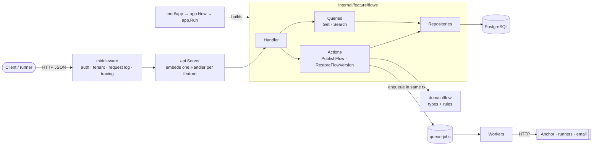
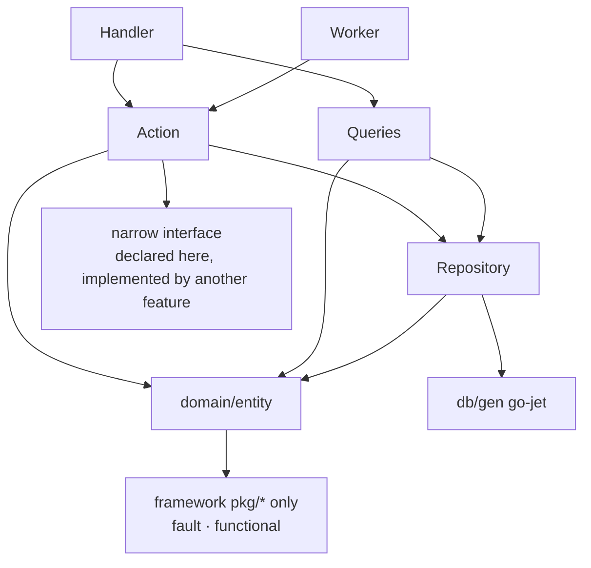
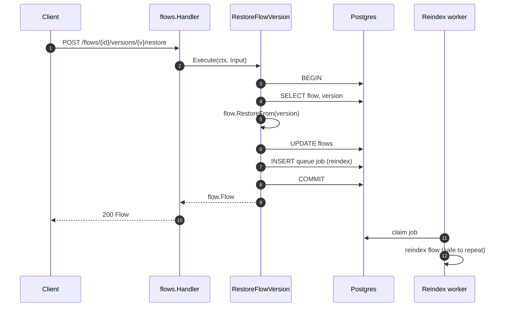

# Feature architecture for Nanostack services

- Status: proposed; [0010](adr/0010-wiring-is-plain-go.md) and [0011](adr/0011-http-tests-specify-table-tests-prove-rules.md) accepted on 2026-10-29
- Date: 2026-10-29
- Applies to: anchor, echopoint and new services built on this framework
- Baseline: anchor `8165b3d4`, echopoint `1d13937e`, nanostack-framework `48a612d`

This guide explains how a Go feature is built in a Nanostack service. It is designed so a reviewer can read one change in one sitting. Each choice is recorded as an ADR, with the alternatives considered, below. The guide describes the target state and ignores migration cost: refactors are cheap now, and each service's HTTP component suite checks behaviour on every change.

> **Rule of thumb.** A reviewer finds a behaviour by its name, sees everything it touches in one file, and trusts the compiler and lint for the wiring.

## Decisions

| ADR | Decision | Choice |
|---|---|---|
| [0002](adr/0002-one-package-per-feature.md) | Layout | One Go package per feature, plus a pure `domain/<entity>` package |
| [0003](adr/0003-domain-types-carry-the-rules.md) | Domain | Types with rules as methods and functions, and no I/O |
| [0004](adr/0004-one-action-per-write.md) | Operations | One action (file, struct and `Execute`) per write, and one `Queries` type per feature |
| [0005](adr/0005-concrete-repositories.md) | Persistence | A concrete repository per aggregate, go-jet, mapping functions, and no logging |
| [0006](adr/0006-actions-own-the-transaction.md) | Transactions | Only actions open a transaction, carried in `ctx` |
| [0007](adr/0007-side-effects-leave-through-the-outbox.md) | Side effects | A queue job enqueued in the same transaction, and no remote call inside it |
| [0008](adr/0008-errors-are-wrapped-and-logged-once.md) | Errors and logs | `fault` where the meaning is known, `%w` context on the way up, one log at the boundary |
| [0009](adr/0009-handlers-only-translate.md) | HTTP | OpenAPI strict server, one handler per feature, and handlers that only map |
| [0010](adr/0010-wiring-is-plain-go.md) | Wiring | `feature.New(Deps)` and `app.New` in plain Go, with `errgroup` for the lifecycle (accepted) |
| [0011](adr/0011-http-tests-specify-table-tests-prove-rules.md) | Tests | Real HTTP requests on containers for operations, crons and jobs; unit tests only for standalone logic; no mocks (accepted) |
| [0012](adr/0012-conventions-are-enforced-by-lint.md) | Conventions | Files named after operations, size budgets, and import rules in lint |

## Why

- **Size piles up in a few types.** Echopoint's `flows/service.go` has 1455 lines, 9 dependencies and about 30 methods. Anchor's `integration_service.go` has 1983 lines [E1, E2]. A one-line change still makes the reviewer load the whole type.
- **There are two layouts.** Anchor is flat (`internal/service`), with slices such as `internal/license` [E3]. Echopoint has `internal/feature/<x>` and also legacy root packages [E4].
- **One failure is logged up to four times.** In echopoint the repository, the service and the handler each log the same failure, and then the strict error handler logs it again [E5, E15].
- **The wiring is resolved at runtime.** A dependency cycle in echopoint is documented only in a comment [E6].
- **Some code has no job.** Mapper types such as `FlowMapper` are an empty `struct{}` provided through FX. Repository interfaces exist, but neither service has a single code mock [E7, E8].

The forces behind the choices:

- Reviewers spend most of their effort understanding context, not finding defects ([Bacchelli & Bird, ICSE 2013](https://www.microsoft.com/en-us/research/?p=164195)).
- Wide mechanical refactors are cheap with AI help.
- HTTP component tests (one file per operation in echopoint [E9]) verify behaviour through any internal reshuffle.
- Go favours "least mechanism" and clarity "through the lens of the reader" ([Google Go Style](https://google.github.io/styleguide/go/guide)).

**Non-goals.** Splitting into more services, full DDD or event sourcing, and API contract changes.

## Big picture

### Who may depend on whom

| Type | Example | Owns | Must not |
|---|---|---|---|
| Domain type | `flow.Flow`, `flow.Definition` | Data and the rules about it | Take a `context`, do I/O, or import DB or HTTP types |
| Input | `RestoreFlowVersionInput` | The validated request for one action | Hold HTTP or DB types |
| Action | `RestoreFlowVersion` | One write use case and its transaction | Call another action of the same feature |
| Queries | `flows.Queries` | Reads | Write or open a transaction |
| Repository | `FlowRepository` | SQL for one aggregate | Log, return a 404, or apply business rules |
| Handler | `flows.Handler` | Mapping between HTTP and inputs and outputs | Branch on business logic or log |
| Worker | `ReindexFlowsWorker` | One job type, processed idempotently | Assume it runs exactly once |
| Feature | `flows.Feature` | The feature's wiring | Use global state |

## The running example: restoring a flow version

The same scenario appears in every ADR.

## Recipe: building a feature

1. **Contract.** Add the operations to `openapi.yaml` and generate.
2. **Specification.** Write one component test per operation, failing at first ([0011](adr/0011-http-tests-specify-table-tests-prove-rules.md)).
3. **Domain.** Add types and rules in `internal/domain/<entity>`, with table tests ([0003](adr/0003-domain-types-carry-the-rules.md)).
4. **Schema.** Add an expand-only migration.
5. **Repository.** Write go-jet queries and mapping functions ([0005](adr/0005-concrete-repositories.md)).
6. **Operations.** One action per write and one `Queries` type for reads ([0004](adr/0004-one-action-per-write.md)).
7. **Handler.** Mapping only ([0009](adr/0009-handlers-only-translate.md)), plus errors in `errors.go` ([0008](adr/0008-errors-are-wrapped-and-logged-once.md)).
8. **Wiring.** `feature.New(Deps)` plus one call in `app.New` ([0010](adr/0010-wiring-is-plain-go.md)).
9. **Gate.** Lint, domain tests, then the HTTP suite.

## How we would know it works

| ID | Given | When | Then |
|---|---|---|---|
| Q1 | A rule change to restoring a version | The PR is opened | The diff touches `restore_flow_version.go`, the domain file and `flow_version_restore_test.go` only |
| Q2 | A database read fails inside an action | The request returns 500 | Exactly one error line, written by the strict error handler, with the wrapped chain and the flow id |
| Q3 | Domain code imports `database/sql` | Lint runs | depguard fails with the 0003 message |
| Q4 | `app.New` misses a dependency | `go build` | Compilation fails; nothing is discovered at boot |
| Q5 | The process crashes right after the restore commits | It restarts | The reindex job still runs, because it was committed with the flow |
| Q6 | Any refactor from this guide | The HTTP suite runs unchanged | All component tests pass with no test edits |

## Getting there

Work per service, then per feature, one PR per step. Each step is a pure move, gated by the unchanged HTTP suite:

1. Errors and logging ([0008](adr/0008-errors-are-wrapped-and-logged-once.md)), repository-wide.
2. Mapping functions and concrete repositories ([0005](adr/0005-concrete-repositories.md)).
3. Pure rules into `domain/`, with table tests ([0003](adr/0003-domain-types-carry-the-rules.md)).
4. Actions and `Queries` ([0004](adr/0004-one-action-per-write.md), [0006](adr/0006-actions-own-the-transaction.md), [0007](adr/0007-side-effects-leave-through-the-outbox.md)).
5. `feature.New(Deps)` under FX first, then `app.New` replaces FX ([0010](adr/0010-wiring-is-plain-go.md)).
6. Anchor: embed per-feature handlers ([0009](adr/0009-handlers-only-translate.md)), then fold the flat `internal/service` into features.

**Rollback.** Code only: revert the PR. No step changes data or the API.

## Open questions

| ID | Question | Affects |
|---|---|---|
| OQ-1 | Resolved: every service drops FX, so all of them wire themselves the same way. | [0010](adr/0010-wiring-is-plain-go.md) |
| OQ-2 | Should aggregates with a state machine (executions, sync runs) use an `UpdateFn` closure instead of `InTx` in the action? | [0006](adr/0006-actions-own-the-transaction.md) |
| OQ-3 | `fault.Error.Error()` leaves out `Meta`, so the boundary line lacks fault metadata. Should the strict error handler log it? And should the queue worker write a line per failed job, which pgkit does not do today? | [0008](adr/0008-errors-are-wrapped-and-logged-once.md) |
| OQ-4 | Should inputs live beside the action (chosen) or in the domain package (anchor today)? | [0004](adr/0004-one-action-per-write.md) |

## Evidence

| ID | Source | Establishes |
|---|---|---|
| E1 | [echopoint `flows/service.go`](https://github.com/nanostack-dev/echopoint/blob/1d13937e/internal/feature/flows/service.go), `openapisyncs/service.go` | 1455 lines, 9 deps, about 30 methods; 13 deps and 29 methods; pure validators at lines ~695–870 |
| E2 | [anchor `integration_service.go`](https://github.com/nanostack-dev/anchor/blob/8165b3d4/apps/anchor/internal/service/integration_service.go) | 1983 lines |
| E3 | [anchor ADR-0007](https://github.com/nanostack-dev/anchor/blob/8165b3d4/docs/adr/0007-first-feature-slice-in-anchor.md), [`license/rules/rules.go`](https://github.com/nanostack-dev/anchor/blob/8165b3d4/apps/anchor/internal/license/rules/rules.go) | Flat layout plus a first slice; a pure rules package and why |
| E4 | [echopoint `architecture.md`](https://github.com/nanostack-dev/echopoint/blob/1d13937e/docs/technical/architecture.md), [`internal/api/impl.go`](https://github.com/nanostack-dev/echopoint/blob/1d13937e/internal/api/impl.go) | Feature slices, legacy roots, per-feature handlers embedded in `EchopointAPI` |
| E5 | echopoint [`flows/repository.go`](https://github.com/nanostack-dev/echopoint/blob/1d13937e/internal/feature/flows/repository.go) `FindByID`, `flows/service.go`, `flows/handler.go` `PublishFlow` | Repository, service and handler each `log.Error` the same failure |
| E6 | [echopoint `licenses/usage_sync_service.go`](https://github.com/nanostack-dev/echopoint/blob/1d13937e/internal/feature/licenses/usage_sync_service.go) | FX cycle documented in a comment |
| E7 | echopoint `flows/db_mapper.go`, `flows/module.go` | `FlowMapper struct{}` provided through FX |
| E8 | `find internal -iname '*mock*'`: echopoint → 0; anchor → only `clerk/testdata/wiremock` | No code mocks; third parties are faked over HTTP |
| E9 | [echopoint `cmd/it/ct`](https://github.com/nanostack-dev/echopoint/tree/1d13937e/cmd/it/ct) | One HTTP test file per operation (`flow_publish_test.go`, `flow_version_restore_test.go`, …) |
| E10 | anchor [`organizationinvitation/input_types.go`](https://github.com/nanostack-dev/anchor/blob/8165b3d4/apps/anchor/internal/domain/organizationinvitation/input_types.go), `invitation/service/service.go` | A per-operation `Input` with validate tags; a service with 7 deps |
| E11 | [`pkg/db/transactor/transactor.go`](../pkg/db/transactor/transactor.go), decision log 2026-05-25 | `InTx` joins the transaction in `ctx`; the outermost call owns the commit |
| E12 | [echopoint ADR-0001](https://github.com/nanostack-dev/echopoint/blob/1d13937e/docs/adr/0001-usage-sync-always-goes-through-pgqueue.md) | Outbox through pgqueue; idempotent gauge recompute |
| E13 | [boundaries](boundaries.md) | "`pkg/` packages should not depend on FX" |
| E14 | echopoint `.golangci.yml` (depguard, funlen, gocognit), `gorules/*.go` | Lint hooks already in place |
| E15 | [`modules/httpserver/strict_error_handler.go`](../modules/httpserver/strict_error_handler.go) | The boundary logs every strict-handler error once: a 5xx at error with `%+v` and `error_type`, a 4xx at info, on the request logger |
| E16 | pgkit `queue/worker.go` `settle` | A failed job's error is stored on the job and its span; no log line per attempt |
