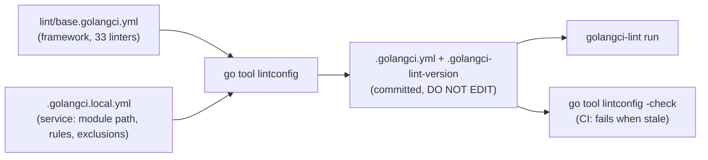

# Research: a lint standard that humans and agents can maintain

- Date: 2026-11-06
- Subject: the design of [`lint/`](../../lint/README.md) after its rebase on `main`. The choice of linters is in [the first research](golangci-lint-standard.md).
- Outcome: keep the design. Close five gaps, listed in [order of value](#what-to-change).
- Status: changes 1 to 4 are applied in the same branch; 5 to 10 are open.
- Evidence: six web research passes on primary sources (80 cited below), and local runs of golangci-lint v2.15.0 on this repository. A claim marked UNVERIFIED was not confirmed at its source.

## In 30 seconds

**Rule:** you edit one small file, a tool writes the real one, and CI fails when they disagree.



**Analogy:** it works like `sqlc` or `go.sum`. Nobody edits the output. You change the input and run the tool, and a check in CI catches a forgotten step.

**Real example:** the framework lints integration tests only after its overlay gains one line. The overlay changes, the generated file follows, and the 30 findings behind that tag become visible ([gap 1](#1-integration-tests-are-not-linted)).

## What the design gets right

| Choice | Evidence that it is the right one |
|---|---|
| Generate a merged file instead of `extends` | golangci-lint has no `extends`. The oldest request ([#1141](https://github.com/golangci/golangci-lint/issues/1141), 2020) is still open with "no decision". A June 2026 request was closed as a duplicate ([#6619](https://github.com/golangci/golangci-lint/discussions/6619)), as was a two-file overlay request ([#4895](https://github.com/golangci/golangci-lint/issues/4895)). The maintainer named merging, fragments or templating as the likely shape of an answer ([#3954](https://github.com/golangci/golangci-lint/discussions/3954)). |
| No fetch at lint time | Remote configuration was declined for security ([#2137](https://github.com/golangci/golangci-lint/issues/2137)). A presets PR was abandoned because external files break cache invalidation ([#2241](https://github.com/golangci/golangci-lint/pull/2241)). The base reaches a service through `go.mod`, so it is pinned and cached. |
| Generate plus verify | Kubernetes renders `hack/golangci.yaml.in` into two configurations and checks them with `verify-*` scripts ([script](https://raw.githubusercontent.com/kubernetes/kubernetes/master/hack/update-golangci-lint-config.sh), [template](https://raw.githubusercontent.com/kubernetes/kubernetes/master/hack/golangci.yaml.in)). `lintconfig -check` is the same pattern across repositories. |
| One flat file per repository | ESLint replaced its cascading configuration with flat config. Its team called the old name-based `extends` resolution one of its biggest regrets ([blog](https://eslint.org/blog/2022/08/new-config-system-part-2/)). An agent or an editor reads one ordinary `.golangci.yml` and needs no knowledge of the merge. |
| Generated file over a template copy | Copier lets a project diverge from its template and merges updates with conflict markers ([docs](https://copier.readthedocs.io/en/stable/updating/)). Projen marks generated files as never edited by hand ([intro](https://projen.io/docs/introduction/)). We want projen's model: no drift is possible. |
| File sync bots are not needed | Prometheus copies shared files into its repositories with a bot that opens PRs ([script](https://raw.githubusercontent.com/prometheus/prometheus/main/scripts/sync_repo_files.sh)). Charmbracelet does the same ([history](https://github.com/charmbracelet/lipgloss/commits/main/.golangci.yml)). A framework bump does that job here, and Renovate already proposes it. |
| `linters.default: none` | golangci-lint's own configuration uses it to avoid regressions across versions ([config](https://raw.githubusercontent.com/golangci/golangci-lint/main/.golangci.yml)). Kubernetes does the same. |
| Pinned version file | The CI install docs recommend a fixed version ([docs](https://golangci-lint.run/docs/welcome/install/ci/)). Action v9 reads `.golangci-lint-version` through `version-file` with `install-mode: binary`, and `verify` checks the configuration against the schema of that version ([action](https://github.com/golangci/golangci-lint-action)). |
| `nolint` needs a linter and a reason | The base already sets `require-specific` and `require-explanation` for `nolintlint` ([settings](https://golangci-lint.run/docs/linters/configuration/)). This is the pairing the baseline research recommends for inline suppressions. |
| depguard says what to use instead | Each deny rule in the base has a `desc` that names the replacement, as CockroachDB's lint test does ("forbidden; use 'envutil' instead", [source](https://github.com/cockroachdb/cockroach/blob/master/pkg/testutils/lint/lint_test.go)). |

One warning does not apply. The golangci-lint install page says not to run golangci-lint itself through `go tool` ([docs](https://golangci-lint.run/docs/welcome/install/local/)), because its many dependencies then join the module graph. `lintconfig` is a different tool: it adds only `gopkg.in/yaml.v3` and the framework, which every service already requires.

## Gaps found in the re-review

### 1. Integration tests are not linted

The framework puts its container tests behind `//go:build integration`. golangci-lint skips those files unless `run.build-tags` names the tag. A run with `--build-tags integration` shows 30 more findings: 18 govet (mostly a shadowed `err`), 3 errcheck, 2 revive, 2 testifylint, 2 unparam, and one each of exhaustive, modernize and staticcheck. The fix is one line in the framework overlay plus those 30 fixes. A service that uses build tags needs the same line in its own overlay.

### 2. `warn-unused` only warns

A probe with a rule that matches nothing printed the warning and exited 0. On a run limited to some packages, every rule for the other packages warns too, so the warning means something only on a full `./...` run. Kubernetes keeps `warn-unused` commented out for this reason ([config](https://raw.githubusercontent.com/kubernetes/kubernetes/master/hack/golangci.yaml)). The README said the exclusion list "only shrinks". It now says the warning does not fail the run and that nothing blocks a new entry.

Other tools fail on a stale suppression. ESLint bulk suppressions exit non-zero when a suppressed violation is fixed, and `--prune-suppressions` removes it ([docs](https://eslint.org/docs/latest/use/suppressions)). PHPStan reports unmatched baseline entries ([docs](https://phpstan.org/user-guide/baseline)). basedpyright removes them automatically ([docs](https://docs.basedpyright.com/latest/benefits-over-pyright/baseline/)). golangci-lint has no baseline file; the request is open with "no decision" ([#3356](https://github.com/golangci/golangci-lint/issues/3356)).

### 3. One exclusion covers many files

The overlay holds one rule per linter, with a regex that joins many paths:

```yaml
- linters: [gocognit]
  path: ^(modules/httpserver/module\.go|pkg/testkit/searchtest/searchtest\.go)$
```

The govet rule joins 20 files the same way. `warn-unused` fires only when every file in a regex is clean, so fixing one file gives no signal. A change to the list shows as one long changed line. Notion moved its ratchet file to one line per entry for readable diffs and fewer merge conflicts ([blog](https://www.notion.com/blog/how-we-evolved-our-code-notions-ratcheting-system-using-custom-eslint-rules)).

### 4. The framework has no CI

The repository has no `.github` directory. `lintconfig -check`, the lint run and the tests run only when someone remembers them. The fixes in this rebase came from code that merged after the standard was written and was never linted.

### 5. An overlay cannot remove anything

The merge appends list items and never removes them. A service cannot drop a base linter or a base depguard rule; it can only exclude findings. RuboCop chose the opposite default: lists replace, because a merged list gives a child no way to remove an item, and `inherit_mode: merge` opts a key in to merging ([docs](https://docs.rubocop.org/rubocop/latest/configuration/inheritance.html)). Ruff solves it with separate keys: `select` replaces, `extend-select` adds ([docs](https://docs.astral.sh/ruff/configuration/); the exact list rules are UNVERIFIED). A comment on #1141 makes the same point for golangci-lint.

Append-only is a valid choice for a standard: a service should not opt out of a base linter. The gap is that the README does not say it is deliberate, and nothing offers a reviewed way out.

## What to change

Ordered by value for the effort. Items 1 to 4 are small; 5 needs a decision.

Items 1 to 4 are applied. The framework overlay names the `integration` tag and holds 32 one-line rules with a reason each; 6 findings were fixed instead. `lintconfig` refuses an overlay whose rules name more or fewer linters than its `nanostack.exclusion-budget`, or a rule whose path joins files with `|`. The new [CI workflow](../../.github/workflows/ci.yml) runs `lintconfig -check`, a full lint that fails on `Skipped 0 issues by rules`, and `go test ./...`. The [lint README](../../lint/README.md) shows the service setup.

| # | Change | Helps | Source of the practice |
|---|---|---|---|
| 1 | Add `run.build-tags: [integration]` to the framework overlay; fix or exclude the 30 findings. | both | local evidence |
| 2 | Write one exclusion per linter and file, sorted, each with a short reason. | both | [Notion](https://www.notion.com/blog/how-we-evolved-our-code-notions-ratcheting-system-using-custom-eslint-rules), [maratori](https://gist.github.com/maratori/47a4d00457a92aa426dbd48a18776322) |
| 3 | Fail CI when the exclusion list grows: `lintconfig -check` counts exclusion entries and compares them with a number committed in the overlay, which only goes down. | both | [Notion](https://www.notion.com/blog/how-we-evolved-our-code-notions-ratcheting-system-using-custom-eslint-rules), [`ratchets`](https://docs.rs/crate/ratchets/0.2.4/source/DESIGN.md) (agents may lower a budget, never raise it; UNVERIFIED, seen in snippets) |
| 4 | Add framework CI: `lintconfig -check`, `golangci-lint run ./...` with the integration tag, `go test ./...`. Pass `version-file` to the action. | both | [action](https://github.com/golangci/golangci-lint-action) |
| 5 | Decide the merge rule for lists: keep append-only and say so, or add explicit `disable` keys reviewed in the PR. | both | [RuboCop](https://docs.rubocop.org/rubocop/latest/configuration/inheritance.html), [Ruff](https://docs.astral.sh/ruff/configuration/) |
| 6 | Put a one-line reason beside each linter in the base, and list the removed linters with a bracketed reason. Lists stay alphabetical. | humans | [maratori](https://gist.github.com/maratori/47a4d00457a92aa426dbd48a18776322), [Kubernetes](https://raw.githubusercontent.com/kubernetes/kubernetes/master/hack/golangci.yaml) |
| 7 | Write a version policy: a base change that can add findings is a framework minor release with a changelog line; one that only removes findings is a patch. | humans | [eslint-plugin-testing-library](https://github.com/testing-library/eslint-plugin-testing-library/blob/main/docs/semantic-versioning-policy.md) |
| 8 | Let Renovate bump `lint/golangci-lint-version` with a custom regex manager, and read the changelog for renamed options on each bump. | humans | [custom managers](https://docs.renovatebot.com/presets-customManagers/), [changelog](https://golangci-lint.run/docs/product/changelog/) |
| 9 | Give agents a fast loop and a gate: lint changed packages after each edit, block finishing on findings, and forbid new `nolint` or exclusion entries without a human. | agents | [Claude Code best practices](https://code.claude.com/docs/en/best-practices), [Böckeler](https://martinfowler.com/articles/harness-engineering.html), [hooks guide](https://agentic.proxify.io/setup/hooks-playbook) (anecdotal) |
| 10 | Write every custom rule message as rule, reason and fix, with a link to the ADR. | agents | [Factory](https://factory.com/using-linters-to-direct-agents), [Böckeler](https://martinfowler.com/articles/harness-engineering.html), [CockroachDB](https://github.com/cockroachdb/cockroach/blob/master/pkg/testutils/lint/lint_test.go) |

A version example for item 7: adding `misspell` to the base can fail a service's CI, so it ships in a minor release with a changelog line that says "new findings possible". Removing `goconst` cannot fail anything, so it ships in a patch.

### Not recommended now

- **A baseline file generated from JSON output.** golangci-lint has none ([#3356](https://github.com/golangci/golangci-lint/issues/3356)) and no maintained third-party tool was found. Per-file exclusions plus the count in item 3 give the same ratchet with no new tool.
- **Lint only new code on PRs** (`new-from-merge-base`, [FAQ](https://golangci-lint.run/docs/welcome/faq/)). It hides findings on untouched lines of a changed function and makes a linter upgrade invisible. Our debt is 11 exclusion entries, small enough to fix. Use it later for a new linter with many findings, as Uber did for NilAway's "stop the bleed" mode ([blog](https://www.uber.com/blog/nilaway-practical-nil-panic-detection-for-go/)).
- **A dedicated architecture linter.** depguard covers the feature-to-feature rule of ADR 0012. Add [go-arch-lint](https://github.com/fe3dback/go-arch-lint) (v1.19.1, 2026-10-29) or Kubernetes-style [`.import-restrictions`](https://github.com/kubernetes/kubernetes/blob/master/cmd/import-boss/README.md) files only when a service needs per-component allow-lists. [arch-go](https://github.com/arch-go/arch-go) runs the same checks inside `go test`.
- **A custom analyzer.** ruleguard covers pattern rules; give each rule `Where` filters and a `Suggest` fix where one exists ([DSL](https://raw.githubusercontent.com/quasilyte/go-ruleguard/master/_docs/dsl.md)). A module plugin ([docs](https://golangci-lint.run/docs/plugins/module-plugins/)) costs a custom binary in every CI, and pays off only for cross-function logic. Test it with [`analysistest`](https://pkg.go.dev/golang.org/x/tools/go/analysis/analysistest) if it comes.

## Findings by topic

### Sharing a configuration

- golangci-lint v2 helps only a little: `config verify` checks a file against the JSON schema, and `-c` picks one file ([CLI](https://golangci-lint.run/docs/configuration/cli/)). The module plugin system is for linters, not configurations ([docs](https://golangci-lint.run/docs/plugins/module-plugins/)).
- The maintainer warned that minimal version selection can raise a shared configuration module silently, and that a shared configuration tends to become weak because projects differ ([#3954](https://github.com/golangci/golangci-lint/discussions/3954)). The framework pin is explicit in `go.mod`, and the overlay carries what differs.
- kubernetes-sigs projects copy a template once and do not sync it ([kueue](https://github.com/kubernetes-sigs/kueue/blob/main/.golangci.yaml)). Small shared-workflow repositories download configurations in CI ([fortio](https://github.com/fortio/workflows)). How Grafana, HashiCorp, Temporal, Cilium and Tailscale share configurations was not confirmed: UNVERIFIED.
- Renovate presets are pinned by git tag and have lower precedence than the repository's own configuration ([presets](https://docs.renovatebot.com/config-presets/), [precedence](https://docs.renovatebot.com/config-overview/)). Prettier shares a configuration as a package that a project spreads into its own file ([docs](https://prettier.io/docs/sharing-configurations)).
- [repo-file-sync-action](https://github.com/BetaHuhn/repo-file-sync-action) opens PRs that copy files into target repositories. Copies drift between syncs; a generated file with `-check` cannot.

### Making a configuration readable

- maratori's reference configuration gives every linter a one-line description and lists rejected linters with a bracketed reason such as `[too strict]` ([gist](https://gist.github.com/maratori/47a4d00457a92aa426dbd48a18776322)). It is now versioned with tags that follow golangci-lint ([repo](https://github.com/maratori/golangci-lint-config)).
- Kubernetes keeps lists alphabetical and links entries to issues ([config](https://raw.githubusercontent.com/kubernetes/kubernetes/master/hack/golangci.yaml)).
- golangci-lint's own configuration says it is not a recommendation, and gives reasons on exclusion rules ([config](https://raw.githubusercontent.com/golangci/golangci-lint/main/.golangci.yml)).
- Rule catalogues to copy the layout from: Ruff (since version, fix, why it is bad, example, [page](https://docs.astral.sh/ruff/rules/unused-import/)), revive ([rules](https://revive.run/r)) and staticcheck ([checks](https://staticcheck.dev/docs/checks/)), whose ST1 checks cite [Code Review Comments](https://go.dev/wiki/CodeReviewComments) and Effective Go. The [Google Go style guide](https://google.github.io/styleguide/go/) names no linters.
- `golangci-lint migrate` drops comments ([guide](https://golangci-lint.run/docs/product/migration-guide/)), so reasons in YAML need care on a major upgrade.
- Changelog renames that a version bump must handle: `exhaustruct` became `exhaustruct_v5` in v2.13.0, and `exhaustive` renamed several options in v2.15.0 ([changelog](https://golangci-lint.run/docs/product/changelog/)).

### Rolling out on existing code

| Tool | Suppression record | Stale entries |
|---|---|---|
| golangci-lint | exclusion rules by path, linter or text | `warn-unused` warns, exit 0 ([docs](https://golangci-lint.run/docs/configuration/file/)) |
| ESLint | `eslint-suppressions.json`, counts per rule ([docs](https://eslint.org/docs/latest/use/suppressions)) | fail the run; `--prune-suppressions` |
| PHPStan | message, count and path, no line ([docs](https://phpstan.org/user-guide/baseline)) | reported; advice: never regenerate to absorb new errors |
| basedpyright | path, rule and column ([docs](https://docs.basedpyright.com/latest/benefits-over-pyright/baseline/)) | removed automatically |
| Android Lint | snapshot XML ([docs](https://developer.android.com/studio/write/lint#snapshot)) | informational message |
| Detekt | rule, file and signature ([docs](https://detekt.dev/docs/introduction/baseline/)) | UNVERIFIED |
| Ruff | inline `noqa` ([docs](https://docs.astral.sh/ruff/linter/#error-suppression)) | `RUF100`, off by default |

- Notion keeps an allowed count per file and rule; a fix lowers it automatically and a rise needs approval ([blog](https://www.notion.com/blog/how-we-evolved-our-code-notions-ratcheting-system-using-custom-eslint-rules)).
- SonarQube applies its quality gate to new code only, with a configurable new-code period ([docs](https://docs.sonarsource.com/sonarqube-server/latest/user-guide/about-new-code/)).
- Google shows analysis results in code review on the changed code, and targets under 10% effective false positives ([SWE at Google, ch. 20](https://abseil.io/resources/swe-book/html/ch20.html)).
- Facebook's Infer paper is cited for a 70% fix rate at diff time against near 0% for a batch list ([CACM 2019](https://cacm.acm.org/magazines/2019/8/238344-scaling-static-analyses-at-facebook/pdf)); UNVERIFIED, seen only in search snippets.
- [reviewdog](https://github.com/reviewdog/reviewdog) filters findings to added lines, the diff context or the whole file.

### Lint as an agent guide

- Claude Code's best practices: a CLAUDE.md line is advice the model can skip; hooks, deny rules and CI always run. A rule with no exceptions belongs in a hook. A `Stop` hook that exits 2 blocks the agent from finishing ([docs](https://code.claude.com/docs/en/best-practices)).
- Böckeler splits an agent harness into guides (AGENTS.md) and sensors (linters, tests, types). Linters are cheap enough to run on every change, and a lint message that says how to fix the problem is a useful kind of prompt injection ([martinfowler.com](https://martinfowler.com/articles/harness-engineering.html)).
- Factory maps every lint rule to an AGENTS.md guideline and an ADR, starts rules as warnings, and gives waivers an expiry ([post](https://factory.com/using-linters-to-direct-agents)).
- Codex reads AGENTS.md files from the root down, capped at 32 KiB by default, and leaves lint to CI during review ([docs](https://learn.chatgpt.com/docs/agent-configuration/agents-md)).
- Anthropic's context-engineering post: keep the smallest set of high-signal tokens and add instructions from observed failures ([post](https://www.anthropic.com/engineering/effective-context-engineering-for-ai-agents)).
- OpenAI's harness-engineering post reportedly uses custom lint messages with remediation steps, and background tasks that open fix PRs for drift. UNVERIFIED: the page returned 403; seen through [ZenML](https://zenml.io/llmops-database/harness-engineering-building-software-where-humans-steer-and-agents-execute).
- Papers, from abstracts and snippets only: static-analysis feedback cut GPT-4o security issues from over 40% to 13% ([2508.14419](https://alphaxiv.org/abs/2508.14419)); CodeCureAgent fixed SonarQube warnings with 86.3% correct patches ([2509.11787](https://arxiv.org/abs/2509.11787v2)); ByteDance fixed more than 12,000 lint issues with a fixed workflow ([2508.03487](https://arxiv.org/pdf/2508.03487)); WhatsApp reuses the lint message plus a longer explanation as the fix prompt ([2512.05314](https://arxiv.org/pdf/2512.05314)). No paper measured agents adding `nolint` or editing configurations.

### Lint as architecture enforcement

- depguard matches import prefixes; a trailing `$` makes a match exact, so `math/rand$` leaves `math/rand/v2` allowed ([docs](https://golangci-lint.run/docs/linters/configuration/#depguard)).
- Go's `internal/` restricts imports to the parent tree, so it cannot ban sibling features from each other ([Go 1.4](https://go.dev/doc/go1.4#internalpackages)).
- Kubernetes `logcheck` ships as a golangci-lint module plugin with per-file configuration ([README](https://github.com/kubernetes-sigs/logtools/blob/main/logcheck/README.md)). CockroachDB has about 22 analyzers next to its grep-based `TestLint` ([passes](https://github.com/cockroachdb/cockroach/tree/master/pkg/testutils/lint/passes)).
- Bazel's nogo fails the build on any finding and says golangci-lint is simpler for small codebases ([docs](https://github.com/bazel-contrib/rules_go/blob/master/go/nogo.rst)).
- Thoughtworks calls these checks fitness functions: objective tests of an architectural property, run in CI ([article](https://www.thoughtworks.com/en-us/insights/articles/fitness-function-driven-development), [ArchUnit](https://www.archunit.org/)).

## Appendix: local evidence

All runs used golangci-lint v2.15.0 on `feat/lint-standard` at its rebase on `main` (2026-11-06).

| Check | Result |
|---|---|
| `golangci-lint run ./...` after the rebase | findings in redisx and redistest code that merged after the standard; fixed in the same branch, now 0 |
| `golangci-lint run --build-tags integration ./...` | 30 more findings, in 8 linters |
| An exclusion rule that matches nothing, full run | warning printed, exit 0 |
| The same rule, run on one package | every out-of-scope rule warns |
| `go run ./lint/cmd/lintconfig -check` | passes |
| Full run after the split into one rule per file | 2 findings the old list never named: golangci-lint shows one finding per line (`uniq-by-line`), so a second finding on a line appears only once the first is fixed or excluded |
| Overlay with 33 rules and a budget of 31 | `lintconfig` fails: over its budget |
| Probe rule for a file that does not exist, full run | the CI step fails on the warning |
